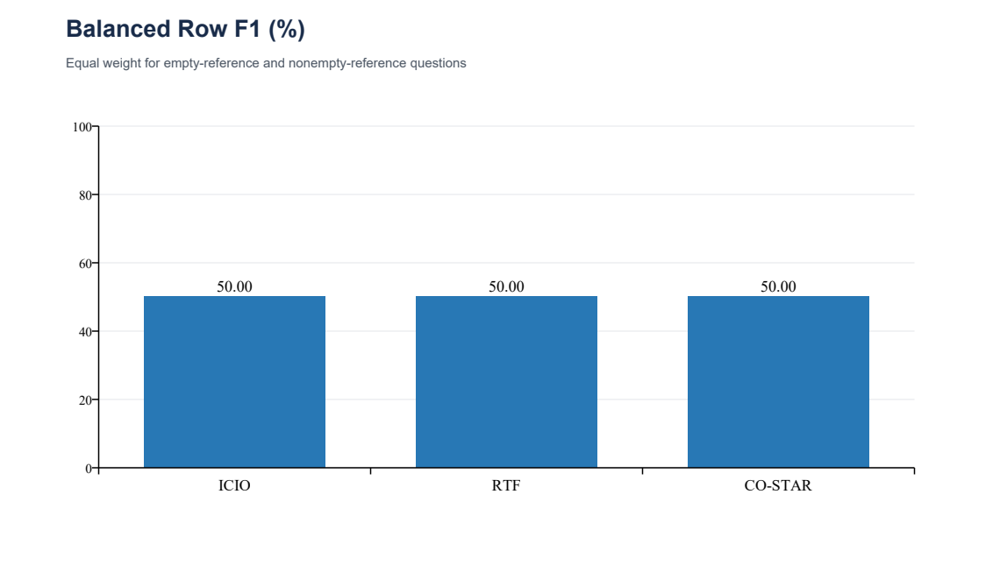

# Task 3 – Balanced Row F1

Stav: metrika bola vypočítaná zo všetkých troch existujúcich súborov predikcií z Task 2; predikcie neboli znovu generované.

## Task 3: Balanced Row F1

Pôvodná execution accuracy pridelí otázke 1 len vtedy, keď je celý výsledok SQL rovnaký ako referencia, inak 0. Nerozlišuje takmer správny výber od úplne nesprávneho. Navrhujeme doplnkovú metriku Balanced Row F1 (BRF1): vyvážený priemer prekrytia výsledných riadkov, osobitne pre otázky s prázdnou a neprázdnou referenciou.

Pre otázku i označme E_i multiset referenčných riadkov a P_i multiset predikovaných riadkov. Multiset zachováva počet výskytov rovnakých riadkov. Platí:

F1_i = 2 × |E_i ∩ P_i| / (|E_i| + |P_i|).

Prienik počíta minimálny počet výskytov každého rovnakého riadka. Poradie riadkov neovplyvňuje skóre; poradie stĺpcov, ID, názvy aj duplicity zostávajú významné, rovnako ako v pôvodnom validátore.

- Ak oba výsledky sú prázdne a SQL sa vykonalo úspešne, F1_i = 1.
- Ak je prázdny iba jeden výsledok, F1_i = 0.
- Chybný, chýbajúci alebo časovo prekročený SQL dopyt dostáva 0, aj keď je referencia prázdna.

BRF1 = 0,5 × priemer F1_i pre prázdne referencie + 0,5 × priemer F1_i pre neprázdne referencie.

Ak niektorá skupina chýba, BRF1 je nedostupné (null), nie nahradené inou metrikou. V poskytnutom datasete sú obe skupiny: 43 prázdnych a 112 neprázdnych referencií. Implementácia však tieto počty nemá zadané natvrdo, odvodzuje ich z dát.

### Prečo je metrika vhodná

F1 penalizuje chýbajúce aj nadbytočné riadky. Otázka s dvoma správnymi riadkami z troch a bez nadbytočných riadkov dostane 0,8 namiesto úplnej nuly. Priemerovanie na úrovni otázok bráni tomu, aby otázka s tisíckou riadkov dominovala otázke s jedným riadkom.

Vyváženie skupín oddeľuje schopnosť správne vrátiť prázdny výsledok od schopnosti nájsť skutočné zhody. Systém, ktorý vždy úspešne vráti prázdny výsledok, má pri existencii oboch skupín BRF1 = 0,5; zároveň má F1 neprázdnej skupiny 0. Preto vždy uvádzame obe zložky aj pôvodnú accuracy a neinterpretujeme samotné číslo 0,5 ako dôkaz dobrej kvality.

Prínos návrhu spočíva v kombinácii bežného multisetového F1 a vyváženia skupín podľa prázdnosti referencie pre tento konkrétny problém. Netvrdíme, že F1 alebo vyvážené priemerovanie sú nové vedecké metódy.

BRF1 pôvodnú metriku dopĺňa, nenahrádza. Presná správnosť celého SQL výsledku zostáva dôležitá. Žiadna z metrík nedokazuje ekvivalenciu SQL na všetkých možných databázach.

### Obmedzenie poskytnutých referencií

V dvoch skorších kontrolách sa ID v referenciách líšili od ID v databáze pri rovnakých názvoch reštaurácií. BRF1 úmyselne nemení ID ani neporovnáva iba názvy: taká zmena by definovala iný cieľ. Tieto nezrovnalosti preto môžu znížiť aj BRF1. Vo finálnom reporte treba odlíšiť chyby modelu od chýb alebo nekompatibility podkladov.

## Namerané výsledky
| Prompt | Execution accuracy | Macro Row F1 | Empty F1 | Nonempty F1 | Balanced Row F1 |
|---|---:|---:|---:|---:|---:|
| ICIO | 27.7419% | 27.7421% | 100.0000% | 0.0003% | 50.0001% |
| RTF | 27.7419% | 27.7421% | 100.0000% | 0.0003% | 50.0001% |
| CO-STAR | 27.7419% | 27.7421% | 100.0000% | 0.0003% | 50.0001% |

Všetky tri prompty majú rovnaké skóre, pretože ich SQL aj vykonané výsledky sú rovnaké. Skóre neprázdnej skupiny treba interpretovať vzhľadom na dokumentovaný nesúlad ID; metrika ho zámerne neopravuje. Rozdiel BRF1 oproti accuracy neznamená automaticky lepšiu kvalitu: ide o inú váhu skupín a čiastočný kredit. Uvedenie oboch zložiek odhaľuje, že úspešné sú predovšetkým prázdne referencie.

## Implementácia a reprodukcia
metrics.py obsahuje skórovanie otázky aj agregáciu; neobsahuje natvrdo zadané počty otázok ani odpovede. scores_*.json obsahujú hodnoty pre každé question_id a súhrn. reproduce_scores.py načíta uložené výsledky vykonania z vedľajšieho Task_2, pripojí pôvodné referencie a znovu vypočíta skóre. Spustenie: `python reproduce_scores.py`. Používa iba štandardnú knižnicu. Hraničné prípady a štatistické pomocné funkcie prešli 12 syntetickými testami.
