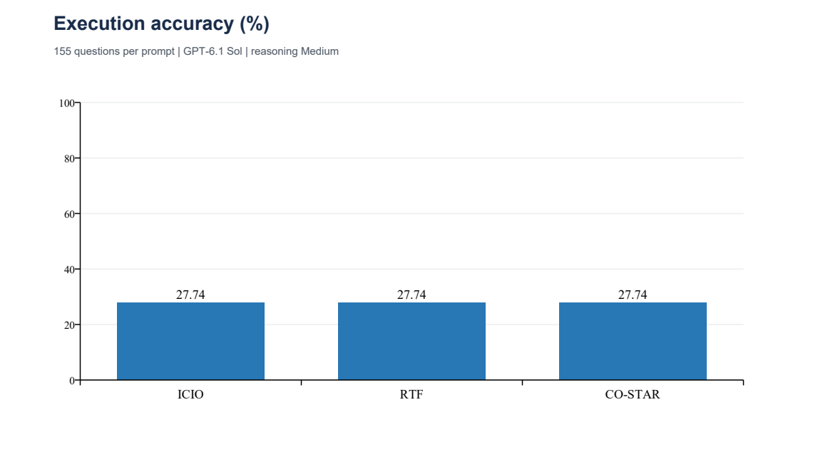
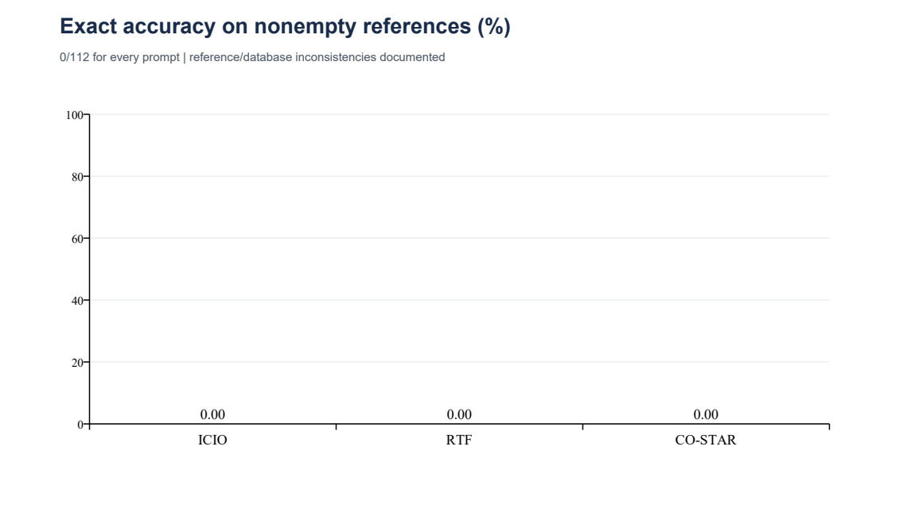
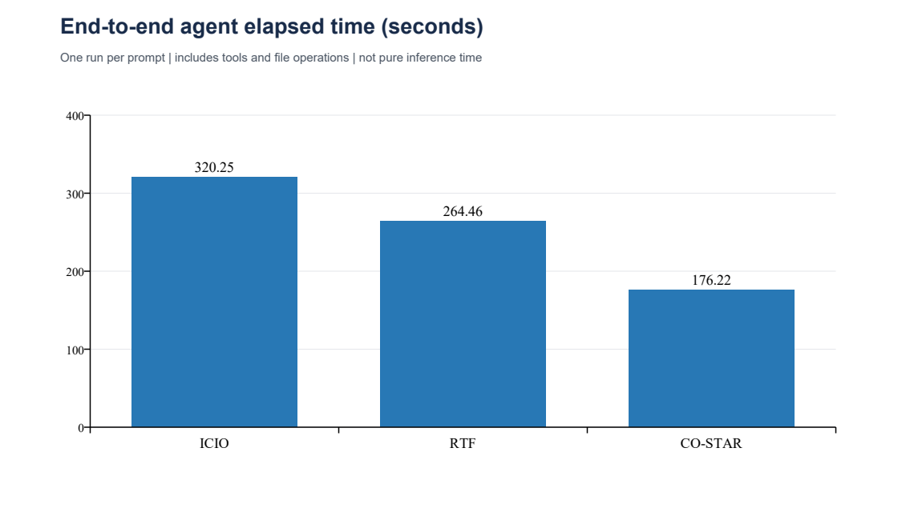

# Task 4 – Podrobná interpretácia porovnania promptov

## Výsledok
Všetky tri prompty vytvorili textovo rovnakých 155 SQL dopytov a rovnaké výsledky vykonania. Na pozorovanom datasete preto nie je rozdiel v execution accuracy ani Balanced Row F1. Tento výsledok nepreukazuje všeobecnú ekvivalenciu frameworkov, iba zhodu týchto konkrétnych behov.

## Súhrn meraní
| Prompt | Correct / total | Accuracy | SQL errors | Agent time (s) |
|---|---:|---:|---:|---:|
| ICIO | 43/155 | 27.74% | 0 | 320.252 |
| RTF | 43/155 | 27.74% | 0 | 264.463 |
| CO-STAR | 43/155 | 27.74% | 0 | 176.218 |

| Prompt | Execution accuracy | Macro Row F1 | Empty F1 | Nonempty F1 | Balanced Row F1 |
|---|---:|---:|---:|---:|---:|
| ICIO | 27.7419% | 27.7421% | 100.0000% | 0.0003% | 50.0001% |
| RTF | 27.7419% | 27.7421% | 100.0000% | 0.0003% | 50.0001% |
| CO-STAR | 27.7419% | 27.7421% | 100.0000% | 0.0003% | 50.0001% |

## Párové štatistické testy
| A | B | Metric | Difference A-B | 95% interval | Raw p | Holm p | Significant |
|---|---|---|---:|---|---:|---:|---|
| ICIO | RTF | accuracy | 0.000000 | [0.000000, 0.000000] | 1.0000 | 1.0000 | no |
| ICIO | RTF | balanced_row_f1 | 0.000000 | [0.000000, 0.000000] | 1.0000 | 1.0000 | no |
| ICIO | CO-STAR | accuracy | 0.000000 | [0.000000, 0.000000] | 1.0000 | 1.0000 | no |
| ICIO | CO-STAR | balanced_row_f1 | 0.000000 | [0.000000, 0.000000] | 1.0000 | 1.0000 | no |
| RTF | CO-STAR | accuracy | 0.000000 | [0.000000, 0.000000] | 1.0000 | 1.0000 | no |
| RTF | CO-STAR | balanced_row_f1 | 0.000000 | [0.000000, 0.000000] | 1.0000 | 1.0000 | no |

Použitý bol obojstranný exaktný McNemarov test pre accuracy a párový permutačný test pre BRF1. Referenčné skupiny zostávajú pri permutácii fixné. Pri identických skóre existuje jediný odlišný permutačný stav hodnoty rozdielu, takže exaktná p-hodnota je 1. McNemar nemá žiadne nesúhlasné páry a tiež vracia p = 1. Holmove úpravy pokrývajú všetkých šesť porovnaní pri alfa 0,05. Rozdiely sú nulové a párové bootstrap intervaly degenerujú na [0,0], pretože každý pozorovaný párový rozdiel je nulový. Nie sú to intervaly neistoty samotnej accuracy ani dôkaz ekvivalencie na nových behoch.

Bootstrap používa 10 000 opakovaní, seed 20261014; pre BRF1 je stratifikovaný podľa prázdnosti referencie. Intervaly sú opisné, nie simultánne korigované. Presný kód a výstupy sú v paired_statistics.py a statistics.json. Podrobná vopred pripravená definícia metód je v methodology_sk.md; jej pôvodný stav prípravy bol ponechaný ako dokument metodiky.

## Vplyv promptov
ICIO jasne oddeľuje inštrukciu, kontext, vstup a výstup. RTF organizuje rovnaký problém cez rolu, úlohu a formát. CO-STAR navyše explicitne popisuje štýl, tón a príjemcu. Zásadné SQL pravidlá, schéma a dve few-shot demonštrácie sú však spoločné, preto sa odlišuje predovšetkým členenie. Pravdepodobným vysvetlením zhody je dominancia rovnakých konkrétnych pravidiel nad organizačnými rozdielmi; ide o hypotézu. Z tohto experimentu nemožno tvrdiť, že zmeny frameworku nikdy nepomáhajú.

## Vplyv modelu a agenta
Vo všetkých behoch je zaznamenaný GPT-6.1 Sol / Medium a nové samostatné chaty. Tým bol odstránený známy problém automatického výberu modelu v Copilot Auto. Stále však zostávajú systémové inštrukcie Codex, kontext narastajúci počas spracovania dávky a možné skrátenie kontextu. Úplné logy neboli priložené, preto tieto faktory nemožno priamo skontrolovať. Rovnaký SQL text sám nepreukazuje nezávislé odvodenie ani kopírovanie. Instrukcie zakazovali čítať predošlé predikcie; ďalší experiment by mal použiť aj fyzicky oddelené priečinky a uložiť logy.

## Časové rozdiely
V jednom pozorovaní trval ICIO 320,252 s, RTF 264,463 s a CO-STAR 176,218 s. CO-STAR bol približne o 45,0 % kratší než ICIO; ide o opis týchto behov, nie odhad všeobecného zrýchlenia. Rovnaké výstupné SQL nevylučujú rozdielne interné uvažovanie, počet nástrojových volaní, záťaž služby, čakanie na súhlasy alebo efekt poradia behov. Beh prebehol vždy v poradí ICIO, RTF, CO-STAR, čo je ďalší nekontrolovaný faktor. Na časy nevykonávame test významnosti: jeden čas na prompt nestačí. Čistý čas inferencie nie je dostupný.

## Vplyv referencií a typické príklady
Všetky 43 prázdne referencie boli uznané správne. Všetkých 112 neprázdnych referencií obsahuje aspoň jednu ID–názov dvojicu neprítomnú v databáze. Toto výrazne obmedzuje validitu výslednej metriky pre hodnotenie modelu. Príklady portola park (databáza 2633, referencia 3) a catahoula restaurant and saloon (databáza 4808, referencia 1457) ukazujú správny názov pri odlišnom ID. Pri týchto konkrétnych dopytoch je výber maximálneho ratingu v požadovanom meste a kuchyni zmysluplný, ale presná zhoda so zastaranou alebo inak nekompatibilnou referenciou nie je možná bežným výberom pôvodných stĺpcov. Presný pôvod nesúladu nie je potvrdený.

Žiadny SQL nemal chybu vykonania. To potvrdzuje syntaktickú vykonateľnosť v SQLite, nie správnosť zámeru všetkých dopytov. Pri prázdnych referenciách môže nesprávny filter náhodne získať prázdny výsledok. Ukážky a kompletné výsledky sú v Task_2/results/evaluation_*.json. Dátový nesúlad sa nesmie skryť zmenou labelov alebo vkladaním referenčných ID do predikcií.

## Rozsah štatistických záverov a ďalší experiment
Otázky sú párované, ale nie nevyhnutne nezávislé: podobné šablóny a parafrázy môžu vytvárať skupiny. Významnosť preto interpretujeme exploratívne. Pri aktuálnych identických skóre je absencia pozorovaného rozdielu priamo overiteľná a nezávisí od voľby testu. Pre robustnejší výskum treba najprv získať kompatibilné referencie, zopakovať každý prompt viackrát s náhodným poradím, uložiť logy a analyzovať aj skupiny podobných otázok. Jediný beh neodhadne variabilitu agenta medzi behmi.

## Reprodukcia a zdroje
Z priečinka Task_4 spustite:
`python paired_statistics.py --scores ICIO=../Task_3/scores_icio.json RTF=../Task_3/scores_rtf.json CO-STAR=../Task_3/scores_co_star.json --output statistics.json`

Štatistické metódy: [McNemar](https://www.statsmodels.org/dev/generated/statsmodels.stats.contingency_tables.mcnemar.html), [párové permutácie](https://docs.scipy.org/doc/scipy/reference/generated/scipy.stats.permutation_test.html), [bootstrap](https://docs.scipy.org/doc/scipy/reference/generated/scipy.stats.bootstrap.html), [Holmova korekcia](https://github.com/statsmodels/statsmodels/blob/main/statsmodels/stats/multitest.py).
