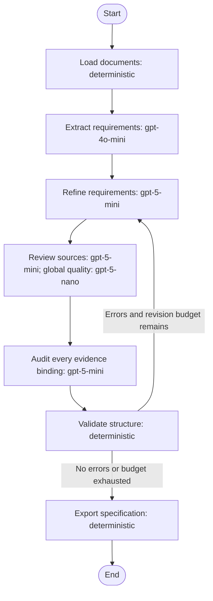

# Task 1: Agentic Network for Software Requirements Refinement

## 1. Objective and implementation boundary

The implemented network converts a directory of software-related texts into one
structured requirements specification. It refines requirements; it does not
implement the software described by them. The supplied example concerns the
management and reporting processes of the PINES / Evergreen library system.

The pipeline is implemented in Python using the actual `langgraph.graph.StateGraph`
API. It invokes OpenAI models through the official Python SDK. The code is generic:
input is a directory argument, files are discovered recursively, and neither the
PINES features nor the expected output requirements are hard-coded.

## 2. Network topology

The loop carries concrete reviewer and deterministic findings into the editor's
next prompt. It is a conditional graph edge, not merely a statement in a prompt.
The revision limit permits an initial draft followed by the configured number of corrections.
If errors persist at the limit, the output is clearly marked as a draft and the CLI
returns exit code 2. Warnings and open stakeholder questions are disclosed rather
than represented as resolved facts.

## 3. Node responsibilities and models

| Node | Type / model | Responsibility |
|---|---|---|
| `load_documents` | Deterministic | Recursively load text/email files, preserve email threads, normalize text, hash original files and split long texts with line overlap. |
| `extract_requirements` | LLM / `gpt-4o-mini` | Extract detailed candidates from every chunk, including constraints, assumptions and dependencies; give each a literal source quotation. |
| `refine_requirements` | LLM / `gpt-5-mini` | Merge semantic duplicates, reconcile conflicts, standardize vocabulary, write paragraphs, assign justified priorities and record rejected proposals and open questions. |
| `review_requirements` | LLM / `gpt-5-mini` for sources; `gpt-5-nano` for global review | Compare the draft to every original full document, recover missed requirements and perform a global consistency review. |
| `audit_traceability` | LLM / `gpt-5-mini` | Assess every candidate-source-paragraph association, including precise conditions and blacklist justification; report semantic mismatches to the editor. |
| `validate_structure` | Deterministic | Check candidate disposition, valid references, exact duplicates, paragraph structure, priority rationale and blacklist completeness. Decide whether to loop. |
| `export_document` | Deterministic | Assign final unique IDs, derive sources from the grounded candidate ledger and write one Markdown specification plus execution evidence. |

The three models were selected from the assignment's permitted list. Separating
the roles exposes intermediate outputs and allows independent criticism. The model
choices are configurable; three identical models or models outside the list are
rejected. Access and Structured Outputs compatibility were checked with real small
requests before the corpus run. Returned served-model identifiers are retained in
the trace, allowing the configured model names to be checked against actual calls.

The graph has four LLM-invoking nodes and three deterministic nodes. The detailed
source and traceability audits use the editor model in separate, critical-review
contexts; the global audit uses a different model. Sharing a model can correlate
errors, so role separation is not proof of independent judgments. Model diversity
satisfies the exercise's structural requirement and the actual tests establish
observed behavior, rather than a guarantee of perfect semantic accuracy.

## 4. State and data contracts

Pydantic models define the data exchanged between agents. OpenAI Structured Outputs
constrains model responses to these schemas; semantic correctness is still checked
separately. The shared LangGraph state includes documents, chunks, candidates,
current specification, findings, revision count and review history.

Important records are:

- **Document:** relative input path, `DOC-xxx` identifier, original-byte SHA-256 and normalized text.
- **Candidate:** short name, proposed obligation, kind, priority hint, literal quotation, document/chunk IDs and normalized source line range.
- **Requirement:** name, paragraph, kind, priority, priority rationale and supporting candidate IDs.
- **Rejected requirement:** original proposal, category, specific rejection reason and supporting candidate IDs.
- **Issue:** category, severity, explanation, suggested correction and affected candidates.

Candidate IDs are assigned by Python, not generated by the models. Each candidate
must occur in exactly one accepted requirement or blacklist entry. Multiple
source candidates can support a single requirement; this is how semantic merging
retains the union of sources. Open questions may refer to candidates but do not
substitute for accepted/rejected disposition.

Long full-draft responses can omit candidate IDs or assign one ID to several
requirements even when explicitly instructed otherwise. The editor therefore has
a targeted disposition-repair step. Python identifies those candidates, temporarily
removes only their ambiguous bindings, and requests explicit decisions in batches
of 24. Each decision updates an indexed existing requirement, creates a distinct
requirement, or records a justified rejection. Python requires the returned IDs to
match the batch exactly, once each, and preserves all existing valid source IDs.
No keyword heuristic decides semantic equivalence. Invalid patch contracts are
returned for correction up to three attempts. Patch records and pre-repair drafts
are retained for inspection. The outer LangGraph reviewer-feedback loop remains
separate and checks the resulting content against the sources.

The first draft is generated as a complete specification. For subsequent rounds,
when errors identify affected candidates, refinement uses incremental patches:
Python temporarily unassigns those candidates, includes newly discovered ones,
and asks the editor to correct their dispositions and paragraphs with the specific
review findings. Unaffected paragraphs are retained. Empty obsolete entries are
removed only after all their candidates have explicit new dispositions. This
reduces detail loss from repeatedly regenerating a long specification. A complete
regeneration remains the fallback for issues without candidate references or when
targeted repair is disabled. The output state is always a complete specification.
Existing-paragraph updates use explicit exact-text replacements and append-only
additions. Python rejects replacement fragments that are absent or non-unique;
every other character remains intact. This prevents a generic "preserving the
existing requirements" summary from replacing concrete obligations. Substantive
completeness/description advisories also receive a separate targeted pass while
the graph is already revising errors; these patches are saved separately.

## 5. Source grounding and completeness

The extractor supplies a literal quotation for each candidate. Python locates it
in the corresponding source chunk after whitespace normalization. A deterministic
repair can correct quotation capitalization, quote-mark style, an outer quotation
wrapper and one model-added terminal period, but only when the resulting words match a source substring; the saved
quotation is always that actual source text. Word substitutions are not accepted.
If a quotation still does not
match, that chunk is sent back for correction, up to three attempts. Failure aborts
the run instead of silently accepting invented evidence. Evidence-only repair
requests retain all original candidate names and statements and correct only the
invalid quotations, preventing a full regeneration from losing other candidates.
These targeted repair requests use the editor model after the small extractor or
reviewer produces an invalid quotation.
The reviewer applies the
same check to independently discovered candidates.

The final source references are derived from the validated candidate-to-document
mapping. The editor cannot invent document IDs in a citation field. The final
document contains a source register and an evidence/disposition ledger. Line
numbers refer to saved normalized source copies, not necessarily the original
email's byte-level line positions. IDs are unique within a run; changing the
corpus or fresh model output can change numbering.

Literal quotation matching alone cannot establish meaning. The separate
`audit_traceability` node therefore compares every singly assigned candidate with
its literal quotation, surrounding source lines and assigned requirement or
blacklist entry. Batches of 20 reduce attention dilution. Its structured response
must assess exactly the supplied IDs once each, with verdicts `covered`,
`missing_detail`, `wrong_requirement`, `unsupported`, or `invalid_rejection`.
Contract violations are retried up to three times; substantive failures become
errors in the outer feedback loop. Final verification independently checks that
every final candidate received an assessment and none retains a failing verdict.
Every round's complete assessments are saved in `traceability-xx.json`.
During the stabilized-ledger rounds, accepted and rejected dispositions are
audited in separate batches. A dedicated rejection prompt checks whether the
blacklist reason is justified; it may return only `covered` or
`invalid_rejection`. This prevents a project activity from being reported as a
wrong accepted requirement when it has already been correctly rejected. Initial
full-source discovery rounds retain the integrated coverage audit.

The auditor checks both whether evidence supports the candidate interpretation
and whether the assigned paragraph preserves the requested obligation. It does
not require one source quotation to support every detail contributed by other
source candidates. Explicit versions, standards, numerical thresholds and
conditions must appear in the requirement paragraphs, rather than only in the
evidence ledger. Blacklist decisions receive the same semantic scrutiny.

An `unsupported` verdict or a retained source-review provenance error also triggers a source-interpretation repair within the
traceability node. The repair agent rereads that candidate's own full document.
It either finds a better literal quotation supporting the original statement or
corrects the statement to express its original quotation accurately. Python
revalidates every quotation and preserves the candidate and document IDs. The
before/after values and reasons are saved in `candidate-corrections-xx.json`.
The original failing audit remains an error, so a corrected candidate must pass
through editing and a new audit; repair never silently marks the finding passed.

Candidate coverage is not equivalent to full semantic recall. To address that gap,
the reviewer receives each original full document and the current draft, not just
the extractor's summary. Missing obligations are added to the grounded ledger and
force another editor pass when revision budget remains. A separate global audit
checks relationships across the entire specification.

By default, independent full-document coverage audits run on the first review
round. Later rounds check the revised specification against the complete grounded
candidate ledger. This keeps the coverage baseline stable while the feedback loop
repairs the document. `--rescan-sources` enables full source audits after every
revision when that extra work is desired. Review history records the number of
source-document audits in each round; the report does not equate candidate coverage
with guaranteed semantic recall.
An optional `--source-audit-rounds` cap bounds repeated full-source discovery.
The final example uses two complete source passes, followed by global and
exhaustive candidate-association checks on the stabilized ledger. This bounds
continued discovery of paraphrased candidates while preserving the findings from
both full passes. Omit the cap when a rescan after every revision is desired.

Source and global reviewers can also make factual mistakes. Before their findings
are passed to the editor, a separate adjudication call compares each finding with
the entire corpus, draft and candidate ledger. It must retain or dismiss every
indexed finding with a reason, and Python verifies that no index is omitted or
invented. Raw findings and decisions are preserved in `review-decisions-xx.json`.
For example, a clause supported by a different source is not unsupported merely
because it is absent from the current document; current hardware descriptions
are not automatically future hardware requirements. Newly discovered candidates
still require disposition, even if an associated review message is dismissed.
The subsequent exhaustive semantic audit is separate: its failing verdicts become
errors directly and are not filtered by this adjudication step.

The independent source audits use four worker threads by default. Results are
folded back in input order, so request completion timing does not alter candidate
numbering. API counters and cache/trace writes are protected by a lock. Use
`--review-workers 1` for sequential requests if needed for account rate limits.

No content is silently
truncated to fit a context window: the provided corpus is processed in full, and
oversized requests for larger corpora would require additional hierarchical
processing or a suitable context window.

### Optional source-grounded external review

`--feedback` accepts a review-data JSON file with a revision index and additional
candidate statements, their relative source paths, literal quotations and reasons.
At the configured validation round, Python checks each quotation against the
current corpus, assigns fresh IDs and inserts completeness findings once. The
same LangGraph feedback loop must then edit and audit those candidates. Existing
equivalent records are reused when their statement and evidence match exactly.
This is optional: other corpora require only their input directory.

The supplied-corpus finalization uses `review_feedback.json` to preserve notice
reports, explicit processing capacity and mandatory Section 508 compliance after
coding-agent source review. These are review inputs, not manually written final
requirements. Their source paths are corpus configuration data, not hard-coded
Python input paths. `external-review-feedback.json` records the applied candidates;
the final document is still produced and reviewed by the network. The offline
suite verifies grounding, one-time application and actual feedback routing.

## 6. Conflict and rejection policy

The editor must distinguish a functional need from an implementation preference,
an existing product limitation from a desired restriction, and stakeholder
decisions from tentative suggestions. Dates alone are not enough to declare an
earlier statement invalid. Explicit authority, decisions and context guide
reconciliation. Unresolved alternatives are documented as stakeholder questions
without imposing contradictory obligations.

The editor is explicitly prohibited from inventing a narrower product scope than
the corpus. Source-requested cross-cutting capabilities, such as authentication,
integration or documentation, remain eligible even if they belong to another
subsystem. For source-level review, Python supplies each candidate's accepted or
rejected disposition and includes only open questions relevant to that source;
this keeps unrelated global questions from distracting the document audit.

Discarded conflicting, nonsensical or out-of-scope candidate requirements appear
in the blacklist with explanations and sources. Ordinary duplicates are merged,
not blacklisted. Personal conversation, meeting logistics and unrelated comments
are filtered during extraction and summarized in `ignored_content.json`; every
social sentence is not turned into a fictitious requirement solely to populate
the blacklist.

The corpus is historical. Legacy browser and server versions must not be
automatically modernized, and vague retention periods must not be replaced with
invented legal numbers. References to legal or accounting obligations are treated
as stakeholder requirements in the corpus, not verified current legal advice.

## 7. Priority policy

| Priority | Interpretation |
|---|---|
| P1 | Essential, explicitly high, mandatory or critical obligations supported by source context. |
| P2 | Important standard capabilities without a stronger critical or optional signal. |
| P3 | Optional enhancements or explicitly low-priority capabilities. |

The scale appears in the generated specification, and every requirement has a
priority rationale. The wording “shall” alone is not treated as proof of P1.

## 8. Assignment compliance

| Criterion | Implemented element |
|---|---|
| ANS1: at least 3 LLM nodes | Extraction, refinement, source/global review and semantic traceability audit are four distinct LangGraph nodes that invoke the API. |
| ANS2: deterministic node | Loading, structural validation and export are non-AI nodes. |
| ANS3: feedback loop | Conditional `validate_structure → refine_requirements` edge passes findings back for correction. |
| ANS4: 3 different models | Three permitted configured models; real requested and served model names in execution trace. |
| ANS5: Python LangGraph | `StateGraph`, graph edges, conditional routing and compiled graph execution. |
| OS1: single document | One authoritative `requirements.md` with all sections. JSON is the same logical document for machine inspection. |
| OS2: unique IDs | Deterministic `REQ-xxxx` and `BL-xxxx` assignment during export. |
| OS3: semantic deduplication | Editor merges equivalent candidates; global reviewer searches for remaining semantic duplication; Python checks exact duplicate text and candidate reuse. |
| OS4: tracing | Validated literal quotations, exhaustive semantic association audits, candidate-source mapping, source hashes, source register and evidence ledger. |
| OS5: names and paragraphs | Explicit editor prompt, typed fields and deterministic minimum paragraph validation. |
| OS6: priority and scale | P1–P3 legend, priority enum and per-requirement rationale. |
| OS7: consistency | Controlled glossary, reconciliation instructions and independent global audit. |
| OS8: completeness | Recursive loading, no silent unsupported-file omission, chunk overlap, full-document independent audit and complete candidate disposition. |
| OS9: blacklist | Dedicated rejection schema, reason validation and separate output section; no silent candidate deletion. |

These mechanisms address every output criterion. LLM-based semantic checks remain
fallible, as allowed by the assignment; structural compliance does not imply a
perfect specification.

## 9. Validation and execution evidence

The offline test suite checks the compiled graph rather than replacing LangGraph
with a hand-written loop. It includes iteration-limit behavior, deterministic
feedback routing, recovery of an extraction omission, source quotation validation,
line positions, recursive loading, email thread preservation, model diversity,
invalid references, the optional-endpoint configuration and cache invalidation.
It also tests semantic-audit feedback routing and rejection of incomplete audit
responses, inspectable review adjudication, and grounded evidence repair without
changing candidate identity. A separate real-API regression verifies the previously observed
unsupported interpretation, incorrect association, and a correct association;
its recorded result is included in `artifacts/semantic_regression/`.

Test doubles are explicitly labeled and used only in the unit tests. The submitted
corpus document is obtained through real OpenAI API requests. Concrete run metrics,
findings and sample quality checks are recorded in `RESULTS.md` after execution.

Files supporting inspection include per-version `draft-xx.json` and
`review-xx.json`, the full review history, candidate ledger, original file manifest,
safe API trace, usage metrics and the graph diagram emitted from the compiled graph.

## 10. Reproducibility, credentials and limitations

The key is loaded from a local `.env` file or the environment. It is not present
in source code, logs, the report or the submission archive. Inputs are treated as
untrusted evidence; agent prompts explicitly reject instructions embedded in
source documents. Models have no browser, shell or file-writing tools; Python
controls input loading and export. This reduces, but does not prove elimination
of, prompt injection risk.

Successful responses are cached by the exact request configuration. This makes
interrupted runs cheaper to resume and preserves intermediate evidence, but is
not a durable LangGraph checkpoint system. The configured invocation limit does
not include every SDK retry and is not a strict spending limit. Fresh uncached
runs are nondeterministic. Large corpora beyond the selected context windows need
additional scaling work; the implementation is debugged on the supplied example.

## 11. Coding-agent assistance

The implementation was developed with Codex assistance, as explicitly required by
the assignment. Assistance covered architecture, Python modules, agent prompts,
tests, debugging and documentation. The four runtime agents are the model-backed
LangGraph nodes in the delivered program, distinct from the coding assistant used
to develop it.

## References

- [LangGraph Graph API](https://docs.langchain.com/oss/python/langgraph/graph-api): state, nodes, edges and conditional routing.
- [OpenAI Structured Outputs](https://developers.openai.com/api/docs/guides/structured-outputs): Pydantic response contracts and structured parsing.
- [OpenAI Python SDK](https://developers.openai.com/api/reference/python): API client and environment-based credentials.
