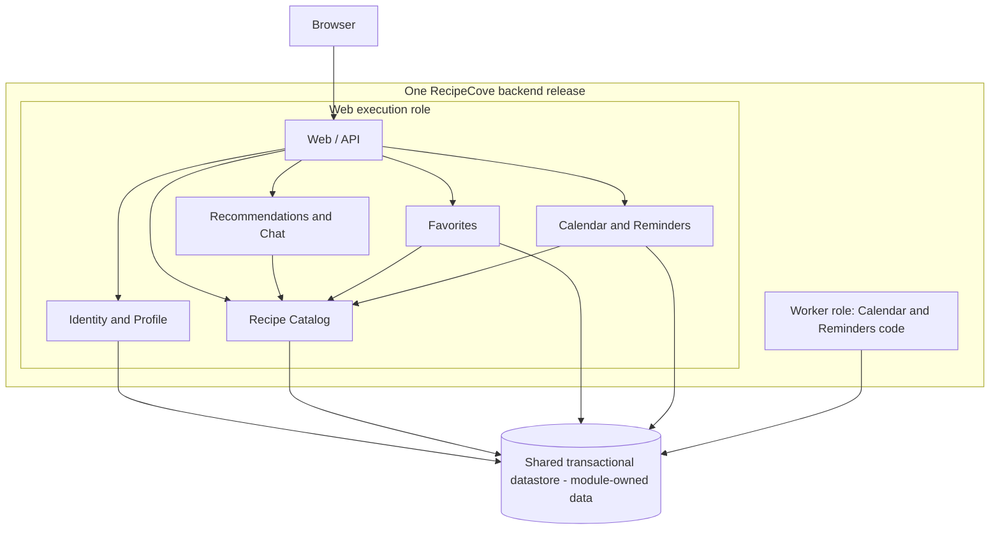

# ADR-001: RecipeCove architecture

- **Status:** Proposed
- **Date:** 2026-10-27
- **Revision:** v1 — first draft for review

The user selected the modular-monolith direction with durable reminder jobs and a background worker for this exercise after comparing three proposals. This ADR documents that direction; its wording, boundaries, and detailed policies still require review. Selection of the direction does not mean this draft is approved.

## Context and scope

RecipeCove is a web application for recipe discovery, recipe/ingredient information, diet-based suggestions and a chatbot, with Google sign-in, profiles, favorites, and a recipe calendar with reminders.

Sources: [project requirements](../../Tasks/data/RecipeCove.txt), [Task 1 architecture discussion and user selection in Entry 5](../baseline/task1_discussion.md), and [Task 2 review record](../baseline/task2_discussion.md). Detailed scenarios, failure cases, and illustrative product documentation remain in the discussion notes.

This decision covers application structure, data ownership, deployment roles, and reliable background processing. Recipe-data source, chatbot implementation, reminder channel and exact timing, physical deletion policy, technology stack, and hosting provider remain open.

## Decision drivers

| Category | Basis |
| --- | --- |
| **Source requirements** | All 14 stories and the description's chatbot; visitor recipe discovery and diet suggestions; Google-based registration; login/logout and profile; personal favorites and calendar/reminders. The description emphasizes ease of use and detailed recipe/ingredient information. |
| **Provisional comparison assumptions** | Small team, modest initial traffic, limited operations budget. These were supplied by the user, not by the requirements file. |
| **Design priorities inferred from the comparison** | Limit application-level operating components; keep calendar/event/job consistency local; retain clear module boundaries; make retries and cancellation recoverable. These are architectural judgments, not additional source requirements. |
| **Unresolved drivers** | Workload, latency/availability objectives, team/cloud expertise, integration behavior, and product policies listed below. No numerical performance targets or measured cost ranking are available. |

## Decision

Use a **modular monolith with durable reminder jobs and a background worker**.

- Build and version the backend as **one release**, with **web** and **worker** execution roles using the same application code. The worker runs Calendar/Reminders code in its own process; it is not an independently deployed business service. Role instance counts may differ.
- Use explicit in-process module interfaces. Other modules obtain data through the owning module's interface; they do not write its tables or bypass its rules. Enforce dependency and migration ownership during development.
- Use one shared transactional datastore with module-owned tables or equivalent collections. The database engine and technology stack are undecided. Catalog references in favorites/events use stable recipe IDs; external-source disappearance still needs a product policy.
- Keep calendar state, events, reminder jobs, and delivery-attempt state in **Calendar and Reminders**. Scheduling is a durable local write; execution occurs later in the worker.

### Module ownership and requirement coverage

| Module | Responsibility and owned data | Stories |
| --- | --- | --- |
| **Identity and Profile** | Google identity mapping, internal users, application sessions and personal profile data; register, log in/out, view profile. | **1, 6, 7, 8** |
| **Recipe Catalog** | Name search and recipe/ingredient details; canonical recipe IDs, owned catalog or external-source mappings/permitted cache. | **2, 3, 4** |
| **Recommendations and Chat** | Diet suggestions and chatbot via Catalog interfaces; recommendation rules/configuration. Persistent conversation history is not assumed. | **5 + chatbot** |
| **Favorites** | Add, remove and list favorites; user-to-recipe links. | **12, 13, 14** |
| **Calendar and Reminders** | Create/delete calendars, add recipe events, schedule/process reminders; calendars, events, jobs, attempt state and command-idempotency records. | **9, 10, 11** |

Module arrows are local calls within the web process. Both roles access persistence through module-owned code. External integrations are omitted for readability; Google sign-in is required, while recipe, chatbot and delivery providers remain undecided.

### Local transaction boundaries

1. Adding/removing a favorite is a Favorites transaction. A later calendar failure does not undo it.
2. Creating an event checks the active calendar/owner and atomically saves the event, durable reminder job, and command-idempotency result. A successful response confirms stored scheduling intent, not delivery.
3. Calendar deactivation/cancellation and final send authorization coordinate on authoritative calendar/job state. Their proposed semantics are described below.
4. External recipe validation and provider calls occur outside short database transactions. The database cannot atomically commit an external send. Future adoption of a separate scheduler or broker would require explicitly addressing that new write boundary.

## Alternatives considered

All proposals cover the same requirements under the same provisional assumptions; serverless and microservices are overlapping concepts, not exclusive categories.

| Concrete proposal | Benefit | Trade-off and disposition |
| --- | --- | --- |
| **Modular monolith + durable worker** | Local calls/transactions, fewer application deployment components. | Selected direction; shared releases and web-process resources, less targeted scaling. |
| **Four-service microservices**: Identity/Profile, Catalog, Recommendations/Chat, Personal Workspace | Independent releases and targeted scaling/failure isolation. Calendar/jobs remain local to Personal Workspace. | Not selected: network/authentication dependencies, API compatibility, tracing and multiple release pipelines add overhead without an established need for that independence. |
| **Illustrative managed serverless/event-driven design**: functions, managed identity/storage, outbox/stream relay, external scheduler, queue and reconciliation | Less host administration and triggered scaling. | Not selected: our concrete pipeline adds eventual schedule configuration, IAM/infrastructure configuration, recovery paths and provider coupling. This does not establish that every serverless design requires this complexity or costs more. |

These are qualitative judgments, not measured price comparisons. Managed hosting, authentication or persistence can also support the selected monolith. See the [Task 1 comparison](../baseline/task1_discussion.md) for the full proposals.

## Implementation obligations and policy limits

| Concern | Required design behavior / draft policy |
| --- | --- |
| **Authentication and authorization** | Validate Google sign-in through a maintained integration, map verified provider identity to an internal user, and establish a revocable application session. Every private read/write checks ownership using server-derived identity. Login alone does not authorize another user's calendar, profile or favorites. Logout invalidates the local session; it does not delete saved data, cancel reminders, or necessarily log out of Google. An already-authorized request may finish. |
| **Favorites and command idempotency** | Atomically enforce one favorite per non-null `(user_id, recipe_id)`; repeated add/remove preserves the intended state. Calendar/event commands use user/operation-scoped idempotency keys with request fingerprints and durable results; conflicting reuse is rejected. |
| **Durable scheduling and recovery** | Commit event/job/idempotency state together. Supervise the worker; atomically claim jobs using expiring leases and attempt ownership so crashes and concurrent workers are recoverable. Monitor overdue jobs and terminal failures. Browser timers and process memory are not durable schedules. |
| **Time zones and timing** | Preserve the intended day and, when agreed, local time/named zone plus derived execution instant. Handle ambiguous/nonexistent local times explicitly. Exact reminder time, travel behavior, recurrence and lateness policy are unresolved; no timing SLA is promised. |
| **Retries and external delivery** | Use bounded timeouts, transient-error retries with backoff/jitter, and inspectable terminal failures. Reuse stable reminder-occurrence identifiers; use provider deduplication/status lookup if supported. A provider-accepted send followed by a crash can be duplicated on retry. No exactly-once external-delivery guarantee. |
| **Calendar deletion during processing** | Proposed semantics for review: atomically make the calendar inactive and invalidate pending work, coordinating event creation and final send authorization on the same calendar state. Claimed jobs recheck current state; asynchronous cleanup may remove dependent records. After deletion commits, new send authorization must fail. Previously authorized/in-flight or provider-accepted messages may still arrive. Physical deletion, retention and recovery policies remain open. |
| **External dependencies and operations** | Isolate adapters, bound provider calls and concurrency, keep failures visible, protect private data/secrets, and maintain compatible migrations, backups/restores and monitoring across web/worker restarts. Source/provider selection must define permitted caching and missing-recipe behavior. |

These detailed policies are part of the Proposed draft and require review. The user has selected the architectural direction, not separately approved every policy in this table.

## Consequences

**Positive:** simpler local consistency and debugging; a small number of application deployment units; explicit module ownership; durable reminder recovery; domain interfaces that allow later adaptation.

**Negative:** shared backend release cadence and datastore; unrelated web modules can be affected by one web-process failure or slow dependency; database contention and provider limits remain. Web replication generally copies all web modules. Worker instances can scale separately but share persistence and code evolution. Module discipline, runtime/worker operations, authorization, observability and safe migrations remain team responsibilities.

## Open product and implementation decisions

- Recipe source/licensing/update model, required detail fields, search matching and missing-recipe behavior.
- Supported diets and validation rules, chatbot implementation/access policy, and any conversation retention.
- Reminder channel, verified delivery destination, exact timing/time-zone/travel rules, recurrence and overdue handling; calendar cardinality and final cancellation semantics.
- Physical deletion/cascade, retention, recovery and account-data lifecycle rules.
- Profile fields/editability, session policy, database engine, language/framework, hosting and deployment tooling.
- Workload and quality objectives.

## Evidence that would justify revisiting

Reassess if measurements show sustained resource contention or independently demanding Catalog/Chat workloads; teams need independent release ownership; newly confirmed availability/security isolation requirements exceed this design; integrations require different execution boundaries; or validated hosting/cost/operational evidence favors another approach. Revisit the relevant policies when open product questions are answered. No trigger threshold is invented here.

## Review state

First draft awaiting user review. Resolve feedback and preserve subsequent revisions in the [Task 2 record](../baseline/task2_discussion.md). Keep status **Proposed** until the user explicitly accepts the ADR.
