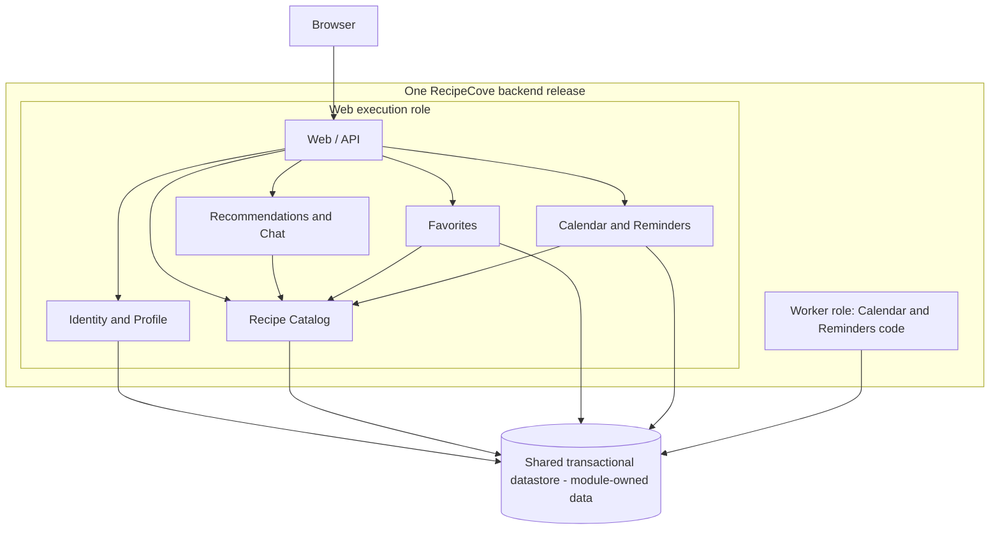

# ADR-001: RecipeCove architecture

- **Status:** Proposed
- **Date:** 2026-10-27
- **Revision:** v2 — policy status and deletion-state clarification

The user selected the modular-monolith direction with durable reminder jobs and a background worker for this exercise after comparing three proposals. This ADR documents that direction; its wording, boundaries, and detailed policies still require review. Selection of the direction does not mean this draft is approved.

## Context and scope

RecipeCove is a web application for recipe discovery, recipe/ingredient information, diet-based suggestions and a chatbot, with Google sign-in, profiles, favorites, and a recipe calendar with reminders.

Sources: [project requirements](../../Tasks/data/RecipeCove.txt), [Task 1 architecture discussion and user selection in Entry 5](../baseline/task1_discussion.md), and [Task 2 review record](../baseline/task2_discussion.md). Detailed scenarios, failure cases, and illustrative product documentation remain in the discussion notes.

This decision covers application structure, data ownership, deployment roles, and reliable background processing. Proposed policies and open choices are tracked in the status table below.

## Decision drivers

| Category | Basis |
| --- | --- |
| **Source requirements** | All 14 stories and the description's chatbot; visitor recipe discovery and diet suggestions; Google-based registration; login/logout and profile; personal favorites and calendar/reminders. The description emphasizes ease of use and detailed recipe/ingredient information. |
| **Provisional comparison assumptions** | Small team, modest initial traffic, limited operations budget. These were supplied by the user, not by the requirements file. |
| **Design priorities inferred from the comparison** | Limit application-level operating components; keep calendar/event/job consistency local; retain clear module boundaries; make retries and cancellation recoverable. These are architectural judgments, not additional source requirements. |
| **Unresolved drivers** | See the unresolved choices in the status table below. No numerical performance targets or measured cost ranking are available. |

## Decision — selected architectural direction

Use a **modular monolith with durable reminder jobs and a background worker**.

- Build and version the backend as **one release**, with **web** and **worker** execution roles using the same application code. The worker runs Calendar/Reminders code in its own process; it is not an independently deployed business service. Role instance counts may differ.
- Use explicit in-process module interfaces. Other modules obtain data through the owning module's interface; they do not write its tables or bypass its rules. Enforce dependency and migration ownership during development.
- Use one shared transactional datastore with module-owned tables or equivalent collections. Catalog references in favorites/events use stable recipe IDs.
- Keep calendar state, events, reminder jobs, and delivery-attempt state in **Calendar and Reminders**. Scheduling is a durable local write; execution occurs later in the worker.

### Module ownership and requirement coverage

| Module | Responsibility and owned data | Stories |
| --- | --- | --- |
| **Identity and Profile** | Google identity mapping, internal users, application sessions and personal profile data; register, log in/out, view profile. | **1, 6, 7, 8** |
| **Recipe Catalog** | Name search and recipe/ingredient details; canonical recipe IDs, owned catalog or external-source mappings/permitted cache. | **2, 3, 4** |
| **Recommendations and Chat** | Diet suggestions and chatbot via Catalog interfaces; recommendation rules/configuration. Persistent conversation history is not assumed. | **5 + chatbot** |
| **Favorites** | Add, remove and list favorites; user-to-recipe links. | **12, 13, 14** |
| **Calendar and Reminders** | Create/delete calendars, add recipe events, schedule/process reminders; calendars, events, jobs, attempt state and command-idempotency records. | **9, 10, 11** |

Module arrows are local calls within the web process. Both roles access persistence through module-owned code. External integrations are omitted for readability; Google sign-in is required, while recipe, chatbot and delivery providers remain undecided.

### Local transaction boundaries — correctness safeguards

1. Adding/removing a favorite is a Favorites transaction. A later calendar failure does not undo it.
2. Creating an event checks the active calendar/owner and atomically saves the event, durable reminder job, and command-idempotency result. A successful response confirms stored scheduling intent, not delivery.
3. Deletion coordination and its proposed product semantics are specified in the deletion-state section below.
4. External recipe validation and provider calls occur outside short database transactions. The database cannot atomically commit an external send. Future adoption of a separate scheduler or broker would require explicitly addressing that new write boundary.

## Alternatives considered

All proposals cover the same requirements under the same provisional assumptions; serverless and microservices are overlapping concepts, not exclusive categories.

| Concrete proposal | Benefit | Trade-off and disposition |
| --- | --- | --- |
| **Modular monolith + durable worker** | Local calls/transactions, fewer application deployment components. | Selected direction; shared releases and web-process resources, less targeted scaling. |
| **Four-service microservices**: Identity/Profile, Catalog, Recommendations/Chat, Personal Workspace | Independent releases and targeted scaling/failure isolation. Calendar/jobs remain local to Personal Workspace. | Not selected: network/authentication dependencies, API compatibility, tracing and multiple release pipelines add overhead without an established need for that independence. |
| **Illustrative managed serverless/event-driven design**: functions, managed identity/storage, outbox/stream relay, external scheduler, queue and reconciliation | Less host administration and triggered scaling. | Not selected: our concrete pipeline adds eventual schedule configuration, IAM/infrastructure configuration, recovery paths and provider coupling. This does not establish that every serverless design requires this complexity or costs more. |

These are qualitative judgments, not measured price comparisons. Managed hosting, authentication or persistence can also support the selected monolith. See the [Task 1 comparison](../baseline/task1_discussion.md) for the full proposals.

## Safeguards, proposed policies and unresolved choices

The selected architecture is recorded above. **Required safeguards** are correctness/security obligations, not optional features or claims that the source specified their mechanism. **Proposed policies** need confirmation; neither the source nor the user's architecture selection approves them. **Unresolved choices** remain open.

| Status | Concern | Behavior or choice |
| --- | --- | --- |
| **Required safeguard** | Authentication and private-data authorization | Validate Google identity, map it to an internal user and use a revocable application session. Every private read/write checks ownership using server-derived identity. Logout invalidates that session; an already-authorized request may finish, and the Google session is separate. |
| **Required safeguard** | Reliable persistence, idempotency and recovery | Apply the local transaction boundaries above. Repeated commands must not accidentally duplicate effects: use user/operation-scoped keys, request fingerprints and durable results; reject conflicting key reuse. Supervise workers, atomically claim jobs with expiring leases/attempt ownership, and monitor overdue work and terminal failures. |
| **Required safeguard** | Time interpretation | Preserve the intended day and, for timed reminders, the chosen local time/named zone and derived execution instant. Handle ambiguous/nonexistent local times explicitly without inventing a timing policy. |
| **Required safeguard** | External calls and operations | Bound calls/concurrency; retry transient failures with backoff/jitter and inspectable limits. Use stable occurrence IDs and provider deduplication/status lookup when supported. A crash after provider acceptance can still duplicate delivery; no exactly-once external guarantee. Protect private data/secrets and maintain compatible migrations, monitoring and tested backup/restore procedures. |
| **Proposed policy — confirm** | Duplicate favorites | One favorite per non-null `(user_id, recipe_id)`; repeated add reports an already-satisfied state, and repeated removal leaves it absent. If confirmed, enforce uniqueness atomically. Source stories 12–14 specify add/remove/list, not these duplicate semantics. |
| **Proposed policy — confirm** | Deletion and cancellation | The deletion-state table below defines the proposed cancellation boundary; its coordination invariant is a required safeguard. |
| **Unresolved choice** | Recipe integration | Source, licensing/update model, detail fields, search matching, permitted cache and missing-recipe behavior. |
| **Unresolved choice** | Diets and chatbot | Supported diets/validation rules, implementation, access policy and conversation retention. |
| **Unresolved choice** | Reminder behavior | Channel/verified destination, exact timing, time-zone/travel rules, recurrence and overdue handling; calendar cardinality. No timing SLA is assumed. |
| **Unresolved choice** | Data lifecycle | Physical deletion/cascade, retention, recovery and account-data lifecycle, including retained data after logout. Logout itself does not constitute a deletion request. |
| **Unresolved choice** | Implementation and quality objectives | Profile fields/editability, session details, database engine, language/framework, hosting/tooling, workload, latency/availability objectives and team/cloud expertise. |

### Calendar deletion and reminder states

**Proposed product policy:** deletion logically deactivates the calendar and cancels delivery that has not yet been authorized. Previously authorized delivery is not guaranteed to be stopped. The policy remains subject to confirmation.

**Required coordination safeguard:** claiming only reserves work; it does not permit sending. Final send authorization must atomically check authoritative active calendar/job state and record authorization in coordination with deletion. A previous read or cached calendar state is insufficient. **No new send authorization, including authorization for a retry, may succeed after deletion commits.**

| Reminder state at deletion commit | Meaning | Effect under the proposed policy |
| --- | --- | --- |
| **Pending** | No worker owns a delivery attempt. | Immediately ineligible for delivery through the inactive calendar state; cancellation markers/record cleanup may follow. |
| **Claimed, not authorized** | A worker holds a reservation only. | The final authoritative check fails; the claim cannot be used to send. |
| **Already authorized** | An attempt received permission before deletion committed. | That attempt may still complete. Deletion blocks new authorizations, including later retry attempts. |
| **Provider accepted** | The external provider accepted the message, which may still await end-user delivery. | Local cancellation cannot guarantee retraction; delivery may complete. |

Logical deactivation is atomic and makes pending work ineligible without first rewriting every dependent record. Physical cleanup of events/jobs may run separately in batches. Preserve enough authoritative cancellation state to reject stale work; retention and physical-deletion rules remain unresolved. Detailed concurrency reasoning belongs in the [Task 2 notes](../baseline/task2_discussion.md).

## Consequences

**Positive:** simpler local consistency and debugging; a small number of application deployment units; explicit module ownership; durable reminder recovery; domain interfaces that allow later adaptation.

**Negative:** shared backend release cadence and datastore; unrelated web modules can be affected by one web-process failure or slow dependency; database contention and provider limits remain. Web replication generally copies all web modules. Worker instances can scale separately but share persistence and code evolution. Module discipline, runtime/worker operations, authorization, observability and safe migrations remain team responsibilities.

## Evidence that would justify revisiting

Reassess if measurements show sustained resource contention or independently demanding Catalog/Chat workloads; teams need independent release ownership; newly confirmed availability/security isolation requirements exceed this design; integrations require different execution boundaries; or validated hosting/cost/operational evidence favors another approach. Revisit the relevant policies when open product questions are answered. No trigger threshold is invented here.

## Review state

Revision v2 addresses the user's policy-status and deletion-state feedback and awaits further review. No final acceptance or confirmation of proposed product policies has been recorded. Keep status **Proposed** until the user explicitly accepts the ADR; revision history is in the [Task 2 record](../baseline/task2_discussion.md).
