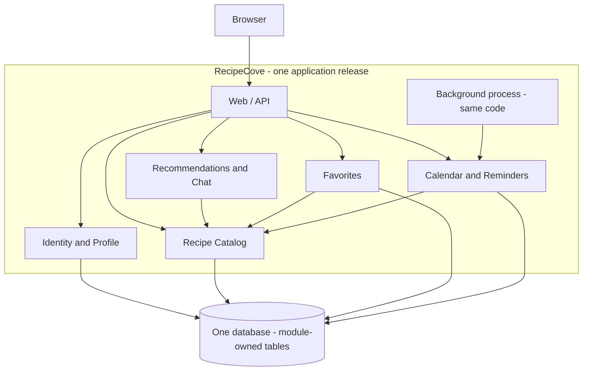
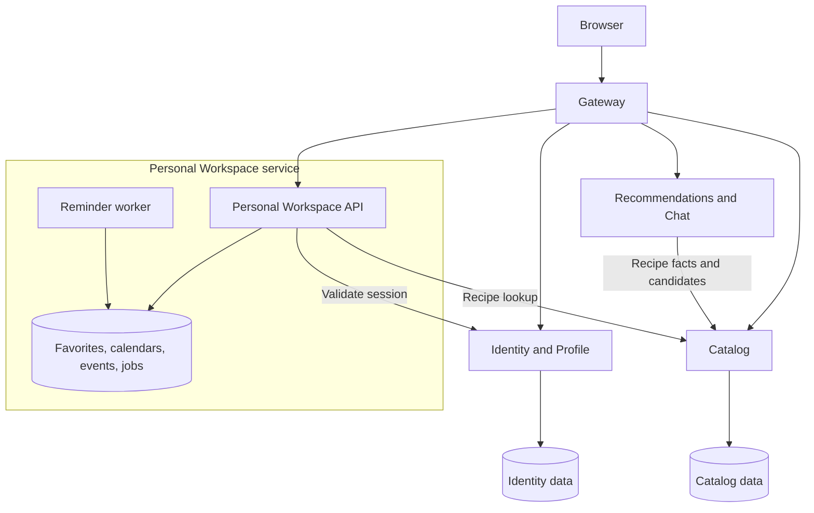
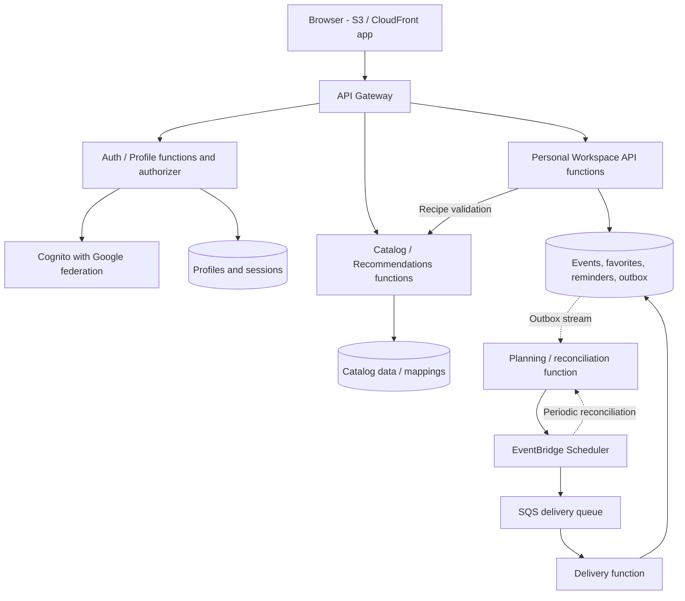

# Task 1 discussion notes — RecipeCove (baseline)

## Purpose and recording conventions

These English notes summarize the actual Task 1 conversation. User-facing explanations are in Slovak, as requested. Append or update entries as the discussion continues; distinguish user statements, source requirements, assistant explanations, assumptions, and decisions. Do not invent questions, feedback, or agreement.

## Entry 1 — Initial request and requirements analysis (2026-10-27)

### User request

The user identified RecipeCove as their assigned Week 05 project. Before discussing architectures, they requested ongoing notes at `solution/baseline/task1_discussion.md`, a review of Tasks 1–3 and the RecipeCove requirements, a summary of assignment deliverables, coverage of all 14 user stories and the chatbot, and a distinction between explicit requirements and architectural uncertainties/assumptions. They requested Slovak explanations and English submission notes. They want to discuss three architectures step by step after this initial analysis.

### Sources and workspace location

The requested files are present under `Tasks/` in the current assignment directory, `/home/myroslav/projects/SEwAI/Labs/Week_05`, rather than a nested `Week_05_Designing/Tasks` directory. Read:

- `Tasks/Task_1.md`
- `Tasks/Task_2.md`
- `Tasks/Task_3.md`
- `Tasks/data/RecipeCove.txt`

### Assignment requirements and expected deliverables

- **Task 1 (1.5 points):** Conduct and record a substantive conversation about three different architectures for the assigned system. Understand the proposals, their trade-offs, and difficult low-level implementation details. Output: conversation record. Notes must start before the discussion.
- **Task 2 (1.5 points):** Use the Task 1 discussion to produce an Architecture Decision Record (ADR). Inspect its completeness, excess detail, structure, and usefulness; request several revisions. Tables and diagrams are options to evaluate, not mandatory outputs. Record the discussion from its beginning. Outputs: conversation record and final ADR.
- **Task 3 (2 points):** Inspect both recorded discussions and create a reusable skill or set of skills for requirements analysis, architecture proposals/comparison, architecture selection, and ADR creation. Put the skill in the codebase, repeat Tasks 1 and 2 in a new session using it, compare the before/after recordings, and write a brief report. Outputs: skill(s) and comparison report. Preserve baseline recordings for that comparison.
- Total available: **5 points**. The task texts do not explicitly require implementing the RecipeCove application or deploying it. This initial request covers analysis and starting the Task 1 record, not completion of Tasks 2 or 3.

### Explicit RecipeCove functionality

RecipeCove is a web application for discovering recipes and obtaining detailed recipe and ingredient information. Discovery includes a search bar and a chatbot that suggests recipes following a particular diet. Personal profiles support favorites and an application-created calendar with recipe-related reminders.

| Story | Actor | Explicit capability |
| --- | --- | --- |
| 1 | Visitor | Register using an existing external Google account. |
| 2 | Visitor | Search recipes by name. |
| 3 | Visitor | View recipe information. |
| 4 | Visitor | View ingredient information. |
| 5 | Visitor | View recipe suggestions for a specified diet. |
| 6 | Registered user | Log in to access additional functionality. |
| 7 | Registered user | Log out. The motivation's phrase about leaving information on the website is ambiguous; deletion is not explicitly requested. |
| 8 | Registered user | View personal information on a profile page. |
| 9 | Registered user | Create a calendar for recipe-related events. |
| 10 | Registered user | Delete a calendar. Exact deletion/cascade semantics are unspecified. |
| 11 | Registered user | Add a calendar event to be reminded on a specified day to prepare a recipe. |
| 12 | Registered user | Add a recipe to favorites. |
| 13 | Registered user | Remove a recipe from favorites. |
| 14 | Registered user | View the favorites list. |

The chatbot is explicit in the system description even though it has no separate numbered story. Its implementation is not prescribed: an LLM, a particular provider, free-form generation, and persistent conversation history are not requirements. Story 5 makes diet suggestions available to visitors; whether the entire chatbot is available to visitors is not separately specified.

### Architectural uncertainties and potential assumptions

The following points are unresolved. Candidate assumptions are discussion aids, not user-approved decisions.

| Area | Explicit source requirement | Uncertainty / possible assumption to validate | Architectural impact |
| --- | --- | --- | --- |
| Scale and quality goals | Web application; easy to use; detailed information. | No user counts, concurrent load, latency, uptime, growth, budget, team size, or operations constraints. A small initial deployment could be used as a comparison scenario, but has not been agreed. | Distribution, scaling, caching, resilience, and operating cost. |
| Recipe and ingredient data | Recipe discovery and recipe/ingredient details. | No source, licensing, data ownership, update process, catalog size, or required fields specified. An external API and an owned catalog are alternatives. | Data model, integration boundaries, caching, and behavior during provider outages. |
| Search and dietary constraints | Name search and suggestions for a diet. | Exact vs partial/fuzzy search, supported diets, nutritional data, allergies, exclusions, and verification rules are absent. | Search engine needs, indexing, filtering, and recommendation validation. |
| Chatbot | Suggest recipes following a particular diet. | Rule-based/retrieval vs LLM implementation, visitor access, conversation history, permitted data sharing, and fallback behavior are unspecified. Do not assume unrestricted recipe generation or medical advice. | Integration boundary, latency/cost, state storage, privacy, and correctness controls. |
| Identity and authorization | Google-based registration, login/logout, personal profile, favorites, and calendar. | Google-only vs additional login methods, editable profile fields, session behavior, and provider failure handling are unspecified. Treating personal data as owner-only is a reasonable candidate assumption, not an explicitly detailed policy. | Authentication integration, sessions, access checks, and user-data boundaries. |
| Calendar and reminders | Application-created calendar; create/delete calendar; add recipe event and reminder on a day. | One or many calendars, time zones, exact notification time/channel, recurrence, and Google Calendar synchronization are not specified. Google sign-in does not imply Google Calendar integration. | Data relationships, scheduling, background jobs, and delivery integrations. |
| Deletion and data lifecycle | Delete a calendar; remove a favorite; log out. | Whether calendar deletion cascades to events, retention/recovery rules, and account deletion are unspecified. Logging out is not evidence of a requirement to delete stored user data. | Referential integrity, transactions, retention, and scheduled-job cleanup. |
| Favorites and consistency | Add/remove/list favorites. | Duplicate entries, ordering, concurrent updates, stale/deleted recipes, and consistency guarantees are unspecified. | Unique constraints, transactions, and cross-component coordination. |
| Scope and deployment | The stated web functionality. | Recipe authoring, administration, reviews, payments, mobile/offline clients, hosting platform, technology stack, and existing infrastructure are not requested or specified. | Avoid adding unsupported components; evaluate deployment constraints when comparing proposals. |

### Current status and decisions

- Started the requested baseline discussion record at this path.
- Working communication convention: Slovak explanations; English submission notes, as directed by the user.
- No architecture has been proposed, selected, or accepted yet. No technology stack, scale assumption, or notification channel has been agreed.
- No clarification questions, user feedback on this analysis, or architecture trade-offs have yet been discussed. The uncertainties above are the assistant's initial analysis of missing requirements.
- Next intended step, per the user's request: discuss the three architectures incrementally after reviewing this analysis, explaining trade-offs and implementation difficulties and recording the actual exchanges here.

## Entry 2 — First architectural option: modular monolith (2026-10-27)

### Actual user request and working assumptions

The user thanked the assistant and reaffirmed Slovak explanations and English submission notes. They requested a step-by-step examination of a modular monolith, followed later by two genuinely different alternatives, with the final decision deferred until all three have been compared. They explicitly supplied **a small team, modest initial traffic, and a limited operations budget as provisional working assumptions for a consistent comparison**, not source requirements. No numerical performance targets were supplied or invented.

They asked for a plain-language explanation of deployment and communication; modules, responsibilities, data ownership, a small Mermaid diagram, and coverage of all stories plus the chatbot; a search-to-favorite-to-calendar walkthrough; concrete implementation difficulties involving Google authentication, private data, duplicate favorites, time zones, retries, calendar deletion, and workers; and benefits, limitations, scaling constraints, and reasons to choose another architecture. Recipe-data source, chatbot implementation, and reminder delivery channel must remain provisional. They requested two short understanding-check questions and a pause before the second option.

### Assistant explanation: deployment and module boundaries

A modular monolith is one backend application divided into business modules with explicit interfaces. In the proposed baseline, all backend modules are built, versioned, and released together. During a web request they normally communicate through in-process function/service calls, not HTTP calls between separately deployed business services. The browser accesses the application over HTTP. One relational database is proposed, with module-owned tables or schemas; this is a design proposal, not a prescribed stack. PostgreSQL is used only as an illustrative implementation in the technical references below.

Data ownership means that a module alone controls writes and migrations to its tables. Other modules use its public interfaces and stable identifiers instead of writing directly to its tables. Separate database schemas can make boundaries visible but do not enforce them automatically. Package dependencies, review, and boundary checks are needed to prevent cyclic imports and direct cross-module SQL from eroding the design.

A background execution role can run the same application artifact and Calendar module code in a separate process. It is released with the web application and shares the database; it is not an independently owned reminder microservice. The initial processes may run on the same host. This reduces infrastructure but shares host-level failure risk.

### Proposed modules, data ownership, and complete requirement mapping

| Module | Responsibility | Owned data | Stories / description |
| --- | --- | --- | --- |
| Identity and Profile | Google identity integration, local account mapping, application sessions, profile access. | Local users, external identity links, sessions, profile fields. | 1, 6, 7, 8. |
| Recipe Catalog | Name search, recipe/ingredient details, stable application recipe identifiers, recipe-source adapter. | Application catalog records or external-source mappings and permitted cached data; source strategy remains open. | 2, 3, 4. |
| Recommendations and Chat | Diet-based suggestions and chatbot interaction; obtain recipe facts through Catalog. | Diet/filter configuration and recommendation logic; no persistent chat history is assumed. Any future chat history would belong here. | 5 and the chatbot in the system description. |
| Favorites | Add, remove, and list a user's favorite recipe references. | User-to-recipe favorite links. | 12, 13, 14. |
| Calendar and Reminders | Create/delete calendars, create recipe events, schedule and track reminder attempts. | Calendars, events, reminder jobs, delivery state, attempt metadata. | 9, 10, 11. |

Favorites, Calendar, and Recommendations obtain recipe information through Catalog interfaces. A shared database does not make all tables shared module property. Calendar and reminder scheduling are kept within one module so event creation/job creation and calendar deletion/job cancellation can use local transactions without introducing a cross-module notification ownership problem. A generic delivery integration can remain an adapter within this module for this option.

The diagram shows logical module dependencies, not separate network services. The worker invokes Calendar code in its own process; its arrow is not a worker-to-web HTTP call. Optional external recipe, chatbot, and delivery providers are omitted because their selection remains open. Recommendations need not persist data initially.

### Concrete walkthrough explained

1. A user already has a RecipeCove session established after verified Google sign-in. The backend resolves its internal user ID from that session.
2. Searching for a recipe by name calls Catalog; opening the result obtains recipe and ingredient details. The source can be local data or an external adapter without changing Favorites' public interface. If an external source is used, stable source-to-application ID mapping and missing/unavailable-recipe behavior need definition.
3. Adding that recipe to Favorites sends the recipe ID; the backend uses the session's user ID and checks the recipe through Catalog. Favorites stores the link under a database uniqueness constraint.
4. The user selects an owned calendar, or creates one, and adds a recipe event. An example time such as tomorrow at 18:00 in `Europe/Budapest` is illustrative only: the source requires a reminder on a day, not a specific time-selection feature. A time and channel policy still need agreement.
5. Calendar verifies ownership and active status, and transactionally stores both the event and its durable pending reminder job. If the transaction fails, neither remains. Adding a favorite and scheduling an event are separate user actions/transactions; failure to schedule does not undo the favorite, and scheduling does not require favoriting first.
6. The worker finds due jobs and attempts delivery through an adapter for the still-undecided channel. The reminder survives closing the browser and application restarts because it is stored durably.

### Concrete implementation difficulties and proposed mitigations

**Google authentication versus private-data authorization.** Use a maintained Google/OpenID Connect integration. For a server-side sign-in flow, validate callback state and the ID token's signature, issuer, audience, expiry, and nonce when used. Link `(issuer, sub)` to an internal user ID rather than treating an editable email address as identity. Establish a protected application session, for example using an HttpOnly/Secure cookie and appropriate SameSite and CSRF handling. Logout invalidates the local session; it need not log out of Google or delete saved data. Every Favorites, Profile, and Calendar operation derives the user from the server session and checks ownership. Changing a `calendarId` in a request must not expose or modify another user's calendar. Google authentication establishes identity but does not authorize access to other RecipeCove accounts. Owner-only access is a proposed policy for the personal features, not a detailed source-specified authorization model. Google Calendar integration remains unrequired.

**Duplicate favorites.** Two tabs can both pass an application-level existence check before inserting. Propose non-null IDs and `UNIQUE(user_id, recipe_id)` in the database, handling a uniqueness conflict as an already-successful add. Repeated removal can likewise leave the item absent. This gives idempotent add/remove behavior; button disabling alone is insufficient. The uniqueness rule is a proposal, not an explicit source constraint.

**Time zones.** Keep the event's intended local date/time and named time zone, plus the derived UTC execution instant for a timed reminder. Preserve the recipe event date separately if it is a day-only event. `Europe/Budapest` captures daylight-saving rules; a fixed offset does not. A local time can be nonexistent or ambiguous around a clock change; reject it with an explanation or obtain the user's intended interpretation rather than silently guessing. Even a database timestamp-with-time-zone field does not by itself preserve the original named zone. The choice of reminder time, travel behavior, recurrence, and changes to future scheduling rules remains open.

**Why background execution is needed.** For proactive reminders at a scheduled time, some execution independent of the browser/request is needed. If a reminder only means showing calendar entries when the user opens the app, a delivery worker may be unnecessary; that interpretation and delivery channel are unresolved. For the proactive-reminder variant being illustrated, propose a simple database-backed scheduler/worker rather than a new message broker. A scheduled command is another execution form. Never rely solely on an in-memory timer or browser tab. The worker can be supervised/restarted and shares application module code and the release lifecycle.

**Retries and concurrent workers.** Store a due time, state, attempt count, next-attempt time, and a temporary claim/lease. Claim work atomically so concurrent workers do not normally process the same job. Recover jobs after an expired claim when a worker crashes; use attempt ownership when completing a claim. Retry transient failures with increasing delays, cap attempts, and expose terminal failures for operational inspection. A stable delivery key per reminder occurrence lets a supporting provider deduplicate retries. If a provider accepts a message but the worker crashes before saving success, retrying can duplicate delivery. Without provider deduplication or reconciliation, the design cannot promise exactly-once external delivery. Persistent jobs and retries do not guarantee exact wall-clock delivery, particularly during outages; no timing SLA has been assumed.

**Deleting a calendar with pending work.** Proposed semantics, still requiring product agreement: deleting the calendar removes its events from use and cancels unsent reminder work. Calendar deletion, event creation, and final send authorization must coordinate on the same calendar state/row lock. The deletion transaction verifies ownership, makes the calendar inactive, removes/cancels events as appropriate, and cancels pending/retry jobs. New event creation must check active state while holding the same coordinating lock so it cannot recreate work after deletion. A worker must recheck active calendar/job state before authorizing delivery, even for a job claimed earlier; stale work cannot be trusted. A small deletion marker can remain temporarily to coordinate in-flight work, with physical cleanup/retention policy still open. A database transaction cannot retract an external message: a delivery authorized before deletion, or already accepted by its provider, may still arrive. The proposed guarantee stops new send authorizations after deletion commits and cancels waiting work; it does not promise cancellation of every in-flight message. Do not hold a database transaction open across a slow provider call as a substitute for resolving this race.

### Benefits, limitations, and scaling discussion

- Under the user's provisional team/traffic/budget assumptions, one codebase/release and one database limit operational overhead. Local calls and local transactions simplify debugging and consistency. Modules allow focused code ownership without initially operating multiple business services.
- Modularity requires discipline. Direct writes across modules, cyclic dependencies, shared catch-all utilities, and uncoordinated migrations can turn the application into tightly coupled code despite module names. Proposed safeguards are explicit public interfaces, dependency rules, and module-owned migrations.
- All backend modules share a release cycle; a small change still releases the application. Web modules share process resources and failure risk; a slow chatbot integration or resource leak can impair unrelated requests. Provider timeouts and concurrency limits are necessary. A separate worker reduces direct web-process interference but still shares database and possibly host capacity.
- Scaling remains possible: improve queries/indexes, add justified caches, increase host capacity, run multiple web replicas behind a load balancer, and run more coordinated workers. Sessions must work across replicas rather than live only in one process. Database constraints and durable job claiming still protect concurrency.
- Web replicas generally replicate all web modules, so expensive chatbot/search workloads cannot be deployed and scaled as independent business services within this proposal. Worker counts can be tuned independently as process roles, while code and database remain coupled. The shared database can become a bottleneck; replicas do not remove contention or provider limits. Schema changes must accommodate overlapping old/new process versions during rollout.
- A different architecture would deserve consideration if measured workloads require separate resource pools for chat/search/reminders; multiple teams need independent releases; components require stronger failure/security isolation; database contention persists after suitable optimization; or separately managed integrations and asynchronous workflows dominate the system. Growing traffic alone does not establish that a monolith must be replaced. No numerical break-even threshold has been invented.

### Provisional integrations and unresolved choices

- Recipe data: owned catalog versus external provider remains open; Catalog owns the application-facing contract and source mapping.
- Chatbot: rules/retrieval versus an LLM/provider remains open; the Recommendations interface should return recipe suggestions grounded in Catalog information and checked against selected diet rules.
- Reminder delivery: in-app display, email, push, or another channel remains open. The worker discussion explains the proactive-delivery variant rather than silently selecting a channel.
- A relational database, the five-module split, private ownership checks, duplicate-favorite semantics, cancellation behavior, and worker implementation are architecture proposals, not accepted final decisions.

### Primary documentation consulted for implementation details

- [Google OpenID Connect](https://developers.google.com/identity/openid-connect/openid-connect): token verification, callback state, stable `sub`, and application sessions.
- [PostgreSQL constraints](https://www.postgresql.org/docs/current/ddl-constraints.html): composite unique constraints, illustrated for favorites; PostgreSQL is not selected as the final database.
- [PostgreSQL date/time types](https://www.postgresql.org/docs/current/datatype-datetime.html): named time zones, daylight-saving considerations, and UTC conversion/storage semantics.

### Understanding-check questions and current status

The assistant's two closing questions (asked in Slovak in the user-facing explanation) are:

1. Why are modules not allowed to write directly into another module's tables even when they share one database?
2. What can happen if a calendar is deleted after a reminder has already been handed to the delivery provider?

No user answers or feedback on the modular-monolith explanation have been received yet. Only the comparison assumptions were supplied by the user; no architecture has been selected. Wait for the user's response before discussing the second architectural option. Two genuinely different alternatives and the final comparison remain outstanding.

## Entry 3 — Second architectural option: microservices (2026-10-27)

### Actual user request, requirements, and assumptions

The user explicitly requested proceeding to microservices and keeping the two previous understanding-check questions recorded as unanswered. They did not answer those questions or approve the first architecture. They reaffirmed Slovak explanations, English notes at this path, and the same provisional assumptions: a small team, modest initial traffic, and a limited operations budget. These are comparison assumptions, not source requirements. All 14 stories and the chatbot remain in scope. Recipe-data source, chatbot technology, reminder delivery channel, exact reminder timing, and the other unresolved product requirements remain open. No workload measurements or numerical performance requirements were introduced.

The user requested independent deployment and network/data boundaries; a minimal justified decomposition, diagram, and complete requirement mapping; logical versus physical storage isolation; the same user journey with synchronous/asynchronous operations, transactions, and visible failures; security, availability, idempotency, calendar/reminder consistency and deletion, retries and partial failures; justified use of patterns such as an outbox; operational overhead; and a direct comparison with the monolith. They requested a concise comparison table at the end and a pause before the third architecture. Final selection is deferred until all three have been discussed.

### Assistant proposal: four independently deployable business services

This proposal uses four services rather than copying each monolith module into a separate service. Each service has a separately versioned deployable artifact, API, private data ownership, and independent release process. They may share a source repository, technology stack, or physical host initially; those choices do not replace the independent deployment contracts. Interservice calls cross a network and can time out or fail after the remote operation has completed. Routine changes should not require lockstep deployment; if they do, the decomposition has retained excessive coupling.

| Service | Responsibilities and owned data | Requirement mapping | Boundary justification |
| --- | --- | --- | --- |
| Identity and Profile | Google identity verification, internal user IDs, identity links, profiles, application sessions and revocation. | 1, 6, 7, 8. | Isolate identity credentials, session handling, and profile access behind a narrow security interface; independently maintain the identity integration. |
| Catalog | Name search, recipe and ingredient details; canonical application recipe IDs, source mapping, catalog records or permitted cached external data. | 2, 3, 4. | Public discovery and recipe-source integration can evolve and scale independently of private user workflows. The actual data source remains open. |
| Recommendations and Chat | Diet suggestions and chatbot; diet/filter configuration and logic, any permitted cache, and optional future conversation state. Persistent chat history is not assumed. | 5 plus the description's chatbot. | Isolate potentially slow or resource-intensive recommendation/provider work and its releases. This justification does not presume an LLM or measured heavy load. |
| Personal Workspace | Favorites, calendars, events, reminder jobs, attempt/claim state, operation-idempotency records, and any minimal permitted recipe display snapshots. | 9, 10, 11, 12, 13, 14. | Keep private user organization together; co-locate calendar and reminder state to preserve local atomic operations and avoid an unnecessary notification-service boundary. |

An API gateway/reverse proxy supplies one browser entry point and routing; it is infrastructure, not a fifth business service. It does not own the domain data. The Personal Workspace has an API and a background worker role using its own code and datastore, released as that service. The worker is not a separate business service. This is a compact candidate, not a claim that four is the uniquely correct number of services.

Arrows between services are synchronous HTTP calls in this proposal. The worker asynchronously processes durable local jobs; no interservice event broker is required for this journey. External Google/recipe/chatbot/delivery integrations are omitted from the diagram for readability; only Google sign-in is explicitly required, and the other integrations remain provisional. Recommendations may initially need no persistent database, with configuration deployed alongside its code.

### Logical data isolation versus physical database servers

Each authoritative fact has one service owner. Services do not read or write one another's tables, share ORM entities, or coordinate cross-service SQL joins/transactions. Personal Workspace stores internal user and recipe IDs as references, not ownership of Identity or Catalog records; any copied display metadata is a potentially stale snapshot. No cross-service database foreign key is assumed. Catalog availability checks do not create a globally atomic guarantee that a recipe will never disappear later; missing-recipe behavior remains a product question.

Separate logical databases or schemas with restricted credentials can share one physical database server initially. Each service controls its migrations and permissions. Physical sharing can reduce cost but shares resource contention, outage risk, and maintenance concerns; it does not provide independent physical failure isolation. Later physical separation is possible without changing ownership contracts. A database cylinder in the diagram denotes ownership, not a requirement for a dedicated server.

### Same concrete user journey, transaction boundaries, and visible outcomes

1. **Logged-in identity:** Identity previously verified Google sign-in and issued a protected local session. Public name searches can go through Gateway to Catalog without a login, consistent with visitor stories.
2. **Find and open a recipe:** Browser -> Gateway -> Catalog is synchronous. Catalog may use its local source/cache or a provisional external adapter. If unavailable, the UI reports that search/details are temporarily unavailable and can offer retry; permitted cached results must be identified as such, not fabricated as current.
3. **Add to favorites:** Browser -> Gateway -> Personal Workspace. Personal Workspace validates the session with Identity and synchronously checks the recipe with Catalog. The external calls finish before a short local write transaction. Personal Workspace commits the favorite under a non-null `(user_id, recipe_id)` unique constraint and returns success. Catalog failure before validation means no favorite is created; an acknowledged validation failure can be shown clearly. A timeout after submission can leave the result unknown, so the client rechecks or retries idempotently instead of claiming nothing happened.
4. **Create/select a calendar and add an event:** Personal Workspace validates the user, calendar ownership/active state, and recipe through Catalog. An illustrative local date/time and named zone follow the same provisional policy as the monolith; the source requires only a specified day. A local transaction writes the event, durable reminder job, and idempotency result together. Confirm success only after commit. Failure rolls back those writes; earlier favorite success remains intact. A response lost after commit yields an unknown outcome, recoverable through the same idempotency key or a state read. There is no transaction spanning the whole search/favorite/calendar sequence.
5. **Later reminder processing:** The Personal Workspace worker asynchronously claims due jobs from its own datastore and delivers through the provisional channel adapter. API success confirms the event and scheduling intent were stored, not that delivery already happened. A worker outage delays delivery while durable jobs remain recoverable. If the UI exposes delivery state, that is a proposed way to communicate scheduling/delivery distinctions, not a newly mandated feature.

There is no saga or interservice message required in this journey: each durable business mutation belongs to Personal Workspace, while Identity/Catalog calls validate/read facts. Calendar/worker code can use stored recipe references and minimal permitted display metadata rather than requiring live Catalog data for every delivery. The eventual channel will determine how a verified destination is obtained; no email/push destination model has been assumed. Existing favorite/calendar lists can return owned records even when recipe enrichment is unavailable; the UI should distinguish missing details. Newly adding a recipe still follows the proposed Catalog validation policy.

### Concrete distributed implementation difficulties

**Authentication and authorization.** Identity alone handles Google callback/token checks, stable `(issuer, sub)` mapping, and application-session lifecycle. The proposed simple internal mechanism is online session validation: the gateway forwards the session credential only to the relevant trusted private service over protected transport; Personal Workspace validates it through Identity over an authenticated service channel. It never trusts a client-supplied `userId` or unverified forwarding header. Personal Workspace then independently checks calendar/favorite ownership. Service credentials and TLS authenticate internal callers; Google tokens are not reused indiscriminately as internal authorization tokens. Public Catalog reads do not require private user data. Story 5 remains available to visitors; access to the full chatbot remains unresolved. Logout invalidates the session in Identity; new online validations reject it, although an already-authorized in-flight request may finish. Online validation adds an Identity dependency: when unavailable, private operations fail closed with a temporary-unavailability response rather than bypassing authorization. Locally verified short-lived tokens are an alternative, with key rotation and revocation-delay trade-offs, not an additional selected mechanism.

**Slow/unavailable Catalog and chatbot.** Give each network call a timeout within the overall request deadline; limit concurrent calls and use a circuit breaker to stop repeatedly calling a failing dependency until a later probe. Catalog reads can use permitted, explicitly stale cache data where acceptable. In this proposal new favorites/events are not silently accepted when recipe validation cannot be completed. Recommendation failure leaves ordinary Catalog search available; Catalog failure may also disable recommendations because they depend on recipe facts. Do not claim complete isolation merely from separate processes. Identity and the gateway can also become shared availability dependencies. A chatbot timeout may occur after an external provider accepted work or incurred a charge, so automatic retry must consider the provider's contract and cost. A fallback to Catalog-based diet filtering is only appropriate if equivalent filtering data exists; otherwise show the feature as temporarily unavailable.

**Duplicate requests and message/job processing.** Preserve database uniqueness for favorites and idempotent add/remove behavior. Event creation uses an idempotency key scoped to user and operation, with the request fingerprint, created result, and event/job saved atomically; the same key with different content must not silently create a different operation. Concurrent requests with the same key are serialized/conflict-handled in the local store. Worker jobs have stable IDs, atomic temporary claims/leases, recovery after expiry, and completion tied to the current claim. A repeated job must not create a second calendar event or scheduling record. Local deduplication cannot guarantee exactly-once external delivery after a provider accepted a message but success was not recorded. The baseline has no interservice broker consumers. If events are later introduced, record consumed event IDs in an inbox/deduplication table in the same transaction as the local business effect; acknowledging a message alone is not sufficient deduplication.

**Calendar/reminder atomicity and the outbox boundary.** Co-locating events and durable jobs in Personal Workspace permits one local transaction. Introducing a broker here is unnecessary for reliable scheduling. If reminder scheduling were moved to another service, a naive sequence of saving the event and then publishing `ReminderRequested` could lose the reminder on a crash between those steps. A transactional outbox would save the event and an outbound message record atomically in the Calendar-owned database; a relay would later publish it and retry after failure. The recipient would deduplicate event IDs and durably create its scheduling state. The outbox preserves the committed intent to publish, not instantaneous downstream availability, end-to-end atomicity, ordering by itself, or exactly-once delivery. Relay restarts can republish; delayed or reordered create/cancel messages need aggregate IDs/versions and cancellation tombstones or an explicit ordering policy. This is a conditional explanation of a changed boundary, not an outbox/broker/separate notification service added to the current proposal.

**Calendar deletion and pending/in-flight work.** Preserve the monolith's proposed product semantics: verify ownership, mark the calendar inactive, remove/cancel its events as appropriate, and cancel pending/retry jobs in a local transaction. Event creation, deletion, and final send authorization coordinate on the same Calendar state/row lock. A claimed job must recheck current active state before receiving send authorization. Retain enough deletion state to reject stale work and recover safely; physical cleanup/retention remains open. Delete retries should leave the calendar deleted; a lost response is not evidence that deletion failed. Deletion prevents new send authorizations after its commit. An operation authorized before that point or already handed to the provider may still deliver. No database lock should be held across an unbounded provider request. The proposed co-location avoids waiting for a remote cancellation event; if scheduling were remote, an outbox alone would not solve cancellation races.

**Retries, timeouts, and partial recovery.** Retry transient errors with bounded attempts, increasing delays and jitter, not arbitrary authorization/validation failures. Choose a responsible retry layer so gateway and services do not multiply retries. Check operation state or reuse an idempotency key after an ambiguous write timeout. Do not keep local database transactions open during remote validation calls. Reclaim abandoned worker jobs; preserve terminal failures for inspection and controlled replay using the same operation/message identities. Reconciliation can find overdue jobs or local event/job inconsistencies, but any automated repair must honor cancellation state and duplicate-delivery risks. A provider may support a stable idempotency key or delivery-status query; without these, an unknown external outcome cannot always be resolved safely. No exact delivery time or exactly-once external guarantee was promised.

### Operational costs and comparison reasoning

- **Deployments:** independently buildable artifacts, service-specific configuration, credentials, health/readiness checks, discovery/routing, rollout/rollback, and datastore migrations. A monorepo and a common runtime can reduce tooling variety but do not remove these responsibilities. Independent deployment requires compatible contracts, not merely multiple containers.
- **Monitoring and tracing:** monitor service errors/latency, dependency failures, worker job age/failures, and the shared database's health. Propagate a trace identifier across Gateway, Personal Workspace, Identity, and Catalog and correlate it with logs and later job execution. Do not place credentials or personal data in trace metadata. Independent services otherwise fragment a single failed user action across unrelated logs.
- **Compatibility:** deploy additive API changes first and keep old callers working during transitions. Version breaking behavior deliberately. Each service owns compatible datastore migrations. If events are introduced, define schema, identity, version, deduplication, and ordering/cancellation contracts. Shared business-model libraries or synchronized breaking changes can defeat independent deployment.
- **Testing:** service-level business tests, API contract tests between actual consumer/provider versions, integration tests for databases and job claims, a small set of end-to-end journeys, and failure cases such as slow Catalog, Identity outage, lost write acknowledgements, duplicate commands, worker crashes, and delete/send races. These are design/verification needs, not tests run or implementation completed in this discussion.
- **Small-team maintenance:** patch and operate multiple runtimes, manage secrets, backups/restores, troubleshoot cross-service failures, and account for shared-database recovery consistency. Initial co-hosting can limit infrastructure cost but shares host failure and resource risk. Multiple languages, a service mesh, a broker, and a particular orchestration platform are not requirements of this proposal.

Compared with the monolith, microservices provide independently releasable Catalog/Recommendations/Identity/Personal Workspace and targeted scaling of chatbot/search workloads, along with process-level failure boundaries. The monolith already had modules, data ownership, and an independently adjustable worker process; those are not unique microservice advantages. Microservices add network latency and ambiguity, interservice security and availability dependencies, weaker cross-service referential guarantees, and much more deployment/contract/observability work. Personal Workspace remains an intentional unit, so Favorites cannot be independently released or scaled from Calendar inside this candidate. A shared physical database still limits physical isolation.

Under the stated provisional constraints, the assistant assesses microservices as carrying more current overhead than the modular monolith, without selecting the final architecture. Adopting them would be justified by evidence of independently demanding workloads, multiple teams/release cadences, strong isolation needs backed by suitable infrastructure, or major separately evolving integrations, together with sufficient operating capability and budget. No such measurements or organizational requirements have been asserted for RecipeCove.

### Primary sources consulted

- [Microsoft: Data considerations for microservices](https://learn.microsoft.com/en-us/azure/architecture/microservices/design/data-considerations): private data ownership, physical-server sharing, and cross-service consistency.
- [AWS: Transactional outbox pattern](https://docs.aws.amazon.com/prescriptive-guidance/latest/cloud-design-patterns/transactional-outbox.html): dual-write failure, durable publication intent, and duplicate handling. No AWS product is selected.
- [OpenTelemetry: Context propagation](https://opentelemetry.io/docs/concepts/context-propagation/): tracing requests across process/network boundaries and avoiding sensitive trace metadata.
- [Google OpenID Connect](https://developers.google.com/identity/openid-connect/openid-connect): external identity verification and local application sessions. The internal validation arrangement is the assistant's proposal.

### Closing comparison and current decision status

| Aspect | Modular monolith | Proposed microservices |
| --- | --- | --- |
| Release unit | All backend modules together. | Four services released independently with compatible APIs. |
| Communication | In-process module calls; external integrations remain remote. | Synchronous service HTTP plus durable local worker jobs; no baseline broker. |
| Data | One database, module-owned tables. | Service-private logical stores, possibly sharing a physical server. |
| Calendar/reminder consistency | One local transaction. | Also one local transaction inside Personal Workspace. |
| Scaling | Replicate the web application; tune worker count separately. | Scale Catalog/Recommendations separately; Personal Workspace remains one unit. |
| Failure behavior | Shared web process; external/provider failures still need handling. | Better process isolation but network/dependency failures and shared infrastructure remain. |
| Operations and team cost | Lower initial coordination/operating overhead. | More deployments, security, contracts, tracing, and recovery work. |
| Fit under provisional assumptions | Lower-overhead candidate. | Conditional value if independence/isolation benefits justify the extra cost. |

**No architecture has been selected or accepted.** The user authorized discussing option 2, not adoption. The two Entry 2 understanding-check questions remain unanswered. The third architecture and final comparison/selection are still pending. Pause after the concise comparison table in the user-facing response; do not proceed to option 3 in this exchange.

## Entry 4 — Third proposal: serverless, event-driven managed services (2026-10-27)

### Actual user request and comparison constraints

The user requested examining a third concrete proposal using serverless execution, events, and managed services. They explicitly asked to acknowledge that serverless and microservices overlap rather than presenting them as exclusive categories. They retained the same provisional comparison assumptions (small team, modest initial traffic, limited operations budget), functional scope (all 14 stories and the chatbot), and unresolved recipe source, chatbot technology, reminder delivery channel, and exact reminder timing. These assumptions are not source requirements. No measured workload, numerical performance requirement, team cloud expertise, or final technology selection was supplied.

The requested explanation covers components, ownership/deployments and interaction types; the same user journey; the database/scheduler dual-write failure and recovery; duplicates, delays, retries, concurrency and calendar deletion; Google sign-in, authorization and logout; implementation/operations and qualitative costs; and official verification of any concrete provider claims. The user requested a final comparison of all three proposals and an assistant recommendation explicitly not recorded as their accepted decision. They want to review that recommendation before starting Task 2 or creating an ADR.

### Concepts and material differences from proposal 2

Serverless execution means the provider starts/manages execution environments for invoked functions; the team still writes, deploys, configures, secures, and monitors application code. Persistent state must live outside a function's memory. Event-driven processing means an already-recorded change or a scheduled/queued trigger causes subsequent processing, which can happen later and more than once.

These concepts can implement microservices, and microservices can run on managed platforms. The comparison is between our concrete designs: (1) one modular backend release and local database-backed worker, (2) four independently deployed business services with synchronous HTTP and Personal Workspace-local jobs, and (3) request-triggered functions, managed Google federation, managed key-value/document persistence, a change stream/outbox, an external scheduler, and a queue-triggered delivery function. Reads and direct user writes remain synchronous where a useful immediate answer is needed. The reminder pipeline is asynchronous and has an explicit eventual-consistency boundary between committed scheduling intent and external schedule configuration. Managed hosting/auth/databases could also be used with the other two proposals; they are not categorically exclusive benefits of option 3.

### Illustrative coherent AWS arrangement — proposal, not a product decision

- **Frontend:** static application assets in S3 delivered through CloudFront.
- **API:** API Gateway HTTP API routes to ordinary Lambda event functions for discovery, profile/auth callbacks, and private workspace commands/queries. A Lambda authorizer checks private requests; public recipe search/details and diet suggestions remain accessible without login. Access to the entire chatbot remains unresolved.
- **Authentication:** Cognito user-pool federation explicitly configured for Google, preserving registration/sign-in with an existing Google account. It does not substitute email/password registration for the source requirement. A small application auth layer maps the verified identity to an internal user and establishes a revocable server-side session.
- **Persistent state:** DynamoDB, illustrated in on-demand mode, with logical ownership split into Identity/Profile/session data, Catalog data or permitted source mappings/cache, and Personal Workspace data. Recommendation configuration may be deployed with code; persistent chat history is not assumed. Personal Workspace owns favorites, calendar metadata, events, reminder records, operation-idempotency results, and outbox records. The browser cannot access private tables directly.
- **Planning:** a Lambda relay reacts to committed outbox changes through DynamoDB Streams and configures one-time EventBridge Scheduler schedules. A recurring schedule runs reconciliation code in the same planning package to inspect durable unfinished work and recover from missed stream processing or partial failures. Discovery does not need an event bus for every read.
- **Delivery:** Scheduler sends a reminder-ID/version payload to an SQS standard queue; a Lambda handler processes the queue. The queue buffers due work and decouples trigger acceptance from delivery execution; it is not used as long-term calendar storage. Configure bounded retries, a Scheduler target-failure DLQ, and queue-consumer failure/redrive handling with alarms. These are distinct failure stages even if operational tooling is shared.

This is a compact arrangement for the chosen external-scheduler variant. The outbox, reconciliation, queue, and failure handling have specific reliability responsibilities rather than being added to every feature. A periodic database-only sweep would be another implementation choice, but it is not the reminder implementation proposed here.

### Responsibilities, data ownership, and deployment units

| Application capability | Responsibilities and owned data | Story mapping |
| --- | --- | --- |
| Identity and Profile functions + Cognito | Google federation, identity mapping, profile and local session lifecycle; authorizer reads current session state. | 1, 6, 7, 8. |
| Catalog functions | Recipe-name search, recipe/ingredient details, stable recipe IDs, owned catalog or external mappings/cache. | 2, 3, 4. |
| Recommendations/chat function | Diet-based selection and chatbot interaction through Catalog interfaces; rules/configuration, no assumed conversation history. | 5 and the description's chatbot. |
| Personal Workspace API functions | Favorites and calendars/events; own their records and enforce ownership/idempotency. | 9, 10, 11, 12, 13, 14. |
| Planning, reconciliation, and delivery handlers | Maintain schedule intent, external schedule state, delivery attempts/claims, cancellation and recovery. Their state belongs to Personal Workspace. | Support 10 and 11; no extra user story added. |

Keep a small set of domain deployment bundles: Identity/Profile (including auth callback and authorizer), Discovery (Catalog and Recommendations handlers), and Personal Workspace (API plus planning/reconciliation/delivery handlers). Frontend assets and common managed infrastructure are also versioned deployment artifacts. Individual handlers are execution units, not automatically autonomous microservices. Use versioned infrastructure as code and compatible API/event/data migrations. Different execution roles receive only the required table/API/queue permissions; auth-session writes remain owned by Identity, while private handlers obtain trusted identity through the authorizer. Catalog and Personal Workspace data are not writable by unrelated function roles. Catalog facts are accessed through its interface, including synchronous recipe validation for new private recipe links.

API requests and recipe validation wait for a response. Dotted stream/reconciliation edges and the scheduled queue-delivery pipeline represent deferred work; Scheduler/queue hand-offs do not keep the original user request open. The authorizer is invoked before protected API handlers. External recipe/chatbot/delivery providers and DLQs are omitted from the diagram for readability, not removed from the reliability discussion. Recommendation technology and channel are still provisional.

### Same user journey and meaning of commits/success

1. **Find a recipe:** public API -> Catalog function -> owned data or provisional source adapter. It synchronously returns search/details. No private write occurs. Recipe-name indexing must match the eventual search semantics; the database choice does not automatically solve arbitrary fuzzy/full-text search. Catalog failure is shown as temporary unavailability; any permitted stale cache must be identified.
2. **Add a favorite:** authorizer validates the session and supplies trusted internal user identity; Personal Workspace verifies the recipe through Catalog. A conditional database write uses a deterministic favorite key derived from user and recipe. A repeated add keeps one link; success means that link is durable. Remove/list use the same ownership boundary. A lost acknowledgement gives an unknown outcome, recoverable by rechecking or idempotent retry.
3. **Add the calendar event:** validate owner/active calendar and recipe. In one DynamoDB transaction, condition-check the calendar, write the event, reminder state, an outbox scheduling intent, and the operation-idempotency result. The records are committed together or none are. Time/date/zone handling follows the same unresolved policy as earlier proposals; preserve the intended day/local time and named zone plus a derived execution instant when an exact time has been agreed.
4. **Immediate response:** success means the event and durable scheduling intent are saved. It does not mean the external schedule already exists or that the reminder has been delivered. A proposed UI state can distinguish scheduling pending, schedule configured, delivery sent, and failed. Do not show a scheduler failure as if the event were never saved. This state communication is a design proposal, not an additional source requirement. An earlier favorite is not rolled back if this operation fails.
5. **Schedule configuration and later trigger:** the outbox relay creates/verifies the deterministic external schedule and conditionally records success. At the agreed due time, Scheduler puts the reminder reference on SQS. The delivery function checks authoritative state, obtains a conditional delivery claim/authorization, and uses the provisional delivery adapter. API success, schedule registration, queue acceptance, and external provider acceptance are four different facts.

### The database/scheduler failure window and justified recovery

DynamoDB transactions cover the selected database operations only; they do not atomically create a cloud schedule or enqueue a message. Saving the event and then calling Scheduler without a durable intent leaves a crash window: a saved event with no trigger. Creating the schedule first leaves the opposite risk: a trigger for an event that did not commit.

The proposed outbox places a durable scheduling intent in the same transaction as the event/reminder. A stream wakes the relay quickly, but the outbox record remains until handled or explicitly failed. The relay uses a stable schedule name and version-based idempotency identity, not a new random name on every retry. If schedule creation succeeds but the relay crashes before recording success, recovery verifies that same schedule and its intended configuration, then conditionally marks the current reminder version as configured. It must not mark deleted/superseded work active. Concurrent relays use claims and conditional version updates.

DynamoDB Streams has finite retention and its Lambda consumers can process records more than once. Therefore the stream is a wake-up mechanism, not the sole durable record of unfinished work. A recurring reconciliation pass queries unfinished/stale intent, verifies authoritative base state, compares external schedule state, and retries or raises a terminal error. A delayed create can race with calendar deletion; cancellation markers remain authoritative, cleanup removes the obsolete schedule, and delivery still checks current state. If recovery occurs after the due time, it must use an explicitly agreed overdue policy rather than quietly creating a schedule in the past. The acceptable lateness/send-late/suppress policy remains open. Backlog age, overdue unsent records, exhausted retries, and DLQs must be monitored. Recovery assumes eventual component availability and does not promise delivery during a provider outage.

### Duplicates, delays, concurrent execution, and deletion

- **Duplicates and retries:** both stream processing and queue-triggered execution can repeat. Use stable reminder/operation IDs, durable idempotency results and request fingerprints, conditional state transitions, bounded claims with attempt ownership, and partial-batch failure reporting so successful items are not needlessly retried. Align queue visibility and function execution/lease settings. Marking an item processed before its required effect risks losing the effect; marking it only afterward leaves duplicate risk for external effects.
- **External message uncertainty:** use a stable per-occurrence delivery key if the selected provider supports deduplication/status lookup. If it accepts a message and the function dies before recording success, a retry can deliver twice. Neither SQS, Lambda, the outbox nor database transactions justify exactly-once external delivery.
- **Delayed or reordered triggers:** messages carry reminder/event/calendar identities and versions, not an unconditional instruction to send a stale payload. Before authorizing delivery, check the authoritative reminder, due time, calendar active flag/version, and any cancellation state. Already completed or cancelled work is acknowledged without re-sending. Retry temporary failures with bounded backoff and jitter; invalid payloads and terminal failures go to inspectable failure handling. Processing time and reminder-time requirements remain unspecified; no exact-time guarantee is claimed.
- **Deleting a calendar:** atomically mark its metadata inactive/increment its generation and write durable cleanup/cancellation intent. Do not assume an arbitrarily large calendar and all remote schedules can be deleted in a single bounded database transaction. Asynchronous cleanup removes dependent events/work and disables/deletes external schedules in batches. Reads treat the calendar as deleted immediately after the authoritative marker commits. Physical deletion/retention policy remains open.
- **Delete/send concurrency:** event creation and final delivery authorization use database transaction conditions on current calendar state. A read followed later by an unconditional send flag is insufficient. A reminder already reserved must obtain current authorization; deleting a remote schedule alone cannot remove messages already in SQS. If deletion commits first, later authorization must fail. If delivery was authorized earlier, or the provider has already accepted the message, it can still arrive. Keep cancellation/deletion markers long enough to reject stale work; logging out is unrelated to cancelling saved reminders.

### Authentication, private access, and logout

Cognito is configured with Google federation, and the UI preserves the Google sign-in path. The auth callback validates the managed identity proof through a maintained integration, maps the verified provider identity to an internal user rather than using an arbitrary email string, and issues a protected opaque session cookie. Keep `state`/nonce as applicable, secure callback configuration, HttpOnly/Secure and suitable SameSite/CSRF protection.

For protected routes, the Lambda authorizer reads the current server-side session with a strongly consistent base-table read and no cached authorization decision in this proposal. It passes trusted user context to the handler. The handler independently enforces ownership of calendars, events, profile, and favorites; a valid login never authorizes an arbitrary `calendarId`. Private responses must not be shared-cacheable at the CDN. Function-to-function/resource access uses scoped IAM roles; scheduled messages and invocation permissions are restricted so client input cannot become a privileged send command. Public story 5 remains visitor-accessible; the full chatbot access policy stays unresolved.

Logout revokes/deletes the local session and clears the application cookie; the managed-login logout flow is also invoked as appropriate. Provider refresh credentials, if retained, require appropriate revocation/secure handling. Cognito logout does not automatically sign out of Google, and offline JWT signature/expiry validation alone does not enforce revocation. This proposal therefore does not leave a stateless JWT-only private API accepting an otherwise revoked local session. New private requests after local revocation are rejected; an already-authorized request can complete. Logout does not delete favorites/calendars or cancel reminders. Failed session-store access fails closed. Session checks add read cost and availability dependence, intentionally preserving meaningful logout semantics instead of silently weakening them.

### Implementation and operational difficulties

| Concern | Specific implication for this proposal |
| --- | --- |
| Cold starts | Initializing a new Lambda execution environment can add request latency. Keep bundles/initialization small and measure; pre-warmed capacity has a cost and is not assumed. |
| Execution and API limits | Ordinary invocations and API requests have limits. Keep remote calls bounded; a long-running chosen chatbot implementation might need a durable asynchronous job/result interface rather than merely increasing a timeout. Persistent chat history is still not assumed. |
| Concurrency and quotas | Functions can execute concurrently, subject to function/account/service limits. Limit chat and delivery concurrency to protect storage and external providers. Scaling does not remove hot keys, transaction conflicts, or external rate limits. |
| Database access | The illustrated DynamoDB API does not require a relational connection pool per invocation. If SQL were substituted, concurrent functions could exhaust connections and require pooling/proxying and concurrency limits; that is an alternative, not a silently added second database. Key/index design, access patterns, conditional writes, transactions and hot partitions remain team responsibilities. |
| Debugging | Correlate API request, event, outbox, schedule, queue message and delivery attempt IDs; trace asynchronous causality. Inspect scheduling backlog and DLQs, while keeping credentials/private content out of logs. |
| Testing | Unit tests for domain logic; cloud integration/permission tests; transaction conflicts, duplicate/reordered events, lost schedule acknowledgements, missed stream processing, queue retries, expired claims, and calendar-delete/send races. Local emulation alone does not prove real IAM/trigger semantics. No application or tests are implemented during this discussion. |
| Infrastructure/configuration | Version routes, tables/indexes, Cognito callbacks, IAM/resource policies, stream filters, schedules/targets, retries, queue visibility/retention, DLQs, encryption, log retention and alarms as code; review deployments and compatible payload/schema changes. |
| Outages and recovery | Managed services and Google/external integrations can still fail. Durable intent/queues allow later recovery within configured retention/retry policies, not instantaneous availability. Backups/restores and reconciliation must account for existing external schedules and old queued work; recovery must preserve cancellation and deduplication state. |
| Vendor dependence | Cognito claims/login configuration, DynamoDB keys/transactions/streams, IAM, Scheduler and SQS event shapes bind this implementation to AWS. Domain modules and adapters reduce rewrite scope but do not make migration free. |

The provider runs the underlying managed-service infrastructure; the team retains responsibility for application/runtime dependency updates, authorization and IAM, infrastructure definitions, quotas, compatible releases, tests, logs/alarms, backup/restore exercises, failed-job recovery, secrets and cost control. Operating servers is reduced; operating a correct application is not outsourced.

### Qualitative costs and provisional recommendation

Costs include frontend storage/delivery and data transfer, API calls, function invocation/duration/memory, managed authentication usage/features, database reads/writes/indexes/storage/backups, scheduling invocations, queue operations, recurring reconciliation even during low traffic, and logs/metrics/traces. Retries amplify some charges. Provisioned warm capacity can trade cost for latency. External recipe APIs, chatbot computation/providers, and the eventual delivery channel add separate charges and may dominate. Manage log retention, concurrency, retry policies, budgets and alerts; do not rely on free-tier allowances or claim automatic cost savings. Without an actual workload and configuration, no monetary estimate or cheapest option is established.

**Assistant recommendation, not user acceptance:** start with the modular monolith and its durable worker as the provisional preference under the supplied small-team/modest-traffic/limited-budget assumptions. It gives the simplest local consistency model and fewer application-level failure/recovery paths. Its disadvantages remain shared web release/process boundaries, less targeted scaling, discipline needed to preserve modules, and hosting/worker/database operations. Managed hosting or persistence could be used without adopting the full event-driven function pipeline. Serverless deserves stronger consideration if the team already has relevant managed-cloud/IaC expertise or infrastructure and benefits from intermittent/bursty execution; those capabilities/workload characteristics have not been established. Four-service microservices require a clear value from independent service evolution/isolation to justify their extra overhead. No precise cost ranking or final architecture decision was made.

### Official documentation checked for the illustrative products

- [CloudFront origins, including S3](https://docs.aws.amazon.com/AmazonCloudFront/latest/DeveloperGuide/DownloadDistS3AndCustomOrigins.html).
- [API Gateway HTTP API Lambda integration](https://docs.aws.amazon.com/apigateway/latest/developerguide/http-api-develop-integrations-lambda.html) and [Lambda authorizers/caching](https://docs.aws.amazon.com/apigateway/latest/developerguide/http-api-lambda-authorizer.html).
- [Cognito social/Google federation](https://docs.aws.amazon.com/cognito/latest/developerguide/cognito-user-pools-social-idp.html), [logout limitations](https://docs.aws.amazon.com/cognito/latest/developerguide/logout-endpoint.html), and [revoked JWT offline verification](https://docs.aws.amazon.com/cognito/latest/developerguide/token-revocation.html).
- [DynamoDB transactions and isolation](https://docs.aws.amazon.com/amazondynamodb/latest/developerguide/transaction-apis.html), [read consistency](https://docs.aws.amazon.com/amazondynamodb/latest/developerguide/HowItWorks.ReadConsistency.html), [Streams retention](https://docs.aws.amazon.com/amazondynamodb/latest/developerguide/Streams.html), and [Lambda stream duplicate-processing behavior](https://docs.aws.amazon.com/lambda/latest/dg/with-ddb.html).
- [EventBridge Scheduler targets/retries](https://docs.aws.amazon.com/scheduler/latest/UserGuide/what-is-scheduler.html), [schedule timing](https://docs.aws.amazon.com/scheduler/latest/UserGuide/schedule-types.html), [create/idempotency API](https://docs.aws.amazon.com/scheduler/latest/APIReference/API_CreateSchedule.html), and [scheduler DLQ](https://docs.aws.amazon.com/scheduler/latest/UserGuide/configuring-schedule-dlq.html).
- [Lambda/SQS polling, duplicates and partial batch failures](https://docs.aws.amazon.com/lambda/latest/dg/with-sqs.html), [Lambda environment/cold starts](https://docs.aws.amazon.com/lambda/latest/dg/lambda-runtime-environment.html), and [quotas/limits](https://docs.aws.amazon.com/lambda/latest/dg/gettingstarted-limits.html).
- Official qualitative pricing inputs: [Lambda](https://aws.amazon.com/lambda/pricing/), [DynamoDB](https://aws.amazon.com/dynamodb/pricing/), [Scheduler](https://aws.amazon.com/eventbridge/pricing/), [CloudWatch](https://aws.amazon.com/cloudwatch/pricing/), and [Cognito](https://aws.amazon.com/cognito/pricing/). No rates or free-tier amounts are treated as project assumptions.

### Three-proposal comparison and status

| Criterion | Modular monolith | Four-service microservices | Illustrative managed serverless/event-driven proposal |
| --- | --- | --- | --- |
| Requirements | All 14 stories + chatbot; unspecified integrations remain open. | Same coverage/scope. | Same coverage, with Google federation explicitly preserved. |
| Deployment | One backend release, web and worker roles. | Four independently deployed services; worker belongs to Personal Workspace. | Domain bundles of functions plus frontend and versioned managed infrastructure. |
| Consistency | Local database transactions within the application. | Local service transactions; no global recipe/user referential transaction. | Atomic database event/reminder/outbox writes; external schedule is eventually configured. |
| Reminder reliability | Durable jobs, claims, retries, cancellation checks. | Same mechanisms within Personal Workspace. | Outbox, stream relay, reconciliation, managed scheduler, queue, delivery claims and DLQs. |
| Scaling | Replicate web application; scale worker process count separately. | Target Catalog/Recommendations independently; private workspace remains a unit. | Triggered handler concurrency and managed capacity, bounded by quotas/storage/provider limits. |
| Failure behavior | Shared web process and dependencies; worker/database outages still matter. | Process isolation plus network/identity/catalog dependencies and ambiguous outcomes. | Duplicate/delayed triggers, partial configuration failures and provider outages; durable recovery paths required. |
| Operating effort | Fewer logical components; host/runtime/worker/data operations remain. | Most service-release/contract/tracing coordination of these proposals. | Less host administration, substantial IAM/IaC/event recovery/monitoring work. |
| Costs | Hosting and database baseline plus integrations; no measured quote. | Multiple service runtimes and tooling plus team time. | Usage-based compute/API plus storage, auth, schedules, queues, logs, recovery and integrations; not automatically cheapest. |
| Vendor dependence | Depends on chosen stack; comparatively portable domain structure. | API and tooling dependencies; portability depends on hosting/data choices. | Strong AWS service, data-model and event/permission coupling in this illustration. |

**No user acceptance or final architecture decision has been recorded.** The provisional preference is the assistant's recommendation only. The two earlier understanding-check questions remain unanswered. Three proposals have now been explained, but the user's review, clarification and final choice are pending; do not mark Task 1 accepted/finished or begin Task 2/create an ADR. Pause after the comparison as requested.

## Entry 5 — User selects the architectural direction (2026-10-27)

### Actual choice and its basis

The user explicitly selected **the modular monolith with durable reminder jobs and a background worker as RecipeCove's architectural direction for this assignment**, based on the three proposals discussed. This is a new user decision, distinct from the assistant's provisional recommendation in Entry 4. The earlier discussion and its historical decision statuses are preserved.

The architectural rationale carried forward from that comparison is that, under the user-supplied provisional small-team, modest-traffic, limited-operations-budget assumptions, one backend release, local module calls, and a local transaction for event/job persistence offer a simpler consistency and recovery model with fewer application-level operating components. Durable jobs and a worker preserve scheduled work across request completion and restarts. The associated trade-offs discussed earlier include shared release/process boundaries, less independent scaling, and the need to operate the application/datastore/worker and enforce module boundaries. This rationale summarizes the prior analysis; the user's new message states selection based on the comparison and does not provide additional measured evidence or separate review comments.

The four-service microservices proposal and the illustrative managed serverless/event-driven proposal were not selected for this exercise. This does not establish that every serverless design has the same components, complexity, or cost as our illustrative proposal. No workload measurements, numerical performance targets, or measured cost ranking have been supplied.

### Remaining uncertainty and transition to Task 2

- Recipe-data source, chatbot implementation, reminder delivery channel and exact timing, physical deletion/retention policy, technology stack, and hosting provider remain open. Earlier unresolved product questions remain open unless explicitly answered later.
- The two understanding-check questions in Entry 2 remain **unanswered**. Proceeding through the alternatives and selecting a direction does not count as answering them.
- The user explicitly authorized starting Task 2, requested English notes before drafting, and requested an English first ADR draft at `solution/adr/ADR-001-recipecove-architecture.md` with an identical baseline snapshot at `solution/baseline/adr_revisions/ADR-001-v1.md`.
- The architecture direction is selected, but the ADR must remain **Proposed** while its wording and details are reviewed. No approval of the first draft or completion of Task 2 is implied.
- Continue the actual Task 2 discussion in `solution/baseline/task2_discussion.md`; pause after presenting the first draft, before revisions or Task 3.
