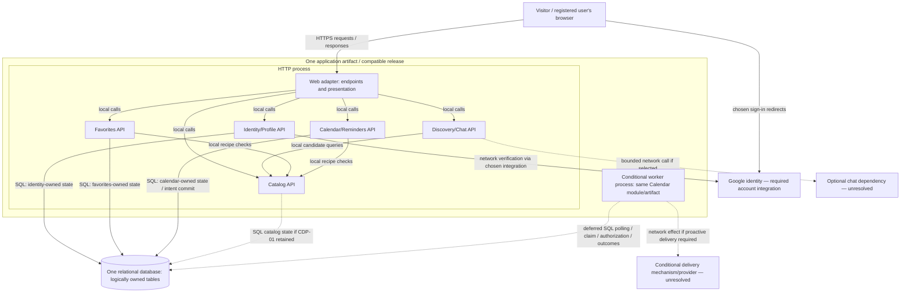

# ADR-001: RecipeCove architectural direction

Status: Proposed

| Record field | Value |
| --- | --- |
| Revision | v1 — first draft, assistant self-reviewed; user document review pending. |
| Client date | 2026-10-29. This is a supplied date, not a measured drafting timestamp. |
| Direction | Option A, explicitly selected by the user in Task 1 discussion entry 18. |
| Acceptance scope | Architectural direction only. This ADR and the proposed policies/integration choices below are not accepted. |

## Context, scope and sources

RecipeCove is a web application for recipe discovery, comprehensive recipe/ingredient information, diet-specific suggestions including a chatbot, and personal profile, favorites and recipe-calendar reminders. Visitors access public discovery; registered users access their own personal records.

This decision record uses only the original inputs and this run's analysis/discussion:

- [RecipeCove requirements](../../../Tasks/data/RecipeCove.txt): original stories 1–14 and descriptive prose. US-01–14 preserve those story numbers; PR-01–04 identify descriptive requirements in the inventory below.
- [Initial requirements analysis](../initial_analysis.md): identifiers, assumptions A-01–03, safeguards S-01/S-02 and questions Q-01–09.
- [Architecture proposals](../architecture_options.md): concrete A/B/C designs, common J1–J6 journey and implementation/failure discussions. Earlier pending-selection statements are historical checkpoints.
- [Task 1 discussion](../task1_discussion.md): actual exchanges, assistant recommendation, then explicit user selection in entry 18. [Task 2 discussion](../task2_discussion.md) records drafting and subsequent review.
- [Task 1](../../../Tasks/Task_1.md), [Task 2](../../../Tasks/Task_2.md) and [Task 3](../../../Tasks/Task_3.md) govern the assignment; the loaded [requirements-to-adr skill](../../../.agents/skills/requirements-to-adr/SKILL.md) governs the workflow, not product requirements.

Scope is application architecture. No framework, database product, hosting vendor, chatbot provider, notification channel or external-calendar integration is selected. Google-account support is explicit scope; an LLM, Google Calendar synchronization, recipe authoring, profile editing and shared calendars are not implied. Implementation, deployment and before/after-run evaluation are outside this draft.

## Decision drivers and authority

| Category | Treatment in this record |
| --- | --- |
| Source requirements | All US-01–14 and PR-01–04 must remain covered; see complete traceability below. |
| Working assumptions | A-01 small team; A-02 modest initial traffic; A-03 limited operations budget. User-supplied provisional comparison assumptions, not measured/source constraints. Team expertise, load, budget amounts and numeric service objectives are unknown. |
| Explicit user decision | Select A as the architectural direction after discussing A/B/C, retaining conditional proactive-reminder processing. This does not accept this ADR or settle product/integration questions. |
| Correctness/security safeguards | S-01 verified identity/sessions and owner authorization; S-02 coherent writes, references, retries and truthful outcomes. Necessary protections, not quoted source mechanisms or optional product policies. |
| Proposed details and policies | CDP-01/CDP-02 and A-PP-01–04 remain pending as specified in their authoritative table in this ADR. |
| Open questions | Q-01–09 remain unresolved; summarized below with architectural impact. |

Supporting rationale: prefer fewer release, communication and persistence contracts while the known requirements can be served through local modules. Keep calendar/event persistence and dispatch-eligibility state in one database, allowing local transactions for each required consistency check. Support public discovery and private features without inventing unrequested integrations. Preserve credible incremental scaling and recovery options.

This rationale is the assistant's synthesis supporting the selected direction, not additional user feedback or evidence of measured cost, delivery speed or architectural quality.

## Selected architectural direction and ownership

Use one modular application codebase and one versioned release artifact, with an HTTP role and a **conditional background-worker role**. Module APIs are local in-process interfaces; they are not separately deployed services. Browser-facing endpoints pass through the web adapter and appropriate authorization. One physical relational database is the starting persistence boundary, with explicit logical table ownership.

| Module / local interface examples | Logical data owner and responsibility |
| --- | --- |
| Identity/Profile — `resolveIdentity`, `requireUser`, `getOwnProfile`, `logout` | Local users, verified external-identity association, sessions and profile. Google is authoritative for its identity assertions; this module owns application identity/session state. |
| Catalog — `searchByName`, `getRecipe`, `getIngredient`, `getDietCandidates` | Recipe/ingredient/relationship/diet metadata access and recipe-reference semantics. Local catalog/read-model placement is CDP-01, still proposed pending sourcing decisions. |
| Discovery/Chat — `suggestForDiet`, `chat` | Diet suggestions and conversational discovery through Catalog. No separate durable chat history is assumed; an external adapter is conditional on Q-03. |
| Favorites — `addOwnFavorite`, `removeOwnFavorite`, `listOwnFavorites` | Owner-scoped favorite entries and relevant command outcomes. Unique membership semantics are CDP-02, still proposed. |
| Calendar/Reminders — `createOwnCalendar`, `deleteOwnCalendar`, `addOwnEvent`, conditional `processDueIntent` | Owned calendars/events and command outcomes; conditional durable reminder intents, reservations and attempt evidence. Owns deletion versus send-authorization coordination. |

Each module writes its owned tables and exposes explicit interfaces for other modules. A shared transaction context can coordinate supported local work through those interfaces. Database constraints can protect established local relationships; they do not establish product rules about retirement, intentional duplicates or erasure. Sharing a database is not permission for arbitrary cross-module writes. Read composition is explicit.

### Deployment and interaction boundaries

Solid arrows identify the labelled interactions. Dotted arrows denote conditional integrations, proposed catalog placement, or deferred worker activity as labelled; they do not mean a broker exists. The worker executes the same Calendar module in another process and accesses Calendar-owned state, not unrelated tables. It can have a different process count from HTTP while remaining part of the same compatible release. Rolling versions require compatible migrations and intent formats.

No queue, separate scheduler, search engine, independent authentication service or independent delivery service is selected. If reminder semantics require proactive work while the user is offline, run the worker and durable-intent path. If a display-only interpretation is explicitly confirmed sufficient, omit that path. Neither interpretation is silently adopted; US-11 still requires the confirmed reminder outcome to be met.

## Complete requirement traceability

Every row refers to the original RecipeCove source; PR identifiers preserve prose coverage. Ownership scope is enforced through S-01.

| Requirement | Actor / access | Responsible module and state or interaction |
| --- | --- | --- |
| US-01 (story 1): register using an existing Google account | Visitor | Identity/Profile; verified external association and local account/session state. |
| US-02 (story 2): search recipe by name | Public | Catalog; recipe-name query and web search. |
| US-03 (story 3): view recipe information | Public | Catalog; recipe details. |
| US-04 (story 4): view ingredient information | Public | Catalog; ingredient details and recipe relationships. |
| US-05 (story 5): suggested recipes for a diet | Public | Discovery/Chat via Catalog candidates; diet criteria Q-02. |
| US-06 (story 6): login | Registered user | Identity/Profile; application session establishment. |
| US-07 (story 7): logout | Session owner | Identity/Profile; application-session termination. No inferred data erasure or Google-wide logout. |
| US-08 (story 8): view profile | Own profile | Identity/Profile; personal information query/page. |
| US-09 (story 9): create calendar | Registered owner | Calendar/Reminders; calendar and owner association. Calendar count Q-07. |
| US-10 (story 10): delete calendar | Own calendar | Calendar/Reminders; deletion/invalidation workflow. Cancellation/retention remain open, not complete-account erasure. |
| US-11 (story 11): add recipe event and be reminded on a specific day | Own calendar/event | Calendar/Reminders plus Catalog reference; event and conditional durable intent/worker. Channel/time Q-05–06. |
| US-12 (story 12): add favorite recipe | Own favorites | Favorites plus Catalog reference. Entry semantics remain CDP-02. |
| US-13 (story 13): remove favorite recipe | Own favorites | Favorites; membership/entry removal. |
| US-14 (story 14): view favorite list | Own favorites | Favorites query composed with Catalog details. |
| PR-01: easy-to-use recipes/food/cooking web application | Browser user | Web adapter and module interfaces. No measurable usability target supplied. |
| PR-02: broad discovery and comprehensive recipe/ingredient information | Public | Catalog and Discovery/Chat; breadth, provenance and freshness Q-01. |
| PR-03: chatbot suggests recipes following a specific diet | Chat caller; exact access Q-03 | Discovery/Chat via Catalog; implementation/provider/history open. Not omitted or reduced to a search bar. |
| PR-04: personal profile, favorites and reminders in an application-created calendar | Registered owner | Identity/Profile, Favorites and Calendar/Reminders compose personal screens; application calendar, no implied synchronization. |

## Transaction, failure and security safeguards

The [Option A walkthrough](../architecture_options.md) supplies the detailed J1–J6 algorithms and C1–C7 boundaries. The architectural contract is:

| Journey segment | Durable boundary and limits |
| --- | --- |
| Find recipe; authenticate if needed | Catalog reads do not save personal state. Google verification is outside local transaction C1, which records necessary account/session state. |
| Add favorite | C2 commits the local favorite effect. The same logical command must not acquire unintended duplicate effects on a lost acknowledgement; exact entry/retry policies remain below. |
| Create/select owned calendar | Selection is a read; C3 commits creation and relevant command outcome. Calendar count is not inferred. |
| Save reminder event | C4 checks current calendar/ownership and commits event plus conditional durable intent together. No scheduler, queue or provider is in the transaction. A favorite saved earlier is not rolled back on event failure. |
| Conditional proactive dispatch | C5 reserves work; C6 authorizes an attempt against the current calendar generation; external X1 occurs outside the transaction; C7 records its outcome. Reservation is not final authorization; provider acceptance is not proof of human receipt. |

S-01 requires verified provider/subject association rather than trusting email/browser identifiers, owner-scoped private reads/writes, protected sessions and browser requests, and constrained worker credentials. Public discovery does not authorize chat access to private profile/favorites/calendar data. Such tools or third-party transfers need an explicit scope/privacy decision. Requests already verified may complete after logout unless a stronger contract is separately established.

S-02 requires authoritative concurrency checks rather than check-then-write races, coherent local references, and safe handling of repeated commands. Keep network calls outside database transactions. A timeout does not prove a write failed: recover authoritative outcomes before claiming rollback or creating a fresh logical command. Historical successful outcomes must not recreate objects subsequently deleted. Proposed keys/receipts and product semantics are distinguished below.

For the discussed cancellation proposal, final authorization C6 locks/checks the same calendar generation used by deletion and validates the current reservation token. A stale lease cannot grant new authorization. An already authorized process may still call the provider; database fencing alone is not provider-side fencing. Calendar validity and attempt acceptance/uncertainty remain separate facts. Logical invalidation can precede physical cleanup, but no indefinite retention or immediate complete erasure is approved.

The worker recovers durable pending work, expired reservations and unresolved authorized attempts. A crash between C6 and X1 can be conservatively uncertain, as can a lost response after external acceptance. Reuse idempotency/status lookup only under a verified provider contract. Otherwise blindly retrying risks duplication and not retrying risks omission. **No exactly-once external delivery, recall, deadline or recovery objective is established.** Changing to a queue/scheduler later requires durable publication intent, idempotent consumption and reconciliation; a database transaction would not cover that handoff either.

## Proposed details and policies — confirmation pending

This table is the current ADR authority for their status; earlier notes document proposal history, not acceptance. Necessary safeguards above do not make their exact user-facing semantics accepted.

| ID | Proposal retained for review | What remains open |
| --- | --- | --- |
| CDP-01 | Local catalog/read-model placement as the starting design detail. | Source, rights, maintenance/freshness and any remote-only requirement. Selection of direction A did not separately confirm this detail. |
| CDP-02 | Unique favorite membership per user/recipe; repeated membership operations return current state. | Intentional duplicate behavior. Uniqueness does not establish ordering of delayed distinct commands. |
| A-PP-01 | Commit-based acknowledgements and read/receipt recovery; distinguish saved event from later active delivery. | Exact response/status UX. Truthful persistence/delivery claims remain mandatory regardless of wording. |
| A-PP-02 | User-scoped operation keys, payload fingerprints and receipts committed with creations; same-key replay returns historical outcome; distinct conflicting commands use local commit order. | Receipt retention/retry window and any stronger client-intent ordering. Reused keys with different payloads must not be silently treated as the same operation. |
| A-PP-03 | Deletion blocks work not yet authorized at C6; already authorized/accepted work can still have an external effect. | Actual cancellation promise, cleanup/erasure/retention and how deletion is explained. The user has not accepted this cutoff policy. |
| A-PP-04 | Bound retries, record uncertainty and reconcile rather than claim success or resend blindly. | Channel/provider contract; late-send/expiry policy; duplicate-versus-omitted-send preference and operational escalation. |

## Open questions and integration impact

| Existing question | Unresolved scope and architectural impact |
| --- | --- |
| Q-01 | Catalog origin/rights/maintenance, volume, freshness and recipe retirement/reference behavior: determines CDP-01 viability and any ingestion/cache/dependency boundary. |
| Q-02 | Supported diets and qualification rules: determines metadata, filtering and common discovery/chat validation. |
| Q-03 | Chat behavior, caller access, history, method/provider and failure/latency expectations: determines persistence, privacy and dependency/resource isolation. |
| Q-04 | Additional sign-in methods/linking, session behavior and profile fields: determines identity and account data contracts. |
| Q-05 | Calendar display versus proactive in-app/email/push/other reminders: activates or removes the worker/adapters; a saved row alone cannot satisfy an offline notification requirement. |
| Q-06 | Specific-day meaning, time/zone, daylight-saving/travel rules and lateness: determines event representation and dispatch interpretation. Do not invent a reminder hour; preserve intended date/time/zone when applicable. |
| Q-07 | Calendar count, deletion scope, retention/erasure and in-flight effects: determines concurrency, cleanup and accepted cancellation policy. |
| Q-08 | Workload, growth, latency/availability/recovery, hosting/residency and team expertise: may change hosting, capacity or boundaries. No numeric threshold is assumed. |
| Q-09 | Duplicate/conflicting commands, dependency failures and uncertain acknowledgements: determines proposed retry/status/recovery policies. |

These choices need resolution when their implementation/contract is undertaken; they are not all blockers to reviewing the architectural direction. No provider contract is inferred from a capability name.

## Alternatives considered and rationale for not selecting them now

All alternatives covered the same source scope, provisional assumptions and journey. The following rationale summarizes this run's analysis; it is not attributed as additional user feedback.

| Alternative | Concrete design and benefits | Reason not chosen as the starting direction; remaining merits |
| --- | --- | --- |
| B — Discovery / Account / Calendar | Three separately versioned services and owned relational databases. Discovery groups catalog/diet/chat; Account groups identity/profile/favorites; Calendar keeps events/intents/delete/worker together. Compatible independent releases and resource scaling are possible. | Adds network/security/API/database lifecycles and observed cross-service references. Its proposed online Account introspection makes Calendar user-request availability depend on Account. No known requirement demonstrates independent release needs sufficient to outweigh that burden under A-01–03. Valuable if those needs become observable. No broker was required merely by the split. |
| C — managed functions/document state | Static web and separately deployed request-function groups; shared logically owned document store with bounded user-partition transactions; conditional recurring trigger → dispatch/recovery function → queue → delivery function. Reduces host/process supervision and offers separate invocation concurrency. | Requires verified platform transaction/query/partition/limit capabilities plus compatible document/message, publication, retry and recovery contracts. Team/platform fit and measured economics are unknown; known scope does not require this topology. Could be preferable with demonstrated platform fit and workload evidence. Managed execution and service decomposition can overlap. |

Neither alternative removes external-send uncertainty. Selecting A does not assert that B/C are universally unsuitable or that A is measured cheapest/fastest.

## Consequences and operating obligations

Positive consequences: local module calls, one coherent event/intent transaction, local deletion/authorization coordination, explicit private-data ownership and fewer independent release/security contracts. HTTP and conditional worker capacity can vary separately without introducing domain-service APIs.

Negative consequences: shared application release and database failure/restore boundary; potential chat/HTTP resource interference; reliance on enforced module discipline; custom due-work/recovery responsibility. Worker concurrency still competes for database connections and locks. Google outages affect new sign-ins; optional chat failure needs containment; delivery failure may leave durable uncertainty. Database failure blocks dependent reads/writes and safe authorization. Worker failure can leave saved events with late pending work.

Operate compatible HTTP/worker migrations, process supervision, secrets/configuration, backups and restore drills, monitoring and dependency limits. Restore must reconcile persisted intents with external effects before dispatch resumes; restoring data alone is not duplicate prevention. Managed hosting/database remains an option, not a vendor selection or removal of these responsibilities. Limit chat/dependency time/concurrency and avoid holding DB transactions during network calls; shared-process exhaustion remains possible.

Observe request errors/latency, DB queries/locks/connections, dependency failures, oldest eligible pending work, expired reservations, uncertain attempts and restore outcomes. Protect personal/session information in logs. Alert thresholds, replica counts, poll cadence, recovery objectives and detailed runbooks depend on the unresolved workload/reminder contracts.

Qualitative cost drivers are runtime/database capacity, backups, logs/monitoring, operations effort and any selected external calls. No cost, performance, implementation-time or reliability advantage has been measured.

## Actionable reconsideration criteria

| Observable evidence or newly confirmed requirement | Limitation revealed | Response to investigate |
| --- | --- | --- |
| Name-search queries dominate measured latency/DB load. | Shared query path no longer fits discovery work. | Examine indexes/query shape and caching, then a maintained search read model with explicit freshness. |
| Chat resource use degrades other HTTP work despite bounds. | Shared execution resources couple unrelated requests. | Tune/isolate a chat execution role; consider limited extraction with preserved ownership APIs. |
| Reminder lateness violates a newly agreed objective despite worker/query tuning. | Current polling/capacity is insufficient. | Examine dedicated worker capacity, hosting, verified scheduling or durable queue handoff with publication/reconciliation safeguards. |
| Independent release/resource needs repeatedly conflict in one application. | Common release boundary is materially restrictive. | Investigate a specific B-style domain extraction, not automatic whole-system migration. |
| Verified platform expertise/fit or measured workload shows an operational/economic advantage for managed execution. | Initial preference for existing process/relational boundaries may no longer fit. | Compare targeted managed hosting/worker changes and C with equivalent guarantees using actual quotas/costs. |
| Confirmed recovery/residency/availability needs exceed current hosting/restore design. | Existing infrastructure arrangements are inadequate. | Evaluate hosting, replication and recovery changes before replacing the application decomposition. |
| Confirmed content or cancellation contract conflicts with CDP-01 or A-PP-03. | A proposed detail cannot meet the required integration/effect semantics. | Reassess data placement or verified provider/protocol guarantees; do not strengthen claims by wording alone. |

No fabricated thresholds or mandatory full migration are prescribed.

## Review and validation status

The assistant reviewed this first draft for requirement coverage, authority/status distinctions, ownership, diagram labels, consistent terminology, unnecessary repetition and unjustified guarantees. This is assistant self-review, not user feedback or ADR acceptance. Review history and actual checks are in [Task 2 discussion](../task2_discussion.md); immutable first-draft copy: [ADR-001-v1.md](../adr_revisions/ADR-001-v1.md).

Relative targets, full identifier coverage, status consistency, byte-equality of the first-draft snapshot and preservation of earlier material are checked separately. No `mmdc`, `node` or `dot` renderer was found on PATH; diagram verification is source inspection only, without parser/render validation. No application tests, performance/cost measurements or provider feature certification were performed. No named product capability is asserted; official documentation verification is deferred until actual product evaluation. Structural checks do not demonstrate behavioral effectiveness or measured architectural quality.

**Next checkpoint:** actual user review of this Proposed document. Direction A is selected; the ADR and explicitly proposed/open items await their respective decisions. No acceptance, additional review round, implementation or run comparison is inferred.
