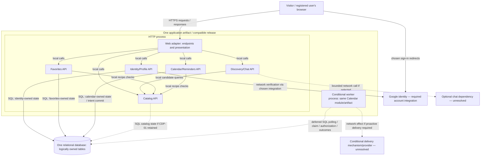

# ADR-001: RecipeCove architectural direction

Status: Proposed

Date: 2026-10-29  
Revision: v2

**Decision:** Option A is the selected architectural direction. This ADR remains under review; the listed product policies and integration choices remain open.

## Context and rationale

RecipeCove provides public recipe/ingredient discovery, diet suggestions and a chatbot, plus registered users' profiles, favorites and recipe-calendar reminders. Sources: [original requirements](../../../Tasks/data/RecipeCove.txt), [requirements inventory](../initial_analysis.md) and this run's [three architectural proposals](../architecture_options.md).

Working assumptions A-01–03 are a small team, modest initial traffic and a limited operations budget. These are provisional comparison assumptions, not source requirements; workload, budget amounts, team expertise and service objectives are unknown.

A keeps local module calls, relational consistency checks and a shared release instead of introducing B's service contracts or C's function/document/queue contracts. The known requirements do not yet demonstrate a need for those additional boundaries. This rationale favors operational simplicity, not a measured cost or performance advantage.

## Architecture and ownership

Use one modular application codebase and versioned artifact, an HTTP role and a **conditional background-worker role**, with one relational database. Modules expose local interfaces and own their tables; they are not separately deployed services.

| Module / local interface | Owned data and responsibility |
| --- | --- |
| Identity/Profile: identity resolution, session checks, own profile, logout | Local users, verified external-identity associations, sessions and profile. Google supplies external identity assertions. |
| Catalog: name search, recipe/ingredient details, diet candidates | Catalog access and recipe-reference semantics. Local recipe/ingredient/diet storage remains proposal CDP-01. |
| Discovery/Chat: diet suggestions and chat | Uses Catalog interfaces; no durable chat history assumed. External implementation/provider remains open. |
| Favorites: add, remove, list own entries | Personal favorites and command outcomes. Unique membership remains proposal CDP-02. |
| Calendar/Reminders: create/delete own calendar, add event, process due intent | Calendars, events, command outcomes and conditional reminder intents/reservations/attempt evidence. Owns deletion versus delivery authorization. |

Other modules use these interfaces rather than writing another owner's tables. A shared transaction context can coordinate local work; database constraints protect agreed relationships without deciding duplicate, retirement or retention policies.

Arrows distinguish local calls, network calls and persistence. Dotted interactions are conditional/proposed or deferred as labelled. The worker runs the same Calendar module/artifact in another process, accessing Calendar-owned state. HTTP and worker counts can vary independently; overlapping releases need compatible migrations and intent formats.

Proactive/offline reminders activate durable intents and the database-polling worker. Omit that path only if a display-only interpretation is confirmed sufficient for the reminder requirement. No separate scheduler, broker or search engine is selected. Framework, hosting, database product, chatbot provider and delivery channel remain open; Google login does not imply Google Calendar synchronization.

## Requirement traceability

US identifiers preserve the original story numbers; PR identifiers cover descriptive prose. Public means visitor-accessible; personal operations require owner authorization.

| Requirement | Actor/access | Responsibility |
| --- | --- | --- |
| US-01: register with existing Google account | Visitor | Identity/Profile: external association and local account. |
| US-02: search recipes by name | Public | Catalog: name query and web search. |
| US-03: view recipe information | Public | Catalog: recipe details. |
| US-04: view ingredient information | Public | Catalog: ingredient details/relationships. |
| US-05: suggested recipes for a diet | Public | Discovery/Chat via Catalog; diet rules open. |
| US-06: login | Registered user | Identity/Profile: application session. |
| US-07: logout | Session owner | Identity/Profile: session termination, not content erasure or Google-wide logout. |
| US-08: view profile | Own profile | Identity/Profile: personal-information page/query. |
| US-09: create calendar | Registered owner | Calendar/Reminders: calendar and ownership. |
| US-10: delete calendar | Own calendar | Calendar/Reminders: deletion; cancellation/retention policy open. |
| US-11: add recipe event and be reminded on a specific day | Own calendar/event | Calendar/Reminders plus Catalog reference; conditional intent/worker. |
| US-12: add favorite recipe | Own favorites | Favorites plus Catalog reference; entry semantics open. |
| US-13: remove favorite recipe | Own favorites | Favorites: remove entry/membership. |
| US-14: view favorites | Own favorites | Favorites query composed with Catalog details. |
| PR-01: easy-to-use recipes/food/cooking web application | Browser user | Web adapter and module interfaces. |
| PR-02: broad discovery and comprehensive recipe/ingredient information | Public | Catalog and Discovery/Chat; provenance/breadth/freshness open. |
| PR-03: chatbot suggests recipes following a specific diet | Caller access open | Discovery/Chat via Catalog; provider/history open. |
| PR-04: profile, favorites and reminders in an application-created calendar | Registered owner | Identity/Profile, Favorites and Calendar/Reminders compose personal screens. |

## Correctness and security safeguards

These protections are necessary design safeguards, not additional source wording or optional product policies:

- **S-01 — identity and privacy:** verify external provider/subject and application sessions; enforce owner scope on private operations; protect browser requests and worker credentials. Chat access does not authorize private-data tools or third-party disclosure. Requests already verified may finish after logout unless a stronger contract is defined.
- **S-02 — coherent writes and recovery:** use authoritative transactional checks, consistent references and safe command replay. A timeout does not establish rollback; recover committed outcomes before issuing a new logical command. Replaying a successful creation must not revive a later-deleted object. Keep network calls outside database transactions.

In the common journey, search is a read; favorite persistence, calendar creation and event creation are separate commits. Event failure does not undo the earlier favorite. [Detailed walkthrough and failure analysis](../architecture_options.md) explain implementation mechanics; the essential reminder boundaries follow.

## Reminder contract

The table describes the architecture supporting the **proposed** cancellation and retry policies A-PP-03/04. Channel, timing, lateness and exact user-visible promises remain open.

| Stage | Persistence / external-effect boundary | Deletion and failure implications |
| --- | --- | --- |
| **Durable event and conditional intent persistence** | One database transaction checks the active owned calendar and commits event, command outcome and, for proactive reminders, durable intent. Confirmation means saved, not delivered. | Event insertion and deletion serialize against the calendar state. A lost response is resolved through committed outcome/read recovery. No external scheduler/provider participates in this transaction. |
| **Work reservation** | A short database transaction grants a worker a temporary lease/token on eligible work. This is not permission to send. | Expired/stale reservations cannot authorize delivery; reclaimed work must undergo final checks. Deletion before authorization blocks eligibility under the proposed cutoff policy. |
| **Final delivery authorization** | A separate transaction checks the current calendar generation, intent eligibility and reservation token, then records attempt authorization. It uses the same calendar header as deletion and ends before any network send. | This is the authoritative deletion race. Under proposed A-PP-03, an attempt authorized first may still execute after deletion. |
| **External acceptance** | The delivery adapter/provider may accept outside every database transaction; the worker records the known result afterward. Acceptance is not proof of human receipt. | Local deletion alone cannot guarantee stopping an authorized attempt or retracting external acceptance; no recall contract is established. |
| **Uncertain outcomes** | A crash after authorization or a lost provider response/result commit can leave an unknown outcome. Keep attempt evidence and reconcile using only verified provider status/idempotency capabilities. | Lease expiry is not permission to blindly resend an uncertain attempt. Repeating may duplicate; withholding may omit. Deletion does not turn unknown acceptance into a confirmed cancellation. |

Calendar validity and attempt outcome are separate facts. Logical invalidation may precede physical cleanup; retention/erasure remains open. The worker recovers pending work, expired reservations and uncertain attempts. No exactly-once delivery, recall or timing guarantee is established. A future queue/scheduler would require durable publication intent and reconciliation across its additional boundary.

## Proposed details and product policies

All items below await confirmation. Safeguards above remain required regardless of the final response wording or product semantics.

| ID | Proposal / unresolved choice |
| --- | --- |
| CDP-01 | Local catalog/read model; source, rights, freshness and any remote-only requirement remain open. |
| CDP-02 | Unique favorite per user/recipe and repeated membership operations returning current state; intentional duplicates and ordering of distinct commands remain open. |
| A-PP-01 | Commit-based responses with read/receipt recovery; exact response/status UX remains open. |
| A-PP-02 | Scoped operation keys, payload matching, atomic creation receipts and local commit-order semantics; retention/retry window and stronger client-intent ordering remain open. |
| A-PP-03 | Cancellation cutoff described in the reminder table; deletion promise, physical cleanup and retention are unaccepted. |
| A-PP-04 | Unknown-outcome/retry handling described in the reminder table; expiry, late-send, duplicate-versus-omitted-send preference and escalation remain open. |

## Open questions affecting implementation

The [inventory](../initial_analysis.md) retains the full question descriptions.

| ID | Choice and architectural impact |
| --- | --- |
| Q-01 | Content source, maintenance, volume, freshness and recipe retirement: catalog placement, references and external dependencies. |
| Q-02 | Supported diets and qualification: metadata and shared suggestion/chat validation. |
| Q-03 | Chat behavior, access, history, provider and failure/latency expectations: privacy, persistence and execution isolation. |
| Q-04 | Sign-in/linking, session behavior and profile fields: identity/data contracts. |
| Q-05 | Reminder display versus proactive delivery/channel: worker and adapter activation. |
| Q-06 | Day/time/zone, daylight-saving/travel and lateness: event representation and dispatch meaning; no arbitrary hour is chosen. |
| Q-07 | Calendar count, deletion scope, retention and in-flight effects: concurrency and cleanup contract. |
| Q-08 | Workload, availability/recovery, hosting/residency and team expertise: capacity and deployment choices. |
| Q-09 | Duplicate/conflicting commands, dependency failure and uncertain acknowledgements: retry/recovery UX. |

No recipe authoring, profile editing, shared calendars, LLM or external-calendar synchronization is implied by the supplied scope.

## Alternatives

| Alternative and benefit | Why not the starting direction |
| --- | --- |
| **B — Discovery, Account, Calendar:** three versioned services with owned relational databases; independent compatible releases and resource scaling. | Adds API/security/database lifecycles and cross-service reference races. Its proposed online Account session checks also couple Calendar request availability to Account. Independent release needs are not established. |
| **C — managed functions/documents:** request-function groups, shared document store with bounded user transactions, and conditional recurring trigger → dispatcher → queue → delivery function. Reduces host supervision. | Adds platform-capability, partition, message/publication and recovery contracts; expertise and economic fit are unknown. No requirement establishes a need for this topology. |

Service decomposition and managed execution can overlap. Both alternatives remain viable under changed drivers, and neither removes external-effect uncertainty.

## Consequences and operations

**Benefits:** local calls and relational coordination, explicit ownership, fewer release/security contracts, and independently adjustable HTTP/worker process counts.

**Costs and risks:** shared release/database failure boundary, possible chat/HTTP resource contention, reliance on module discipline and custom worker recovery. Database failure blocks dependent operations and safe delivery authorization; worker failure can leave saved events pending. Google/chat/delivery outages affect their dependent paths.

The team owns compatible migrations, process supervision, secrets, backups/restore drills, bounded dependency calls and observability. Restore must reconcile intents with external effects before dispatch resumes. Monitor request/dependency errors, database pressure, pending-work age, expired reservations and uncertain attempts without logging secrets. Managed hosting remains an option, not removal of these duties.

Qualitative cost drivers are runtime/database capacity, backups, logs/monitoring, operational effort and external calls. Capacity, alert thresholds, poll cadence and service objectives require workload/reminder decisions.

## Reconsideration criteria

| Observable evidence / confirmed requirement | Limitation | Investigation |
| --- | --- | --- |
| Search dominates measured latency/database load. | Shared query path. | Tune indexes/queries/cache, then consider a maintained search read model with explicit freshness. |
| Chat harms other HTTP work despite limits. | Shared compute. | Isolate execution; consider limited extraction with ownership APIs intact. |
| Reminders violate an agreed lateness objective after tuning. | Polling/capacity insufficient. | Examine worker capacity/hosting, then verified scheduling or queue handoff with publication/recovery safeguards. |
| Independent release/resource needs repeatedly conflict. | Shared release boundary. | Assess a specific B-style extraction rather than full migration. |
| Verified platform fit/expertise or measured economics favor managed execution. | Current execution arrangement may no longer fit. | Compare targeted hosting/worker changes and C with equivalent guarantees. |
| Confirmed recovery/residency/availability needs exceed deployment. | Hosting/restore limitations. | Evaluate hosting, replication and recovery before changing decomposition. |
| Confirmed content/cancellation contract conflicts with CDP-01/A-PP-03. | Proposed detail cannot meet required semantics. | Reassess data placement or verified provider/protocol capabilities; do not strengthen guarantees by wording alone. |

Decision history, review changes and verification: [Task 1 selection](../task1_discussion.md), [Task 2 record](../task2_discussion.md). Revision snapshot: [v2](../adr_revisions/ADR-001-v2.md).
