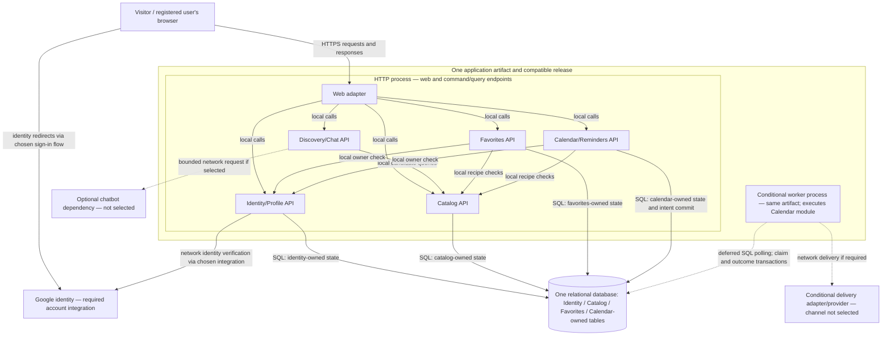
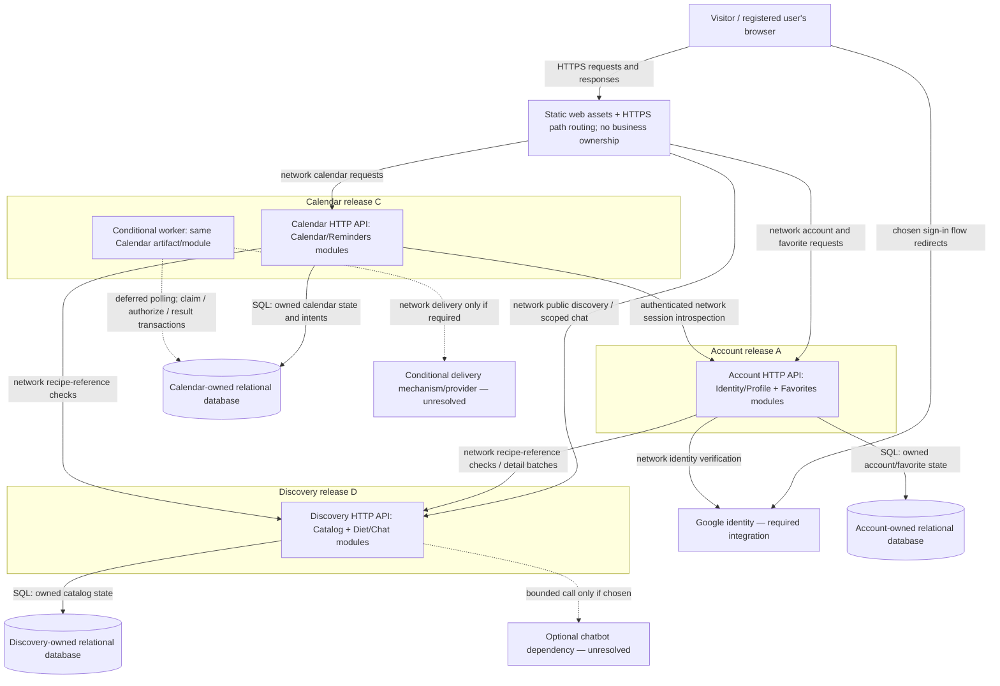
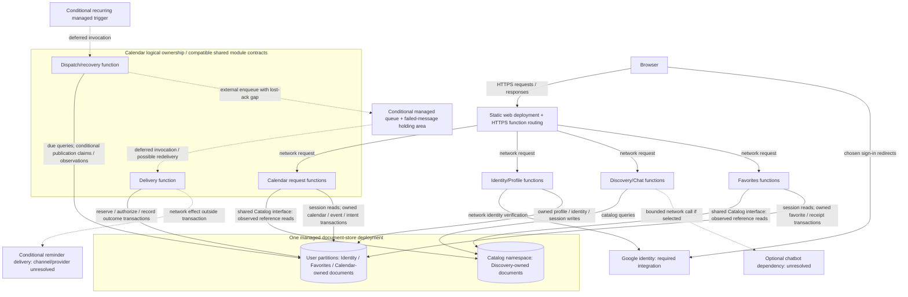

# RecipeCove — three proposals, option A in detail

Status: discussion proposal, not an architectural decision or ADR. Only option A is developed in this exchange. Options B and C require subsequent discussion before selection. No cross-run evaluation is made.

## Basis and common scope

Sources: [RecipeCove](../../Tasks/data/RecipeCove.txt), [Task 1](../../Tasks/Task_1.md), [requirements-to-adr skill](../../.agents/skills/requirements-to-adr/SKILL.md), and this run's [initial analysis](initial_analysis.md). Actual exchanges are summarized in [task1_discussion.md](task1_discussion.md).

All options must cover US-01–14 and PR-01–04, including the diet-aware chatbot. All use the same provisional assumptions A-01–03: a small team, modest initial traffic, and a limited operations budget. These assumptions provide comparison context, not measured workload, staffing, or cost requirements. Q-01–09 from the initial analysis remain open. No recipe source, chatbot provider, notification channel, or calendar synchronization is selected here.

The fixed representative journey is: **find a recipe → authenticate if necessary → add it to favorites → create/select an owned calendar → add a recipe-linked reminder event → observe its saved state and, if active delivery is required, its later delivery outcome**. Other features must also remain covered.

## Three concrete options: overview only

| Dimension | A — modular application with a database-backed worker | B — three independently deployed domain services | C — platform-managed functions and document state |
| --- | --- | --- | --- |
| Deployment/version units | One application release artifact, with an HTTP role and, conditionally, a background-worker role. Internal modules have local interfaces. | Discovery service (catalog, search, diet suggestions, chatbot); Account service (Google identity, profile, favorites); Calendar service (calendars, events, conditional delivery worker). Each is independently versioned. Browser accesses their authenticated HTTP APIs through routing. | Static web assets; separately deployed request/command functions for identity/profile, discovery/chat, favorites, and calendar; conditional due-work and delivery functions. A managed runtime starts execution rather than the team running permanent application servers. |
| Durable ownership | One physical relational database; tables have named logical module owners. | Each service owns its database; no other service directly reads/writes its tables. Recipe/user references cross service boundaries. | Managed document store: catalog documents and per-user records/partitions. Handlers own named document sets; provider identity state is separate. A candidate platform must support the required conditional writes and atomic per-user command updates. |
| Communication and transactions | Local calls inside HTTP/worker processes; relational transactions for supported database changes. Conditional worker polls durable intents in that same database. | Synchronous service APIs plus durable asynchronous handoff when active delivery requires it; local transactions only. Cross-service existence/freshness and failure handling need explicit contracts. | HTTP function invocations and conditional managed scheduler/queue invocations. Per-user transactional writes record event and durable intent; dispatch must reconcile database-to-queue gaps. No transaction is assumed to cover the queue or provider. |
| Scaling and operations | Scale HTTP and worker process counts separately but release the same compatible code; shared database and module coupling remain. Team operates application deployment and worker, with database hosting still open. | Scale and release each domain separately. Team operates several deployments, API compatibility, separate persistence, and inter-service failure diagnosis. | Provider operates execution scheduling; team operates function code, permissions, event contracts, retries, quotas, and reconciliation. Scale follows invocation/event concurrency; database partition limits still matter. |
| Qualitative cost drivers | Runtime capacity, database, backups, logs, and any optional external calls. | Multiple service runtimes/stores, networking, observability, and engineering maintenance. | Invocations, stored/read documents, scheduled/queued work, logs, external calls, and provider limits. |

These proposals differ in release boundaries, communication, state ownership, and operational responsibility. Labels overlap: option A still has two execution roles, option B can use managed hosting, and option C can contain logical modules. No measured cost ordering or overall recommendation follows from this overview. B and C have intentionally not yet received detailed requirement maps, failure walkthroughs, or rejection rationale.

## Option A: deployment and module boundaries

One codebase produces one versioned artifact. Its HTTP process serves the web experience and command/query endpoints. If reminder semantics require work while the user is offline, a second process runs a worker from the same artifact. They share compatible database migrations and release ownership; this worker is not an independently evolving Calendar service. A calendar-display-only interpretation needs no dispatch worker. This is a conditional deployment branch, not an assumption that display alone satisfies US-11.

One relational database is proposed, with local catalog records/read models as the starting data boundary. Content provenance remains Q-01; this does not invent a recipe vendor or an editing/import feature. If the product instead mandates live remote-only content, catalog reads, recipe-reference validity, and dependency failure behavior must be revisited consistently for all proposals.

Five logical modules are enough to give sensitive state and behavior a clear owner without turning every entity into a service:

| Module and interface examples | Authoritative state | Responsibilities and access rules |
| --- | --- | --- |
| Identity/Profile: `resolveIdentity`, `requireUser`, `getOwnProfile`, `logout` | Local users, external identity association, sessions, profile fields selected later. | Map verified external identity to a stable local user; establish/revoke app sessions; expose own profile. External provider remains authoritative for its identity assertions. |
| Catalog: `searchByName`, `getRecipe`, `getIngredient`, `getDietCandidates` | Recipe, ingredient, relationship, and dietary metadata available to the application. | Public catalog reads and candidate lookup; centralize recipe existence/version semantics. Import/authoring mechanisms remain unspecified. |
| Discovery/Chat: `suggestForDiet`, `chat` | No separate durable state initially; session/history retention is Q-03. | Use Catalog APIs and shared diet criteria to suggest recipes. Chat behavior is real scope, but an LLM and external service are not prerequisites. An external adapter is conditional. |
| Favorites: `addOwnFavorite`, `removeOwnFavorite`, `listOwnFavorites` | Favorite membership keyed by user and recipe. | Owner-only membership changes and reads. Obtain recipe information through Catalog rather than writing Catalog tables. |
| Calendar/Reminders: `createOwnCalendar`, `deleteOwnCalendar`, `addOwnEvent`, conditional `processDueIntent` | Calendars, recipe events; if active delivery is needed, durable reminder intents, attempt records and worker reservations. | Own-calendar checks, recipe/date validation, event persistence, and conditional dispatch/recovery. Own command receipts can be committed with events for retry safety. |

The web adapter translates requests and renders responses; it does not bypass these interfaces. Each module writes its own tables. A transaction coordinator may pass a shared transaction context across local interfaces when needed. Physical foreign keys can protect user/recipe/calendar references without granting arbitrary cross-module write access. Read models needed for screens should be exposed explicitly, not built through hidden table access. Business ownership is logical; the database remains one physical deployment and one backup/restore boundary.

### Deployment diagram

Solid arrows identify the labelled calls/reads/writes. Dotted arrows are conditional integrations or deferred work. There is no broker in the base design.

Worker execution uses Calendar/Reminders interfaces; its repeated Calendar code is the same module in another process. Every module's database arrow means access to its owned data, with explicit checks through the other modules' APIs. Arrows into external providers never extend a database transaction. Hosting provider, framework, database product and authentication protocol are not selected by this diagram.

## Complete requirement-to-responsibility traceability for A

| Requirement | Actor/access | Responsible module and persistence/interaction |
| --- | --- | --- |
| US-01 | Visitor registration | Identity/Profile: Google integration; local external-identity association and account. |
| US-02 | Public | Catalog: recipe-name query; web search interface. |
| US-03 | Public | Catalog: recipe details and ingredient references. |
| US-04 | Public | Catalog: ingredient details. |
| US-05 | Public | Discovery/Chat: diet suggestions from Catalog metadata; diet semantics Q-02. |
| US-06 | Registered user | Identity/Profile: login and application session. |
| US-07 | Session owner | Identity/Profile: revoke application session; does not erase content or imply logout from Google. |
| US-08 | Own profile | Identity/Profile: authorized profile query and web page. |
| US-09 | Own calendar | Calendar/Reminders: calendar creation and ownership. |
| US-10 | Own calendar | Calendar/Reminders: deletion workflow; retention/cancellation semantics remain Q-07. |
| US-11 | Own calendar and event | Calendar/Reminders plus Catalog recipe reference: save event; conditionally save/process durable reminder intent. Q-05–06 govern reminder interpretation. |
| US-12 | Own favorites | Favorites plus Catalog validity check: persist membership. |
| US-13 | Own favorites | Favorites: remove membership. |
| US-14 | Own favorites | Favorites query plus public Catalog details for display. |
| PR-01 | Browser user | Web adapter and all module APIs: usable web experience. No measured usability claim. |
| PR-02 | Public discovery/information | Catalog data model and Discovery/Chat queries; provenance and breadth remain Q-01. |
| PR-03 | Chat caller; exact access Q-03 | Discovery/Chat: conversational diet suggestions using Catalog; optional external adapter; no history persistence silently introduced. |
| PR-04 | Registered owner | Identity/Profile, Favorites and Calendar/Reminders compose personal screens; calendar is application-owned. No Google Calendar integration implied. |

## Common journey, concretely executed in A

Commits below are separate durable database transactions, not one transaction covering the whole journey. Reads and network calls are synchronous unless explicitly marked deferred. Proposed acknowledgement and retry policies are identified later; they are not accepted product requirements.

| Step | Execution and durable boundary | What the user can rely on; failure behavior |
| --- | --- | --- |
| J1. Find a recipe | Browser → HTTP → Catalog synchronous name search/detail query. A chatbot-assisted discovery path uses Discovery/Chat → Catalog; optional remote chat call is outside any database transaction. No business-state commit. | A result means matching catalog information was read, not that anything was saved. Query failure reports unavailable/retryable search; a chatbot timeout must not fabricate a successful suggestion. |
| J2. Authenticate if needed | Chosen Google sign-in flow → verified identity → Identity/Profile. **C1:** account/identity association if new, plus local session state. Network verification precedes the local transaction. | Session becomes usable after C1. A uniqueness constraint on the verified external identity prevents concurrent callbacks creating multiple local accounts. Failure before commit creates no confirmed session; lost response can require sign-in again, while identity resolution still finds the existing account. |
| J3. Add favorite | Browser → Favorites synchronously; verify current user, validate recipe through Catalog; **C2:** insert membership under unique `(user_id, recipe_id)`. | Proposed response acknowledges favorite persistence only after C2. Retrying an add returns the current membership rather than creating a second copy. If C2 commits but the response is lost, a list/read or repeat add resolves the uncertainty. |
| J4. Create/select calendar | Read owned calendars; if a new one is needed, browser → Calendar synchronously. **C3:** create calendar with owner and a command receipt in the same transaction. Calendar count remains Q-07. | Existing-calendar selection is a read; C3 confirms a new calendar exists. Reusing the same user-scoped command key/payload recovers its ID after a lost response. No rule limiting the user to one calendar is introduced. |
| J5. Add reminder event | Browser → Calendar synchronously. Validate owner, recipe and date semantics. Lock/check the calendar's active generation in the transaction. **C4:** event + command receipt +, if active delivery is required, its durable intent are committed atomically. Due-time fields require resolution of Q-06. | Proposed response says “event saved”; for active delivery it can separately report “delivery pending.” It cannot say “notification delivered.” If calendar deletion commits first, event creation fails visibly. A retry with the same key/payload returns the stored outcome rather than a second event. |
| J6. Process due intent, conditional | Deferred worker polls the same DB. **C5:** reserve eligible work with a lease/token. **C6:** after a fresh authoritative calendar-generation check, commit authorization and attempt identity. Release transaction locks before any network call. **X1:** invoke the selected delivery adapter. **C7:** persist known result or uncertainty. C5/C6/C7 are separate commits; X1 is external. | A worker outage leaves persisted work pending. An external acceptance is only acceptance by that dependency, not proof the person saw the reminder. A lost X1 response may leave outcome unknown. Retry and uncertainty rules below apply. |

The favorite and event are separate user actions and commits. If J5 fails, the favorite remains saved. The source does not require all-or-nothing behavior across them, and the UI must not describe the whole journey as a single atomic success. Scheduling also requires a valid recipe and owned calendar independently of whether the favorite still exists.

## Difficult implementation issues and safeguards

**Identity is not authorization (S-01).** A verified Google identity resolves to a local user; use the verified provider/subject association rather than treating an unverified email as an account key. Every private read/write checks that local owner. Never trust a browser-supplied `user_id`, calendar identifier, or chat tool argument as proof of access. Authenticate the request, scope queries to the owner, and avoid revealing another user's records through error details. Session expiry/revocation and browser request protections must be enforced by the web/identity boundary. The worker uses restricted execution credentials and recorded owner/calendar relationships, not a user's reusable sign-in token.

**Concurrent changes and retries (S-02).** Database uniqueness and ownership constraints complement application checks. Event insertion and calendar deletion serialize through the same calendar row/generation check; a check performed before the transaction is insufficient. A favorite's recipe check and any allowed catalog retirement must have coherent reference rules. Physical reference constraints help for local records; behavior for retired recipes remains a product/data choice under Q-01. Do not silently cascade from recipe removal into private history.

Membership-style add/remove commands can be made idempotent as a proposed policy. Creation commands need user-scoped operation keys, request fingerprints, and receipts committed with the created object. Reusing a key with a different payload is rejected; receipts require a documented retention/retry window, still pending. Distinct keys may mean intentionally distinct events. Idempotency for duplicate delivery of one command does not determine the ordering of a later add versus a later remove; the proposal uses database commit order, with clients refreshing authoritative state. No exactly-once claim follows.

**Time semantics (Q-06).** “Specific day” must remain a calendar date until the product decides whether a clock time is required. If active timed reminders are selected, retain the intended date/time, named time zone and interpretation policy, then derive a dispatch instant. A UTC instant alone loses the user's original meaning. Daylight-saving gaps/overlaps, changes of zone, late dispatch and rescheduling after rule changes need explicit policy. No arbitrary reminder hour or client-local zone is chosen here.

**Slow dependencies and shared failure (Q-01–03).** Ordinary search should use the proposed local Catalog view. Discovery/Chat invokes it through a public interface and, if an external chatbot is chosen, uses bounded request time, concurrency and retries. Avoid holding database transactions while calling Google, chat or a delivery provider. Catalog data and diet criteria should constrain suggestions; model output alone, if a model is chosen, cannot establish recipe existence or compliance. Detailed matching/fallback behavior remains unapproved. A remote chat failure can be contained at its request boundary, but CPU/memory exhaustion in the shared HTTP process can still affect all endpoints. Rate limits and query indexes help containment; process separation is a response to evidence, not an assumed requirement.

**Private data in chat.** Public recipe lookup does not authorize reading profile, favorites, or calendars. If later chat behavior uses private data, server-side tools must apply the same owner checks and send only data allowed by a confirmed integration/privacy choice. Persistent chat history and sending personal data to a third party are not implicit parts of PR-03.

## Conditional reminder dispatch: the demonstrated external boundary

This section applies only if Q-05 requires active background delivery. If a purely application-calendar interpretation is accepted, there is no external-send gap to solve. Conversely, offline notifications require an actual mechanism; a saved database row alone does not satisfy that stronger interpretation.

The base design does not publish a queue message alongside the event. C4 stores the event and durable dispatch intent in the same database transaction, and the worker polls those rows. This avoids an event-to-queue dual write. A database transaction still cannot include X1. Lease expiry, bounded retries and reconciliation are necessary; a database intent is not an end-to-end delivery guarantee.

Proposed policy **A-PP-03**, pending confirmation: deletion prevents authorization of work that has not yet passed C6. An attempt authorized before deletion may still be accepted externally after deletion. Neither logical deletion nor a later local “cancelled” flag can recall external acceptance. If the product needs a stronger guarantee, a different provider contract/protocol must be investigated and verified; holding a database lock during a network request does not establish recall.

The authoritative race check is **C6**, not reservation C5: lock/check the same calendar row/generation used by deletion, check the reservation token, and record attempt authorization atomically. Whichever transaction commits first determines whether this attempt may proceed. A stale reservation cannot authorize a send. Local fencing does not prevent duplicate external effects from an already authorized process unless the external contract also honors appropriate keys/fencing.

| Attempt state | Meaning and recovery | Effect of calendar deletion under proposed A-PP-03 |
| --- | --- | --- |
| Pending | Durable intent exists; no reservation. | Invalidate eligibility; no new authorization. |
| Reserved (C5) | Worker temporarily claims work; not permission to send. Expired leases can be reclaimed with a new token. | Generation check at C6 blocks sending if deletion won. |
| Authorized (C6) | Current generation validated; stable attempt identity recorded. External request may or may not have started. | Deletion cannot guarantee prevention of this attempt. |
| Accepted | Provider acknowledged X1; C7 records that acknowledgement. Not equivalent to receipt by the user. | Do not pretend external effect was undone. |
| Unknown / known failure | Request outcome uncertain, or known not accepted. Record evidence. Reconcile uncertainty; retry only as the external contract and confirmed policy permit. | Block fresh authorization for invalidated calendar; preserve minimal attempt evidence until cleanup policy is resolved. |

Calendar validity and attempt outcome are separate facts. Do not replace “accepted” with “cancelled” and lose the truth about an external effect. Deletion can logically invalidate a calendar and suppress new authorization before physical cleanup; retention/erasure timing is still Q-07, not permission to retain personal data indefinitely. The deletion response must eventually describe the confirmed policy rather than claiming recall or immediate complete erasure.

The worker periodically scans overdue pending work and expired reservations and examines authorized attempts without a terminal outcome. A crash between C6 and X1 is conservatively uncertain, as is a crash after X1 acceptance before C7. If the provider supports a verified idempotency contract or status lookup, recovery can use the same logical delivery key or query it. Without that contract, blindly resending can duplicate reminders, while refusing to resend can miss one. The preferred behavior and how to expose this uncertainty are unresolved (A-PP-04). Record status can support an operator/support view; a new public delivery-status screen is not a source requirement.

## Proposed policies, separate from requirements

| ID | Proposal for discussion | Authority/status |
| --- | --- | --- |
| A-PP-01 | Acknowledge favorites/calendar/events only after their local commit; a saved event is independent of later active delivery. Recover lost acknowledgements through reads/receipts. | Proposed user-visible success/retry contract; not accepted. |
| A-PP-02 | Treat repeated membership operations as current-state operations; use scoped command receipts for creation; use database commit order for conflicting commands. Receipt-retention window remains open. | Proposed duplicate/concurrency semantics, supporting S-02; not source wording or acceptance. |
| A-PP-03 | Calendar deletion blocks dispatch not yet authorized at C6; already authorized/accepted external work can still take effect. Cleanup/retention needs a separate decision. | Proposed cancellation contract; not accepted. |
| A-PP-04 | Bound retries, record uncertain external outcomes, and reconcile rather than claiming success or blindly resending. Exact expiry, late-send and duplicate-risk policy awaits channel/provider choice. | Proposed operational/product behavior; not accepted. |

The mechanisms above explain how A could implement these policies. They do not settle Q-01–09, diet semantics, chatbot access/history, calendar count, reminder channel, external providers, retention, or exact timing.

## Failure and operational consequences

| Failure | Visible behavior / durable state | Operational response and limitation |
| --- | --- | --- |
| HTTP process crashes before a write commits | No confirmed local change; browser receives failure or timeout. | Restart and retry/read using operation semantics. Never infer commit from a timeout. |
| Commit succeeds but response is lost | Favorite/event may exist even though browser has no acknowledgement. | Resolve through scoped receipts or current-state reads; avoid duplicate creations. |
| Database unavailable | Catalog and personal operations relying on it fail; worker cannot safely authorize work. | Shared failure boundary. Restore service; recovery objectives and redundancy are Q-08. |
| Worker unavailable | HTTP can still save events/intents if DB is healthy; active reminders become late. | Monitor oldest eligible pending work and expired leases; resume polling and apply the still-open late-delivery policy. |
| Google unavailable | New registrations/logins needing verification fail. | Existing valid local sessions need not require Google on every request; expiry/revocation policy is still needed. |
| Chat dependency slow/unavailable | Chat request fails or reports limited availability; ordinary Catalog routes should remain usable if resources are contained. | Track request saturation; bounded time/concurrency and verified safe retry policy. Shared-process exhaustion remains a risk. |
| Delivery call uncertain | Event remains saved; external outcome is unknown rather than guaranteed sent/unsent. | Record, reconcile, and use only provider-supported idempotency/status guarantees. |
| Backup restore reintroduces previously processed intents | Restored local state may disagree with external acceptance. | Recovery must reconcile attempt identities and validity before dispatch resumes; backup restoration alone does not prevent duplicates. |

For a small team, A concentrates release and diagnostic knowledge in one codebase and one database. HTTP and worker roles still require process supervision, configuration/secrets, database migrations, backups, restore drills, logs, dependency monitoring, and worker recovery procedures. Managed database/hosting is an optional operations choice, not a selected provider or elimination of these duties.

Monitor request errors/latency, database lock/query pressure, Google/chat dependency failures, pending-work age, expired reservations, uncertain attempts, and restore outcomes. Do not invent alert thresholds before reminder lateness and service objectives are agreed. Keep sensitive fields out of logs.

Compatible migrations are needed while old/new processes overlap. Old workers must understand any intents they may claim during deployment, or be drained before incompatible changes. Avoid locks or migrations that block the whole database unnecessarily. Scale HTTP replicas and worker concurrency independently under the same compatible release, but both still compete for database connections and shared state. The initial A design deliberately avoids a separate search engine and broker; source requirements have not demonstrated a need for them.

### Benefits, costs and evidence for change

Benefits include local module calls, one coherent relational transaction for an event plus its intent, shared identity and ownership checks, and fewer independently versioned APIs. These can reduce coordination work under A-01–03, but no completion-time or monetary advantage has been measured.

Costs include shared release cadence, dependence on module discipline, a common database failure/restore boundary, possible chat/HTTP resource coupling, and custom responsibility for due-work processing. A worker adds genuine operational work even though it shares the artifact. Relational storage does not remove external-call uncertainty or product-policy decisions.

| Observable evidence or new requirement | Limitation exposed | Response to investigate |
| --- | --- | --- |
| Name-search queries dominate measured latency or database work. | Shared query/storage path may no longer suit search. | First examine indexes/query shape and caching; then consider a maintained search read model with freshness semantics. |
| Measured chatbot resource use degrades ordinary HTTP requests despite bounds. | Shared execution resources couple unrelated requests. | Isolate chat execution in another role, or evaluate limited extraction; preserve ownership APIs. |
| Reminder lateness violates a newly agreed objective despite worker/query tuning. | Polling or shared-resource contention is insufficient. | Investigate dedicated worker capacity, managed scheduling, or a durable queue; adding a queue requires closing/reconciling its publication gap. |
| Confirmed independent release/scale needs repeatedly conflict in one application. | Single release ownership becomes a constraint. | Examine a specific domain extraction using option B's later analysis, rather than assuming a full migration. |
| Confirmed recovery, residency or runtime-management needs exceed the current deployment. | Existing hosting/backup arrangement is inadequate. | Evaluate hosting/replication/recovery changes and relevant platform options before changing the whole application design. |

No option is selected or ranked overall. Next: actual questions/feedback on A, followed by detailed B and C discussions using the same journey and scope. ADR drafting remains deferred.

## Validation boundary

The discussion contains no concrete vendor feature/pricing claim or selected illustrative product stack requiring external documentation. It proposes application mechanisms and records their limits; official documentation must be checked when evaluating a named product/integration contract.

No `mmdc`, `node`, or `dot` executable was found on PATH during this phase. The Mermaid diagram is source-inspected only; no rendered layout or parser validation is claimed. Link targets, requirement identifiers and preservation hashes are checked separately in the discussion record. No implementation, behavioral test, performance measurement or cost benchmark was performed.

---

## Option B — appended detailed discussion

Current status: A above is preserved as the record of its earlier discussion. This appended section develops B; earlier statements that B was still pending describe that earlier checkpoint. C remains an overview awaiting its own exchange. No architecture, ADR, or proposed product policy has been accepted.

### Scope and authority carried forward

B implements the same US-01–14 and PR-01–04 from [RecipeCove](../../Tasks/data/RecipeCove.txt), the same J1–J6 journey, and A-01–03 provisional assumptions. Source requirements and Q-01–09 remain those in [initial_analysis.md](initial_analysis.md). No new workload figures, team skills, availability objectives, budget amounts, provider choices, or timing guarantees are introduced.

Two shared design proposals deserve explicit authority labels, including when reading A:

| ID | Proposal carried into A and B | Authority and limits |
| --- | --- | --- |
| CDP-01 | Store a local recipe/ingredient catalog or read model, rather than making every discovery request depend on a remote recipe source. | Architectural data-placement proposal, not a source requirement or user acceptance. Content provenance, rights, maintenance and freshness remain Q-01. A remote-only requirement would require revisiting both proposals. |
| CDP-02 | Model favorites as unique membership per `(local_user_id, recipe_id)`, with repeated adds/removes returning current membership rather than creating duplicate entries. | Proposed storage model and product semantics, not required wording of US-12–14 or an accepted policy. It supports one possible retry contract; command idempotency and intentional duplicate behavior are distinct decisions. |

The user asked to retain this distinction; asking for the B discussion is not acceptance of CDP-01, CDP-02, A-PP-01–04, or their B counterparts below. Correct authorization, coherent state transitions and truthful outcomes remain S-01/S-02 safeguards; their exact implementation and user-visible policies are proposals.

### Why these three service boundaries

| Independently versioned service | Internal modules, authoritative data and API examples | Boundary rationale and cost |
| --- | --- | --- |
| **Discovery** | Catalog and diet-discovery/chat modules; recipe, ingredient, relationship and dietary metadata under CDP-01. APIs: `searchByName`, `getRecipe`, `getIngredient`, `suggestForDiet`, `chat`, `getRecipeRefs(ids)`. No chat-history storage is assumed. | Keeps public discovery, candidate metadata and diet/chat logic together, avoiding a remote recipe-service call inside every suggestion. Search/chat resources can be changed without releasing personal-data services. Chat and ordinary search still share Discovery resources and release cadence. |
| **Account** | Identity/Profile and Favorites modules; local users, verified external-identity association, sessions, profile fields, favorite memberships/command receipts. APIs: `login`, `logout`, `getOwnProfile`, `addOwnFavorite`, `removeOwnFavorite`, `listOwnFavorites`, internal `introspectSession`. | Favorites are an owner-specific collection closely tied to the local account and privacy checks; combining them avoids a fourth service and distributed user/favorite writes. This grouping is a design judgment, not an independently confirmed business boundary. Session verification and favorites now share a failure/release boundary. |
| **Calendar** | Calendar/Reminders modules; owned calendars, recipe-linked events, command receipts, and conditional reminder intents/reservations/attempt evidence. APIs: `createOwnCalendar`, `getOwnCalendar`, `addOwnEvent`, `deleteOwnCalendar`, owner-scoped operation lookup. Conditional worker uses internal claim/authorize/result interfaces. | Calendar validity, event insertion, cancellation authorization and recovery belong together because they must coordinate against the same authoritative state. Calendar API and worker are roles of this one service, not two independent domain services. This avoids distributing the deletion/send race merely to create another deployment. |

This is a concrete decomposition to evaluate, not evidence that the assumed small team needs services. Three services introduce real network contracts and operating obligations. A single repository is possible; independent deployments do not require separate repositories or three teams.

Each service owns a **distinct logical relational database**, its credentials, schema and migrations. No service reads another service's tables, even for reporting or authorization. Account owns the local user identifier; Calendar stores that stable identifier as an external owner reference, not a cross-database foreign key. Discovery owns recipe identifiers and their meaning; Account/Calendar store references and any explicitly approved limited display snapshots, not authoritative catalog copies.

Separate logical databases do not establish separate physical fault domains. Hosting all three on one physical database host is an optional placement decision that shares capacity and outages; separate hosts permit stronger isolation but add operations and cost drivers. The reference diagram leaves that physical placement open. Independent restore capability must be verified for the eventual hosting arrangement; it cannot be inferred from three database names.

### What independence actually means

| Change or scaling action | Can be independent when… | Still coupled to… |
| --- | --- | --- |
| Change Discovery search/ranking, catalog indexes or an optional chatbot adapter. | Recipe IDs, API fields, diet semantics expected by clients and reference-check contracts stay compatible. | Its own database migrations; search/chat resource contention; callers' expectations. Breaking identifier/diet changes need coordinated migration. |
| Scale Discovery HTTP replicas. | Replicas use compatible code and shared Discovery-owned state. | Discovery database and any external quotas; more replicas do not automatically increase data/provider capacity. |
| Change Account profile/favorites implementation or scale its replicas. | Session-introspection and public API contracts remain compatible; CDP-02 is not silently changed. | Account database; login and Calendar introspection load; Google integration for new sign-ins. |
| Change Calendar scheduling/recovery or scale HTTP and worker roles separately. | Calendar schema/intent formats remain compatible across overlapping Calendar versions. | Its own DB, online identity checks on user requests, reference validation for new events, and conditional delivery contract. Scaling workers alone does not remove database or provider limits. |
| Release the browser UI or routing configuration. | Deployed service APIs remain compatible with old/new browser versions. | Cross-service screens, authentication routing and cache/session handling. It is not a fourth business service. |
| Change a shared API or security contract incompatibly. | Consumers are migrated using compatible versions/fields and a staged rollout. | Multiple releases; service separation does not permit unilateral breaking changes. A shared library must not force every service to release together for every change. |

Discovery can be restarted without restarting Account or Calendar. Nevertheless, new favorite/event commands can depend on Discovery validation. Calendar owns its data but, in the explicit authentication proposal below, cannot accept user commands when Account verification is unavailable. Deployment independence, resource independence and request availability are different properties.

### Deployment and communication diagram

Each service subgraph is a separate release/version boundary. Calendar's HTTP and worker roles use the same Calendar artifact and owned persistence. The router serves static web assets and routes paths; it does not become the authority for personal-data access.

Calls between modules inside one service are local. Every drawn inter-service arrow is a network boundary, not an extension of a database transaction. No reverse Discovery-to-Account call is required for public catalog discovery. If chat later uses private favorites/calendar context, it requires an additional scoped, authenticated contract and explicit privacy choice; that integration is not already granted by PR-03.

### Cross-service authentication and authorization

**Concrete B design proposal B-DP-01:** Account verifies the chosen Google sign-in flow, maps the verified external provider/subject to a stable local user, and owns an opaque application session. For a Calendar user request, Calendar obtains the presented application session through the chosen secure browser routing arrangement, authenticates itself to Account, and requests **online session introspection without a validity cache in this starting design**. Account returns only the needed verified user/session state. Account is not asked whether the user owns a particular calendar: that fact belongs to Calendar.

No Google access token, unverified email, browser `user_id`, or forwarded unsigned user header is accepted as authorization. Router-facing/browser session protections and authenticated encrypted inter-service communication are safeguards; exact protocol/library/hosting choices remain open. Internal introspection is restricted to authenticated callers. Service identity establishes which workload is calling, while user context establishes on whose behalf it may act; neither substitutes for Calendar's owner checks. Public Discovery queries need no account session. Account enforces ownership locally for profile/favorites.

B-DP-01 is an architecture-specific proposal, not a source requirement or a user-selected identity integration. It avoids silently claiming immediate revocation with cached tokens, at the price of Account latency/availability on Calendar user requests. Calendar rejects or reports temporary unavailability when introspection cannot establish identity; it must not treat an Account timeout as authenticated success. Shared authentication middleware or a gateway cannot remove this dependency merely by hiding it.

Logout commits session revocation in Account. Introspection started after that commit must see the revoked state through the authoritative read contract; an arbitrarily lagging replica is insufficient for that contract. A Calendar request already validated before logout may still commit: the introspection and Calendar write are not one transaction. If the product requires stronger in-flight cancellation or global account disabling/erasure, that is a new explicit contract to analyze, not a consequence already guaranteed by login/logout stories. Offline-verifiable scoped tokens could reduce the online dependency, but would require a confirmed expiry/revocation policy and key-rotation handling; they are an alternative, not also part of this starting design.

The Calendar worker authenticates as a restricted workload and processes previously persisted, valid reminder intents. It does not require the user to remain logged in or reuse a browser token at dispatch. Whether account suspension/erasure must invalidate Calendar work is unresolved and not the same operation as deleting a Calendar or logging out. If a chosen delivery channel needs contact details, Account owns those personal fields; a minimal authorized payload/reference and refresh/erasure contract must be defined. Email addresses or push tokens are not silently copied into Calendar by this design.

### Requirement coverage and persistence ownership for B

| Requirement | Actor/access | Service responsibility and boundary |
| --- | --- | --- |
| US-01 | Visitor | Account: Google registration, verified identity association and local account transaction. |
| US-02 | Public | Discovery: recipe-name search; proposed local catalog under CDP-01. |
| US-03 | Public | Discovery: recipe information. |
| US-04 | Public | Discovery: ingredient information and recipe relationships. |
| US-05 | Public | Discovery: diet suggestions using the same candidate metadata as chat; diet meaning remains Q-02. |
| US-06 | Registered user | Account: login and local application session. |
| US-07 | Session owner | Account: logout/revocation; Calendar checks sessions through B-DP-01. In-flight request caveat remains. |
| US-08 | Own profile | Account: profile page/query, owner scoped. |
| US-09 | Own calendar | Calendar: create/own calendar; authenticate user via Account. |
| US-10 | Own calendar | Calendar: authoritative deletion/invalidation, dispatch coordination and pending retention semantics. |
| US-11 | Own calendar/event | Calendar: event and conditional intent commit; Discovery recipe validation across a network boundary. Channel and time semantics remain Q-05–06. |
| US-12 | Own favorites | Account: membership write under proposed CDP-02; Discovery recipe validation across a network boundary. |
| US-13 | Own favorites | Account: remove membership without needing Discovery availability. |
| US-14 | Own favorites | Account: authoritative memberships; public Discovery details composed via batch query. Partial-display semantics remain a proposal. |
| PR-01 | Browser user | Web assets and the three APIs compose usable screens; routing does not own business state. |
| PR-02 | Public | Discovery: catalog information and discovery breadth; sourcing remains Q-01. |
| PR-03 | Chat caller; access Q-03 | Discovery: conversational diet suggestions; no provider/history/private-data integration assumed. |
| PR-04 | Registered owner | Browser composes Account profile/favorites and Calendar-owned calendar. Cross-service screens have independent results, not one database snapshot. |

### Transactions, recipe references and partial reads

Account may atomically update its user/favorite/receipt records. Calendar may atomically update its calendar/event/intent/receipt records. Discovery owns its catalog transactions. **None** includes another service's database, an HTTP response, the router, or an external provider.

For a new favorite/event, the owning service makes a bounded synchronous Discovery call **before** opening its short local write transaction. Proposed validation contract: return stable recipe ID, observed availability/version and necessary reference data. A successful read is evidence of availability at that read, not a reservation or foreign key valid at the later commit. Discovery may change after checking. A cannot simply transfer its cross-module relational foreign-key protection to B's separate databases.

**Proposed B-PP-05, pending:** creation validates an observed recipe reference; later unavailability is handled as an explicit unavailable reference rather than silently deleting personal data. Whether approved snapshots may be shown, and whether retired recipes can still be scheduled, remains Q-01/product policy. There is no source requirement for recipe retirement or strict cross-service referential atomicity. If strict current-at-commit validity is later required, investigate a reservation/version protocol with its own expiry/recovery semantics, a revised ownership boundary, or a stronger coordinated design. Rechecking via HTTP does not eliminate the race. No distributed transaction coordinator is introduced preemptively.

If Discovery is unavailable, this starting proposal reports the new favorite/event command unavailable **before its local write** rather than accepting an unvalidated recipe. Existing favorite membership reads/removals and existing calendar reads/deletion can proceed if their own databases and required authentication are healthy. For composed favorites screens, Account can batch requested recipe details after reading memberships; a failed detail query need not erase the membership list. Showing IDs/placeholders/previously approved snapshots with a clear unavailable-detail state is proposed B-PP-06, not an accepted UI requirement. Batch reads reduce needless per-item calls; no replicated catalog or cache-invalidation infrastructure is assumed.

### Same representative journey: J1–J6 in B

Commit labels B-C1–B-C7 correspond to A's C1–C7 meanings, with explicit service ownership. Synchronous steps return only after their own result; J6 is deferred and conditional.

| Step | Calls and durable boundary | Success, failure and lost acknowledgement |
| --- | --- | --- |
| **J1 — find recipe** | Browser → routing → Discovery synchronously; name search/details or optional diet/chat path. Discovery reads its DB. No business-state commit. | Discovery failure makes discovery unavailable even when personal services are running. A remote chat failure should not fabricate recipes; search/chat still share Discovery resources. |
| **J2 — authenticate if needed** | Browser/Account/Google chosen sign-in flow. **B-C1, Account DB:** new identity association/account if needed and local session state after verification. | No Calendar user row is also created. Concurrent callbacks resolve the same verified identity association. If the response is lost, the account may exist; repeating sign-in must resolve it rather than create duplicates. |
| **J3 — add favorite** | Browser → Account; local session check; Account → Discovery reference query; then **B-C2, Account DB:** proposed unique membership plus any needed operation outcome. | Acknowledgement means membership saved. No Calendar change. Discovery timeout before write means this attempt has not inserted it; a browser timeout after routing does not establish whether B-C2 happened. Query/retry via the same operation semantics resolves uncertainty. |
| **J4 — create/select own calendar** | Browser → Calendar; Calendar → Account introspection. Select owned calendar, or **B-C3, Calendar DB:** create it and store scoped command receipt. | A healthy Calendar still reports unavailable if identity cannot be established. Lost response after B-C3 requires same-key retry/owner-scoped lookup, not creating another calendar with a new key. |
| **J5 — save reminder event** | Calendar authenticates user via Account, validates recipe via Discovery outside its local transaction, then locks/checks its own active calendar generation. **B-C4, Calendar DB:** event + scoped command receipt + conditional durable reminder intent. | Acknowledgement means event saved, not externally delivered; reference freshness has the B-PP-05 limitation. Calendar deletion first means rejection. A lost browser/router response leaves an unknown command result until receipt/read recovery. Favorite B-C2 remains saved on J5 failure. |
| **J6 — conditional active dispatch** | Deferred Calendar worker polls Calendar DB. **B-C5:** reserve with lease/token. **B-C6:** authoritative same-DB calendar-generation check and attempt authorization. **B-X1:** invoke selected delivery mechanism outside DB transaction. **B-C7:** record result/uncertainty. | Account/Discovery are not in the dispatch authorization path for already self-contained intents. A selected channel that needs runtime contact lookup would add a documented dependency. Delivery acceptance is distinct from human receipt; ambiguous external outcomes remain reconcilable only within the provider contract. |

There is no transaction spanning B-C2 and B-C4 and no requirement to compensate a saved favorite if scheduling fails. No saga is introduced for a sequence of independent user actions. If the UI later adds a single “favorite and schedule atomically” command, it is a new contract requiring analysis rather than an unnoticed property of B.

### Ambiguous writes and unavailable dependencies

The service owning a command also owns its durable operation key/result. Router or client retries preserve the same user-scoped key and payload; they must not mint a new key on each retry. Account and Calendar do not share a global idempotency store. Compare payload fingerprints; concurrent repeated requests serialize against the stored key. Commit receipts with their effects. Retention/retry windows remain open. CDP-02 handles membership duplication but is not a general answer for event creation or external sending.

A timeout on a read/validation call that occurred before a local write is different from a lost response to a write. If a service knows it has not begun its write it can report that fact for that attempt; a browser seeing only a gateway timeout cannot infer it. A DB connection lost around commit is also uncertain and must be resolved through the authoritative database/receipt before reporting a definite failure or retrying with a new key. A gateway cancellation does not roll back a committed write.

A recovered receipt establishes the historical command outcome, not that its object still exists: a later calendar deletion must not be undone by replaying an old successful create command. Report historical completion separately from current invalidation when applicable. Likewise, unique favorites alone prevent duplicate rows, not a delayed add taking effect after a later remove. Within the proposed receipt window the same command key recovers the same outcome; new commands follow the local commit-order proposal. Any stronger client-intent ordering requires a separately agreed version/precondition rule.

| Unavailable/uncertain boundary | What still works | What is blocked or unresolved |
| --- | --- | --- |
| Discovery/API or its DB | Account login/profile, own membership removal, Calendar reads/deletion if Account auth and own DBs are healthy; self-contained due reminders. | Search/details/chat and proposed validated new favorite/event writes. Composed favorite details are partial under proposed B-PP-06. |
| Account/API or its DB | Public Discovery; Calendar worker with self-contained already saved intents and healthy Calendar DB. | Login/profile/favorites and Calendar user requests under online B-DP-01. Service independence does not remove this availability dependency. |
| Calendar API | Discovery/Account remain usable; Calendar worker may continue if it and its DB are healthy. | Browser calendar commands/queries. A response timeout does not reveal whether a command committed. |
| Calendar DB | Discovery/Account may remain healthy, unless physically colocated infrastructure also fails. | Calendar reads/writes and worker authorization. Never send using an unchecked stale Calendar state. |
| Calendar worker | Calendar API can save event/intents if dependencies are healthy. | Active reminders accumulate and may become late; lateness handling remains open. |
| Account introspection response lost | No Calendar write should start without established identity in this request. | Report unavailable; do not convert an unverified request into anonymous ownership or trust browser claims. |
| Calendar write response lost after B-C4 | Earlier favorite remains; event may exist. | Recover same-key result/read after authenticated access returns; no false promise of rollback. |
| Google or optional chat/delivery dependency | Services not using the failed call can remain usable, subject to their resource boundaries. | New sign-ins, chat requests, or active delivery respectively; external side effects may have unknown outcomes. |

Inter-service calls need deadlines and bounded retry/concurrency. Do not retry all errors or multiply retries in browser, router and service layers. Returning a clear dependency-unavailable response and preserving a command key is safer than an unbounded retry chain. Circuit-breaking behavior may be implemented at demonstrated call sites; a separate service mesh is not required. No target latency or numerical retry budget is invented.

### Reminder/deletion coordination stays inside Calendar

Splitting the application into services does **not** require a deletion event to be sent from Account to a separate reminder service. Calendar owns deletion, events, intent eligibility and final send authorization. Account authenticates a user's delete request first; the actual deletion race is decided in Calendar's database, not by Account or the router.

Under proposed **B-PP-03** (same semantics as unaccepted A-PP-03), a deletion transaction locks the calendar row, invalidates its active generation and blocks future event insertion and dispatch authorization. Physical deletion of children/attempt records is a separate cleanup/retention matter under Q-07. The delete command's receipt is committed with that logical transition, so a lost response can be recovered. Receipt retention and data-erasure policy must be reconciled; logical invalidation is not claimed to be complete erasure.

| Calendar state / attempt | Authoritative action | Deletion consequence under proposed B-PP-03 |
| --- | --- | --- |
| Active, intent pending | Intent is durable in Calendar DB. | Delete invalidates eligibility. |
| Worker reservation B-C5 | Lease/token prevents competing current reservations; not permission to send. | A later B-C6 must recheck current generation. Deletion first blocks it. |
| Final authorization B-C6 | Transaction checks reservation token and locks the same current calendar generation used by delete; records stable attempt identity. | If authorization commits first, this attempt may still execute after delete. |
| External acceptance B-X1 | Provider may accept outside all local transactions. | Database deletion cannot guarantee recall. |
| Outcome lost / worker crash | Record uncertain attempt; reconcile before another external attempt. | No fresh authorization for invalidated calendar; preserve outcome truth separately from calendar validity until approved cleanup. |

A stale worker whose lease was replaced must not pass B-C6. A worker already authorized before deletion is outside that local eligibility check; neither a cancellation flag nor a late message can reliably stop its external call. Do not overwrite an accepted outcome with “cancelled.” The distinction remains necessary even with three databases because this particular coordination was intentionally kept in one of them.

The durable intent is created at B-C4 in the same database transaction as the event and consumed by Calendar's polling worker. That is the asynchronous handoff; **no broker, external scheduler or fourth delivery service is needed in this starting B design**. The overview's deferred-work boundary is satisfied within Calendar. Service separation alone is not evidence for an event bus.

The remaining demonstrated dual-write gap is Calendar DB ↔ external delivery: a crash after B-C6 before sending and a crash after acceptance before B-C7 can both leave uncertainty. A recovery scan handles pending intents, expired reservations and unresolved authorized attempts. Where a verified provider contract supports it, reuse a stable logical delivery key and/or query status. Without it, duplicate versus missed-send risk remains a product choice. No exactly-once, immediate cancellation, maximum lateness or end-to-end delivery guarantee is claimed.

If later evidence justifies a separate broker/scheduler, B-C4 must also persist publication intent atomically; a relay retries publication, consumers deduplicate, and reconciliation detects unprocessed intent. A committed event followed by best-effort message publication is insufficient. Broker acknowledgement alone still does not mean external delivery. That is a conditional extension, not deployed infrastructure in B.

### Proposed policies and choices: no acceptance inferred

| Identifier | Current proposal / unresolved item | Authority |
| --- | --- | --- |
| CDP-01 / CDP-02 | Local catalog placement; unique-favorite membership semantics. | Shared design/product proposals, explicitly unaccepted. |
| B-DP-01 | Account-owned opaque sessions; online authenticated Calendar introspection without a starting validity cache. | Concrete architectural proposal with availability and in-flight logout limits; protocol/provider implementation open. |
| B-PP-01 / B-PP-02 | Same proposed commit acknowledgements, creation-command receipts and local commit-order semantics as A-PP-01/02, now in each owning service. | Proposed policies; no new global ordering or transaction. |
| B-PP-03 / B-PP-04 | Same proposed cancellation authorization cutoff and uncertainty/retry approach as A-PP-03/04. | Proposed policies; retention, late-send handling and duplicate-risk choices open. |
| B-PP-05 | Validate observed recipe availability; handle later unavailable references explicitly without silently deleting personal state. | Additional cross-service consistency proposal; not equivalent to a cross-database foreign key. |
| B-PP-06 | On composed screens, distinguish saved memberships from unavailable recipe details. | Proposed degradation policy; exact display/snapshot behavior pending. |
| Q-01–09 | Content, diets/chat access/provider/history, identity/profile details, reminder channel/time, count/deletion/retention, service objectives and failure behavior. | Still open. Additional account-status/contact propagation is conditional on future confirmed scope/channel. |

For a fair comparison, A and B retain the same intended functionality and unaccepted success/cancellation proposals. B explicitly introduces weaker atomic cross-domain recipe-reference enforcement and extra authentication/validation network failures; these are consequences of the proposed boundaries, not hidden changes in the source requirements. Any chosen product-policy change must be reconsidered consistently across all options.

### Operations, scaling, costs and evidence for reconsideration

The team now maintains three service deployments, three schema/migration lifecycles, internal API compatibility, credentials/workload authorization, request correlation and dependency-aware monitoring. There can be more than three processes: Calendar has a conditional worker, and services may have replicas. Static assets/routing and database hosting are additional resources, not additional business services. Running three services on one host does not remove their contracts, and sharing that host limits fault/resource isolation.

Monitor per-service errors/latency, Account introspection availability, Discovery validation availability, connection pools/locks, composite-screen partial failures, compatible API versions and Calendar's pending age/leases/uncertain attempts. Carry command/trace identifiers across network calls while excluding personal/session secrets from logs. No numerical objectives or alert thresholds are supplied. B needs contract-focused verification of unauthorized cross-owner access, introspection failure, lost write acknowledgements, recipe-reference races and Calendar deletion/dispatch races when implemented; documentation checks here do not test these behaviors.

Migrations must support mixed versions inside each service. Public/internal APIs require compatible rollouts across consumers; Calendar worker formats remain compatible with Calendar HTTP releases. Independent backup/restore is harder to interpret across services: restoring Account can change session/account state relative to Calendar references, restoring Discovery can alter reference availability, and restoring Calendar can reintroduce processed delivery intents. Reconciliation and dispatch gating during recovery are needed; three successful database restores are not a consistent global point in time or proof against duplicate sends.

Qualitative cost drivers include service runtime capacity, database instances or shared-host capacity, backup/restore arrangements, network/security/observability and the engineering time for contracts and incident diagnosis. Separate Discovery capacity may prevent chat load from directly exhausting Calendar CPU, but Account failure can still block Calendar requests under B-DP-01. No measured monetary ranking versus A is available. Under a small-team/limited-operations assumption, B's extra responsibilities are a material disadvantage to weigh against demonstrated independent release/resource needs, not grounds to select or reject it before C.

| Evidence or confirmed requirement | Limitation revealed | Response to investigate |
| --- | --- | --- |
| Account introspection becomes a measured Calendar bottleneck or availability problem. | Independently running Calendar remains synchronously authentication-dependent. | Optimize Account/call path first; evaluate scoped offline-verifiable credentials only with explicit expiry/revocation semantics. |
| Discovery reference checks prevent acceptable favorite/event availability, or freshness conflicts occur. | Separate state lacks atomic cross-service recipe validity. | Clarify acceptable staleness/retirement policy; evaluate a versioned read model with durable updates/reconciliation or revise ownership. No automatic broker addition. |
| New current-at-commit reference rules cannot tolerate the observed-validity model. | B-PP-05 is insufficient. | Investigate explicit reservation/coordination or colocation; disclose complexity instead of treating HTTP rechecks as atomicity. |
| Repeated coordinated releases and inter-service incidents occur without meaningful independent changes. | The split may not justify its maintenance burden. | Consider consolidating the affected boundary or operating a modular application; do not treat service count as a goal. |
| Measured Discovery/Calendar loads or release needs differ substantially. | Shared deployment/resources would constrain them. | Tune/scale the relevant B service and its datastore; verify actual isolation and dependency limits. |
| Newly agreed reminder timing/recovery objectives exceed polling behavior. | Calendar's worker/host arrangement is inadequate. | Evaluate dedicated capacity or durable broker/scheduler handoff with publication intent and reconciliation; keep deletion authority in Calendar. |

### Concise A-versus-B comparison

| Dimension | A | B |
| --- | --- | --- |
| Release and calls | One compatible application release; local module calls. | Three compatible API contracts/releases; additional network calls. |
| Data ownership and transactions | Logical module ownership in one DB; local relational reference enforcement is possible. | Service-owned DBs; only local atomicity; cross-service references have explicit observation/race limits. |
| Identity availability | Local application session checks within the application. | Proposed online Account introspection adds a Calendar user-request dependency; no immediate in-flight logout guarantee. |
| Scaling/failures | HTTP/worker roles scale separately but share broader release/data/resource boundaries. | Discovery, Account and Calendar resources/releases can vary separately, subject to network dependencies and physical hosting. |
| Reminder deletion | Calendar module controls event/intent/delete/authorization in its DB. | Same coordination remains local to Calendar service; a broker is not required by the split. |
| Operating effort | One application lifecycle and DB, plus conditional worker recovery. | Three service/database lifecycles, API security/compatibility and inter-service diagnosis, plus Calendar recovery. |

B offers more independent deployment and resource boundaries; A retains simpler communication and stronger opportunities for local relational coordination. Neither gains an exactly-once external delivery guarantee. No overall recommendation, selection, ADR or comparison of the two experimental runs is made. Pause here before C.

### B verification boundary

This section is an append-only extension. Its requirement table, relative links and byte-prefix preservation are checked and recorded in the discussion. Mermaid is source-inspected only; no renderer/parser validation, application tests, performance or cost measurements are claimed. No concrete product stack or vendor contract was selected or asserted; named-product evaluation will require official documentation when actually introduced.

---

## Option C — appended managed-platform functions discussion

Current checkpoint: A and B above are preserved historical analyses. C is developed here, followed by a three-way architectural comparison and a **provisional assistant recommendation**. Nothing here is an accepted user decision, an ADR, or an evaluation of the with-skill run against a prior run.

### Same requirements, assumptions and open choices

Sources remain [RecipeCove](../../Tasks/data/RecipeCove.txt), the original assignment, [initial_analysis.md](initial_analysis.md), and the loaded skill; actual exchanges are in [task1_discussion.md](task1_discussion.md). C must cover US-01–14 and PR-01–04. The fixed J1–J6 journey and A-01–03 assumptions remain unchanged: a small team, modest initial traffic, limited operations budget. No load, latency, reminder-time, budget or expertise measurement has been supplied.

CDP-01 (a local catalog/read model) and CDP-02 (unique favorite membership with repeat-operation semantics) remain **unaccepted proposals**, not source requirements. C carries them forward for a consistent comparison. The local catalog's origin/rights/freshness, diet definition, chatbot behavior/provider/access/history, identity/profile scope, calendar count, reminder channel/time, deletion/retention and Q-01–09 remain open. Google-account support is required; Google Calendar, an LLM, email and push are not implied.

C is a concrete **vendor-neutral design with explicit required platform capabilities**. It does not claim that an unspecified or named product supplies them. No illustrative vendor stack or product-specific feature/pricing claim is used; candidate products and their contracts must be checked against official documentation before implementation or a provider choice. “Managed” assigns runtime duties to a prospective provider; it does not certify feasibility, delivery guarantees or price.

### Deployment units and why each component exists

| Unit/resource | Proposed role and boundary | Why it is present / conditional |
| --- | --- | --- |
| Static web asset deployment and HTTPS request routing | Serve browser UI; route requests to the function APIs. No business-state ownership and no direct browser database/queue access. | PR-01 requires a web experience. Routing exposes functions without creating a fourth business service. |
| Identity/Profile function group | Sign-in callback, login/logout and own-profile handlers; owns identity/profile/session document writes. | US-01, 06–08. Google verification happens outside the local document transaction. |
| Discovery/Chat function group | Name search, recipe/ingredient details, diet suggestions and chat handlers; owns catalog data APIs. | US-02–05, PR-02–03. No durable chat history or external model is assumed. A slow chat handler can have a separate concurrency limit within this group. |
| Favorites function group | Owner-scoped add/remove/list handlers; owns favorite documents and its command receipts. | US-12–14. Uses logical interfaces and shared read-only identity/catalog code instead of an Account network service. |
| Calendar API function group | Own-calendar create/read/delete, event creation and command-result lookup; owns calendar/event/intent state. | US-09–11. Creation/deletion and dispatch eligibility must share an authoritative concurrency boundary. |
| Managed document database, with catalog and per-user namespaces | Durable application source of truth. Functions own named document types; one provider-managed storage deployment is proposed, not one datastore per function. | Stores required catalog/personal data. Capability requirements and transaction/partition limits are explicit below. No relational foreign keys are assumed. |
| One recurring managed trigger | Invoke due-work dispatch/recovery at a configured cadence. No separate external schedule per recipe event. | **Conditional on active background reminders.** Without a permanent worker, something must wake processing. Cadence and tolerated lateness need Q-05–06 resolution. |
| Dispatch/recovery function | Query due/overdue intents, claim bounded publication work, enqueue identifiers, and reconcile stalled states in bounded pages. Shares Calendar module/state contracts. | Conditional. Closes/reconciles the committed-intent → queue gap and recovers interrupted publications. It is not a fourth independently owned domain. |
| Managed work queue plus failed-message holding area | Buffer due work for bounded delivery-function concurrency; hold messages that exceed the configured transport retry policy. | Conditional. Decouples bursty due-work publication from slow/rate-limited delivery without a continuously running worker. Buffering/retry/isolation, rather than service count, justify it. Holding failed messages aids diagnosis; it is not the authoritative reminder ledger. |
| Delivery function | Queue-invoked Calendar module: load authoritative intent, reserve, recheck eligibility, authorize, call the selected adapter and record result. | Conditional. Same Calendar state machine as API/dispatch code, running under another invocation role. |
| Required Google integration; conditional chat/delivery adapters | External identity support; chat and notification integrations only if later selected. | Keep source-required capability distinct from unresolved implementation/channel choices. Secret/configuration management and scoped workload identities accompany these integrations. |

Request groups are separately deployable function units in this C proposal, not necessarily one deployment per tiny endpoint. Dispatch/recovery and delivery are separate execution units sharing versioned Calendar code. Calendar document/message formats must remain compatible while versions overlap; a common module does not make every function release independent of schema changes.

This differs from A's one application release and persistent HTTP/worker roles, and B's three network services with separately owned relational databases. In C, logical modules share a managed document store and reuse local code inside each invocation; they do not call three domain servers. The provider starts, places and retires execution instances. Independent concurrency settings and deployments do not isolate shared store capacity, account quotas, region failures or schema contracts.

Serverless execution and service decomposition overlap: B could run each service on a managed functions/container platform, and A could use managed hosting. This comparison concerns **our actual designs**, not mutually exclusive architecture labels.

### C deployment and interaction diagram

Each request box is a separately deployable function group. The Calendar grouping denotes shared logical ownership/code contracts, **not** a single mandatory deployment artifact. Solid arrows are labelled request/state operations; dotted arrows are conditional integrations or deferred invocation/handoff. The timer, dispatch, queue and delivery path are absent if active reminders are not required.

Shared Identity/Catalog interfaces inside request functions execute local code and storage calls, not hidden Account/Discovery server calls. The deployment still has network storage boundaries and shared provider resources. The Calendar dispatch/delivery functions execute the same versioned Calendar state-machine code in different invocation roles. No arrow from a committed document directly guarantees a queue message or external effect.

### Data model, ownership and transaction requirements

| Logical owner | Proposed document layout/state | Transaction boundary and safeguards |
| --- | --- | --- |
| Identity/Profile | Stable local user header; external-identity association represented by a deterministic, opaque local identifier derived from the verified provider/subject in the starting single-provider model; profile and session documents in that user's partition. | Conditional create resolves repeat/concurrent registration to the same account; account/session changes are bounded per-user transactions. Additional-provider linking remains Q-04 and would need a separate mapping/recovery design. No cross-partition account-directory transaction is quietly assumed. |
| Discovery/Chat | Separate catalog namespace: recipe, ingredient, relationship and dietary metadata documents; indexes for the agreed name/diet queries. | No assumed transaction with user state. Recipe-data loading/maintenance remains Q-01, not a newly specified editing/import feature. |
| Favorites | In the user's partition, favorite documents keyed by recipe ID under CDP-02, plus user-scoped command receipts where required. | Conditional membership updates and receipts; uniqueness is a proposed document-key design, not a built-in cross-document guarantee or source policy. |
| Calendar API and background roles | In the user's partition: calendar header with active flag/generation; recipe event; stable reminder intent ID/version; due eligibility, publication/retry metadata, reservation token, attempt/outcome evidence; creation/deletion receipts. | Bounded transactions can read/condition the calendar header and write event + intent + receipt atomically. Publication and external delivery never belong to this transaction. |

The required store must support authoritative conditional reads/writes and bounded multi-document transactions within a user partition. These are **selection requirements for this proposed design**, not source requirements or claims about every document database. If the eventual store cannot provide that scope, colocate the bounded records in an aggregate or revise the data model/option; do not pretend several independent writes are atomic.

Each event command touches a bounded set of records. Deleting a calendar must not attempt to update an unbounded event collection in one transaction. It changes the authoritative calendar header/generation and receipt atomically; background cleanup pages through children later under a confirmed retention policy. Missing/inactive headers fail eligibility checks. Identifiers/generations are not reused to revive stale messages. Logical invalidation is not a claim of immediate physical erasure.

The document store has no assumed cross-domain foreign keys. Favorites/event handlers use the Discovery logical interface to read observed recipe validity, outside their personal-state transaction. They may run shared Catalog query code inside the function rather than make a Discovery HTTP hop. This removes a network service call but **not** the race between catalog observation and the later user-partition commit. C carries forward the unaccepted B-PP-05/06 approach to later-unavailable references and partial detail screens. Strict current-at-commit recipe validity would require a verified broader transaction/reservation model or changed boundary.

Per-user partitioning supports the proposed bounded transactions but can become a hot-key/size constraint for a very active user or many accumulated events. Aggregate transaction limits, query/index capabilities, partition size and throughput, and data-retention effects must be checked for a candidate platform. Shared document storage is a failure/capacity boundary even though ownership is logically separated.

### Request authentication, access control and synchronous behavior

Identity/Profile verifies the chosen Google integration and establishes application session records. Proposed C-DP-02: the browser presents a server-authenticated session locator identifying a local user partition and random session handle; functions verify its integrity and check current authoritative session state through a shared Identity module before owner-scoped work. Do not accept a raw browser user ID, an unverified email, or a Google token as proof of ownership. Exact cookie/crypto/library and provider integration choices remain implementation decisions; secure session handling, browser request protections and no secrets in logs are safeguards, not optional product features.

Unlike B-DP-01, Calendar/Favorites need no online Account **service** introspection call: identity code reads the owned session state through its logical interface within the invocation. Identity remains the writer of that state. Logout commits session revocation, and new checks must use a consistency mode that sees it. Requests that already passed validation can still finish unless a stronger same-transaction session check is explicitly designed and adopted. C does not silently claim stronger global/in-flight revocation than A/B.

Backend functions use distinct restricted workload permissions. Queue and timer invocation authenticate the platform workload, not a logged-in person. Browser clients cannot insert trusted queue messages or directly mutate Calendar documents. Personal reads/writes derive owner scope from verified sessions; asynchronous handlers derive it from authoritative intent/calendar relationships. A queued ID is a lookup hint, not authorization. Public discovery stays public; private chat context/tools and third-party personal-data transfer require separate consent/product/integration decisions under Q-03.

The same function modules supply Catalog, Favorites and Calendar interfaces; local shared-library calls do not imply unrestricted writes to other owners' state. If a provider cannot enforce desired namespace permissions at storage level, the design needs a verified restricted data-access boundary; a naming convention alone is insufficient. Key/configuration rotation and compatible authentication libraries need coordinated maintenance.

### Complete requirement-to-responsibility traceability for C

| Requirement | Actor/access | Function/module and authoritative state |
| --- | --- | --- |
| US-01 | Visitor registration | Identity/Profile: verified Google association and local user/session transaction. |
| US-02 | Public | Discovery: name search over proposed local catalog/index under CDP-01. |
| US-03 | Public | Discovery: recipe document/details query. |
| US-04 | Public | Discovery: ingredient information query. |
| US-05 | Public | Discovery/Chat: diet candidate suggestions; diet criteria remain Q-02. |
| US-06 | Registered user | Identity/Profile login and application session. |
| US-07 | Session owner | Identity/Profile revocation; shared request checks, with in-flight caveat. |
| US-08 | Own profile | Identity/Profile owner-scoped profile query. |
| US-09 | Own calendar | Calendar API: calendar header and creation receipt in user partition. |
| US-10 | Own calendar | Calendar API: authoritative generation invalidation and delete receipt; cleanup separately governed by Q-07. |
| US-11 | Own calendar/event | Calendar API: event + receipt + conditional durable intent; dispatch/queue/delivery only if active reminders are required. |
| US-12 | Own favorites | Favorites: conditional membership under proposed CDP-02 and observed recipe reference. |
| US-13 | Own favorites | Favorites: remove membership; catalog availability is not needed for removal. |
| US-14 | Own favorites | Favorites membership query plus Discovery details; partial-detail policy remains proposed. |
| PR-01 | Browser user | Static web assets, HTTPS routing and request functions; no measured usability claim. |
| PR-02 | Public | Discovery catalog/information queries; breadth/provenance/freshness remain Q-01. |
| PR-03 | Chat caller; access Q-03 | Discovery/Chat function, shared diet/catalog logic, conditional external adapter. No LLM/history assumption. |
| PR-04 | Registered owner | Web composes profile, favorites and application Calendar functions; no external-calendar synchronization implied. |

### Concrete scheduling and queue protocol

The conditional active-delivery branch uses **one recurring platform trigger**, not a separate external scheduled resource per event. At event commit C-C4, the database stores the intended date/time meaning and a durable intent. A dispatch instant can only be derived after Q-06 is resolved: keep the original date/time, named zone and interpretation policy rather than guessing an hour or storing only UTC. Late-send and daylight-saving behavior remain open. The recurring trigger cadence must be selected against confirmed reminder semantics, not invented precision.

Required database capability: an indexed query over due/overdue unresolved intent records across user partitions, paged with a recoverable cursor/fair coverage. If the index is eventually maintained, its lag and completeness must be understood; repeat overlapping windows/rechecks and bounded repair scans must recover lagging records. A failed page/cursor must not permanently skip due work. Do not create a separate application-maintained due-index record outside the event transaction without also designing its durable publication/reconciliation gap. No search engine or database change feed is needed for this starting scheduling mechanism.

The same dispatch/recovery role reserves part of its execution budget for a checkpointed, paged sweep of canonical user/intent records, independent of the due index. This requires a verified way to enumerate those records/partitions; it is not assumed to be a cheap unrestricted scan. Repeat/overlap completed sweeps so concurrent creations or failed pages are eventually revisited, and monitor sweep progress. This slower repair path can rediscover unresolved work omitted from normal indexed dispatch or lost from transport, but it cannot promise a recovery deadline without verified completeness/capacity and an agreed objective. If a candidate cannot support that path, a different verified change-feed/index-repair design is needed before selecting it.

| Boundary | Concrete action and durable effect | Meaning and possible partial failure |
| --- | --- | --- |
| **C-C4: event/intent commit** | Within one user-partition transaction: current calendar check, event, command receipt and conditional reminder intent with ID/version/generation/due metadata. | Event saved; active reminder intent durable. No queue message or external schedule is atomically included. A successful response must not claim delivery. |
| **C-P1: publication claim** | Timer invokes dispatch/recovery function. It queries due/repair candidates, then conditionally claims bounded publication work with a lease/token in the authoritative partition. | Claim coordinates dispatchers, not send authorization. Duplicate timer invocations or stale index hits must recheck active state/version. |
| **C-Q1: queue handoff** | Dispatch function enqueues a small versioned message containing intent/user/calendar identifiers and generation/version, using workload credentials. | External acknowledgement may be lost. Queue may contain zero, one or multiple messages for a logical intent; no unique delivery guarantee is assumed. Avoid personal content/contact details in messages. |
| **C-P2: publication observation** | Conditional DB update records acknowledgement time/next repair check and releases publication lease, without overwriting newer intent/delivery/deletion state. | Recording queue acceptance is not marking the reminder complete. A crash before C-Q1 leaves a recoverable intent/lease; a crash after C-Q1 before C-P2 may cause duplicate enqueue. A consumer may run before C-P2; late publisher updates must not revert its state. |
| **C-C5: delivery reservation** | Queue triggers delivery function. Load authoritative intent/calendar, reject obsolete versions, and conditionally reserve eligible due work with a fresh token. | A queue message is not an authoritative intent. A duplicate invocation cannot acquire a competing live reservation. Early messages must defer rather than authorize before the agreed dispatch time. |
| **C-C6: final send authorization** | Bounded transaction rechecks current calendar generation, event/intent version, eligibility/due time and reservation token, then records stable attempt identity. | Authoritative race with delete; this is the authorization point. End the transaction before external calls. |
| **C-X1: external effect** | Invoke the selected delivery adapter outside DB/queue transactions, with a stable logical delivery key only where a verified contract supports its use. | Acceptance, explicit rejection, timeout, runtime termination or lost response are distinct outcomes; receipt by the person is not established by acceptance. |
| **C-C7: result commit and transport acknowledgement** | Persist known acceptance/failure/uncertainty. Acknowledge transport only after the invocation's relevant state is durably recorded; duplicates consult canonical state. | Lost queue acknowledgement may redeliver; lost DB outcome after external acceptance leaves uncertainty. No DB transaction includes queue acknowledgement or provider acceptance. |

An early/deferred message can be acknowledged after recording its durable next-eligibility state; dispatch/recovery will republish it later. A known obsolete/cancelled/terminal duplicate can be acknowledged after authoritative validation. A message competing with a live reservation must not create another send; its later handling and lease recovery depend on durable state, not on keeping that one message alive forever. A known transient non-acceptance can record a bounded retry plan; queue transport retries do not independently grant another external attempt.

Publication claims, delivery reservations and final authorization are three different responsibilities. Leases reduce concurrent work but do not prove exclusive external execution after an authorized process stalls. When an authorized attempt is uncertain, a replacement must reconcile it rather than treating lease expiry as permission for a fresh external effect.

The queue is not used to wait arbitrarily long until a future date; the database remains the long-lived schedule and only eligible work is handed off. Managed timer, dispatcher, queue, failed-message holding area and delivery function exist only for the active-reminder interpretation. If display-only reminders are confirmed, remove them. If a small bounded dispatcher could directly execute required work safely, a queue could be omitted, but that would be a changed C variant with different timeout/back-pressure properties, not a hidden simplification of this design.

### Same representative journey: J1–J6 in C

| Step | Request/deferred execution and durable boundary | User-visible success and uncertainty |
| --- | --- | --- |
| **J1 — find recipe** | Browser → HTTPS route → Discovery function; catalog/index reads, or diet/chat path with conditional external call. No personal-state commit. | Search/detail result; failure is reported rather than fabricated. Shared document capacity can affect other functions even if Discovery compute is isolated. |
| **J2 — authenticate if needed** | Identity/Profile function verifies Google outside a DB transaction; **C-C1:** bounded user/session changes in the user partition. | A valid local session after commit. Response loss can require sign-in again; verified subject resolves the same starting-model user rather than a duplicate account. |
| **J3 — add favorite** | Favorites function verifies session, queries observed Catalog reference via its logical interface, then **C-C2:** membership/required operation result in user partition under CDP-02. | Saved membership after commit; same-key recovery/current-state read handles lost response. New operation ordering and intentional duplicates remain policies, not uniqueness guarantees. |
| **J4 — create/select own calendar** | Calendar function verifies session/owner. Select is a query; **C-C3:** new header and scoped command receipt atomically. | Existing or saved owned calendar. Same-key lookup resolves a lost create acknowledgement without recreating a later-deleted calendar. |
| **J5 — save reminder event** | Calendar function reads observed recipe validity and validates date meaning; **C-C4:** active-generation condition, event, receipt and conditional intent atomically. | Event saved, with durable active intent if required. Timer/queue outages do not roll back this commit; do not claim external scheduling/delivery completion. Favorite C-C2 remains saved if C-C4 fails. |
| **J6 — conditional dispatch** | Recurring trigger → dispatch/recovery → C-P1 / C-Q1 / C-P2; queue → delivery function → C-C5 / C-C6 / C-X1 / C-C7. | Work may be late, duplicated at transport level, cancelled before authorization or externally uncertain. Recovery is grounded in canonical intent and attempt state, not a queue acknowledgement alone. |

There is no transaction spanning the favorite and event, and no compensation/saga is justified by these separate user actions. Function timeout or request cancellation does not imply rollback; a commit may have succeeded after the browser lost its acknowledgement. Scoped keys, request fingerprints and effects/receipts in the same transaction preserve the proposed retry contract. Key retention and stronger ordering of distinct commands remain open. Shared document storage does not automatically make the entire journey atomic.

### Cancellation, deletion and stale triggers

Proposed **C-PP-03** carries forward unaccepted A/B cancellation semantics: deletion prevents new authorization that has not passed C-C6; an already authorized attempt may still have an external effect. Calendar generation and attempt outcome remain separate facts.

| Current condition | Authoritative response | What cleanup cannot guarantee |
| --- | --- | --- |
| Intent pending or queued; calendar is deleted/inactive/missing or generation mismatches. | C-C5/C-C6 reject it. Dispatch also stops new eligible publication when it sees current state. | Queue deletion is unnecessary for safety; old messages may still arrive. |
| Delivery reserved but not authorized. | C-C6 checks current header/generation and token in the same transaction as authorization. If delete committed first, no send authorization. | Revoking a reservation elsewhere without this check is insufficient. |
| Authorized before calendar deletion. | Keep truthful authorized/attempt state; no new authorization on the invalidated calendar. | Cannot promise the authorized process will stop before external acceptance. |
| Externally accepted or uncertain. | Record/reconcile evidence; preserve acceptance/uncertainty separately from calendar invalidation. | Removing a queued message, scheduled invocation or local row does not recall an external effect. |
| Obsolete duplicate after physical child cleanup. | Missing canonical intent/header is ineligible; IDs/generations are not reused. | Transport cleanup does not establish complete erasure of backups/logs/provider data. |

The authoritative concurrency check is a conditional transaction against the **same calendar header/generation** used by delete, not an eventually consistent due index or the message payload. An eventually observed “still active” flag is not enough. Logical invalidation is bounded and can precede paged cleanup. Confirmation of erasure/retention and contact-payload handling remains Q-07; indefinite tombstones/private history are not approved. Delete acknowledgement and its receipt must describe the policy eventually agreed.

If delayed queued messages arrive before a scheduled instant, check due eligibility and record/defer safely. If they arrive late, apply a still-to-be-confirmed late-send/expiry policy rather than automatically delivering obsolete reminders. Source wording does not establish maximum lateness, cancellation recall or a preferred duplicate-versus-missed-send policy.

### Partial failures, recovery and limits of idempotency

| Failure or replay | Durable truth / visible effect | Recovery and limit |
| --- | --- | --- |
| Event commit succeeds; request response or function invocation acknowledgement is lost. | Event/intent may exist; browser outcome unknown. | Same scoped command key/receipt or owner-scoped read. Do not create a new event on every retry. |
| Scheduler disabled, missed/delayed trigger, or dispatch function cannot start. | Intent remains durable but no timely queue handoff is assured. | Repeated overdue queries and monitoring expose backlog; repair catches up once execution returns. No execution while the platform is unavailable is guaranteed. |
| Due-index lag or interrupted paging. | Query may omit eligible work temporarily. | Overlap query windows, retain durable progress, repeat overdue/recovery scans and verify index completeness; alert on missing heartbeats/backlog. Candidate capability needs verification. |
| Publication claim expires before enqueue. | Pending intent survives; no confirmed queue handoff. | Recovery reclaims with a new token and republishes if still eligible. |
| Enqueue succeeds but response or C-P2 commit is lost. | Queue may contain a message; DB publication observation stale. | Republish after lease/repair policy; consumer deduplicates against canonical intent/attempt state. Queue-level deduplication alone is not sufficient. |
| Duplicate/reordered queue trigger or overlapping function invocations. | Multiple transport invocations reference one logical intent. | Conditional reservation/generation/version checks suppress competing new authorization. Terminal state is not reset by an older invocation. |
| Function ends after C-C6, before/during/after external call but before outcome commit. | External outcome may be unknown, even if no call actually began. | Reconcile via a verified provider lookup/idempotency contract where available. Without one, blind retries risk duplicates; non-retry risks omission. No exactly-once guarantee. |
| Queue delivery expires, reaches retry limit, or enters failed-message holding area. | Message transport no longer progresses; canonical intent may still be unresolved. | Inspect holding area and reconcile from DB. Redrive is not new authorization; validate generation/due/attempt state again. |
| Known terminal result stored, then queue acknowledgement lost. | Outcome remains authoritative. | Redelivery sees terminal state and does not repeat external effect. |
| Calendar delete races with publishing/consumption. | Stale message may exist regardless of delete. | C-C6 is decisive; cleanup is best effort, not the cancellation protocol. |
| Document store unavailable or throttled. | Request functions cannot safely write/read required state; consumers cannot authorize sends. | Bound concurrency/back off; leave durable/transport work recoverable. Do not send from unchecked cached state. |
| Backup restore reintroduces old intents/session/calendar state. | Restored local state may disagree with external effects and queued messages. | Gate dispatch during restore, reconcile versions/attempts and external outcomes before resuming. Backup restoration is not replay safety. |

The failed-message area and queue are operational tools, not independent sources of truth. The same scheduled dispatch/recovery function can perform bounded overdue, expired-publication, expired-reservation and uncertain-attempt scans; there is no need for another always-running reconciler service. Operators may need to resolve uncertainty the system cannot safely automate. Resuming after a prolonged outage does not guarantee recovery within an unspecified lateness objective.

External idempotency must be established end to end: key scope, retention, payload matching and behavior after timeout must be verified for the actual provider. An internal unique intent ID, queue deduplication window or document transaction cannot create that contract. A stale authorized process may still send even when a new process is fenced from the database; local leases are not provider-side fencing.

### Platform capability checks and operating responsibilities

| Capability/limit to verify for a candidate | Consequence for this C design |
| --- | --- |
| Transaction scope, conditional-read consistency, record count/size and conflict behavior. | Determines whether event+intent+receipt and final authorization/delete checks are genuinely atomic. |
| Indexed name/diet search and due-work queries across partitions; index freshness, paging, canonical-record enumeration and cost. | Determines recipe-search adequacy and whether indexed dispatch plus bounded repair can find every eligible intent. A separate search engine is not assumed. |
| Per-partition storage/throughput, account quotas and throttling behavior. | A hot user or shared quota can limit otherwise separate function concurrency. |
| Maximum invocation duration, memory/concurrency, startup delay, payload/connection limits. | Long chat/provider calls may exceed execution budgets; blocked functions incur resource/latency cost. No numerical limits are asserted. |
| Timer granularity/jitter and invocation retry/overlap behavior. | “Managed” scheduling does not establish a precise reminder instant. Choose cadence against confirmed semantics and monitor misses. |
| Queue retention, visibility/reservation behavior, acknowledgements, batches, retry/dead-letter and ordering contracts. | Tune bounded consumers and partial-batch outcomes; never assume transport order or uniqueness. Per-message failures must not replay successful external effects. |
| Permissions by function/namespace, browser session handling, region/residency, backup/restore and logging retention. | Determines actual privacy/isolation/recovery properties and erasure obligations; role names alone do not enforce them. |
| Deployment rollback/version overlap and message/document compatibility. | Old queued messages and old functions must coexist safely with new schemas, or be drained/migrated explicitly. |

The provider would operate execution scheduling/hosts and selected managed storage/queue infrastructure. The team still owns domain correctness, permissions/secrets, deployment definitions, schema/index changes, message versions, retry/cancellation policies, quotas/concurrency budgets, alerting, backups/restore verification and redrive/reconciliation procedures. This reduces some host/process management, not application operations or incident responsibility.

Observe request errors/latency, function timeouts/throttles, store conflicts/capacity, trigger heartbeats, oldest eligible intent, publication/authorization leases, queue age/depth, failed-message count and uncertain external attempts. Correlate invocation, command, intent/version and attempt identities without logging personal/session secrets. Redrive tools must revalidate state, not bypass it. No alert thresholds or numeric SLOs are invented.

Independent function rollouts require compatible shared Identity/Calendar libraries and additive document/message changes. Rollback cannot assume old code understands new intent formats. Restoring the database must be coordinated with queued messages and prior external effects. Platform permissions/configuration and vendor coupling are part of reviewable application architecture, not invisible infrastructure.

### Qualitative costs and actionable reconsideration

C cost drivers include request/function execution and startup, document reads/writes/transactions/indexes/storage, query/recovery scans, recurring triggers, queue operations/retention/redelivery, logs/metrics, network traffic and any selected external calls. Managed operations may reduce host administration, but retries, polling and verbose logs can add work/cost even with modest user traffic. Cost behavior depends on selected products, region, traffic shape and retention; no free-tier assumption, pay-only-when-busy guarantee or cheapest-option claim is made.

| Observable evidence or newly confirmed requirement | Limitation revealed | Response to investigate |
| --- | --- | --- |
| Repeated function timeouts/startup delays violate an agreed interactive objective. | Current execution model or dependency path is unsuitable. | First bound/shorten calls and tune deployment; compare a persistent process/managed container without assuming a complete rewrite. |
| Measured due-query/index lag or dispatch backlog violates agreed reminder lateness. | Tick/query/queue arrangement cannot meet the objective as operated. | Tune coverage/capacity or evaluate a verified scheduler contract with durable publication/reconciliation; no schedule creation dual write may be hidden. |
| A user's partition repeatedly hits transaction/size/throughput limits. | User-wide aggregate is too coarse. | Evaluate calendar-scoped aggregates with explicit session/ownership/reference coordination and migration, or different storage. |
| Queue/retry/scan/log charges or incident work dominate observed cost. | Fine-grained managed processing has material overhead. | Tune batches/concurrency/retention; compare a DB-polling worker like A using measured workload and equivalent guarantees. |
| Confirmed cross-partition invariants cannot fit the transactional model. | C cannot enforce them with current ownership. | Revise data/aggregate boundaries or evaluate relational storage; do not substitute eventual consistency without product acceptance. |
| Existing platform expertise/hosting becomes confirmed, or genuinely bursty workload is measured. | Initial operations/traffic assumptions may undervalue managed execution. | Reassess C's operational fit and documented quotas/costs against A/B before selection. |

### Proposed-policy authority summary for C

| ID/category | Treatment |
| --- | --- |
| CDP-01 / CDP-02 | Still proposed local catalog and unique-favorite behavior; not source requirements or user acceptance. |
| C-DP-01 | Proposed managed functions/document-store/recurring-trigger/queue topology with required capabilities; conditional background branch. No provider selected. |
| C-DP-02 | Proposed shared session-verification module with authoritative local session-state reads, not B's Account service introspection. Exact implementation open. |
| C-PP-01 / C-PP-02 | Same unaccepted commit-acknowledgement, scoped receipt and local command-order policies as A/B, adapted to per-user transactions. |
| C-PP-03 / C-PP-04 | Same unaccepted final-authorization cancellation cutoff and bounded retry/uncertainty principles. Late-send, expiry and duplicate-risk policies remain open. |
| C-PP-05 / C-PP-06 | Carry forward the unaccepted observed-recipe-reference and partial-detail behavior explained for B. No cross-partition foreign key implied. |
| Source obligations / safeguards | US-01–14, PR-01–04 still required; ownership/identity verification, coherent concurrency and truthful outcomes still necessary. Mechanisms above do not become source wording. |
| Explicit user decisions | Continue this discussion and request a provisional recommendation. No architectural direction, provider, product policy, ADR or comparison-run conclusion accepted. |

### Concise comparison of the three specific proposals

| Dimension | A — modular application | B — Discovery / Account / Calendar | C — managed functions and documents |
| --- | --- | --- | --- |
| Release/execution | One application artifact; HTTP and conditional persistent worker roles. | Three independently versioned services; Calendar has HTTP/worker roles. | Request function groups plus conditional timer/dispatch/queue/delivery units; provider-invoked execution. |
| State/atomicity | One relational DB, logical module ownership; relational reference protection possible. | Three owned relational DBs; local transactions and observed cross-service references. | Shared managed document store, logical ownership; bounded user-partition transactions, no assumed cross-partition references. |
| Authentication | Local Identity module/session check in application. | Calendar uses proposed online Account introspection; authentication availability coupling. | Shared Identity code reads authoritative session docs; no Account server, but store/shared-config dependence. |
| Reminder boundary | Event+intent commit; DB-polling worker → provider. | Same pattern local to Calendar; no broker required. | Event+intent commit → periodic dispatcher → queue → delivery function → provider; more durable handoffs to reconcile. |
| Independent scaling | HTTP/worker counts vary; shared release/data resources. | Service/DB resources vary, with network and physical-placement limits. | Function concurrency varies, constrained by shared store, quotas and contracts. |
| Operations/coupling | Fewer release/security contracts; shared DB/process risks and worker ownership. | More API/security/database lifecycles and partial failures; stronger potential resource/release separation. | Less host supervision, more platform configuration, document/queue contracts, replay/limit/cost diagnostics and provider coupling. |
| External outcome | No exactly-once/recall guarantee from a local transaction. | Same limit. | Same limit; queue acknowledgement does not improve the external guarantee. |

### Provisional assistant recommendation — not selected

**Provisionally recommend A as the starting architectural direction under A-01–03.** It covers the known functionality with fewer release/API/persistence boundaries than B and fewer scheduling/transport/document-capability contracts than this specific C. Its event/intent and deletion/authorization checks can remain local relational work, and no requirement yet demonstrates independent domain releases or a need for a function/queue platform. This is qualitative reasoning from the supplied scope, not evidence of measured cost, speed or superior architectural quality.

Disadvantages of that recommendation: A shares an application release and a database failure/restore boundary; chat load can interfere with other HTTP work; the team still operates a worker, migrations, backups and external-outcome reconciliation. A local relational design does not solve reminder-channel/timing/retention choices, dietary validity, private-data policy, or exactly-once external effects. CDP-01/CDP-02 and A-PP-01–04 remain proposed even if A is later chosen.

The recommendation assumes that reducing the number of operational contracts matters to this small team, that modest initial traffic does not yet require the other boundaries, and that no unreported constraints favor an already established managed platform. Team expertise and actual workload/cost remain unknown. C could become preferable if verified platform fit/expertise and measured execution/traffic needs justify its handoffs and document limits; B could become preferable with demonstrated independent release/resource needs worth its synchronous dependencies. Start with targeted hosting/optimization/isolation changes where evidence supports them, not automatic whole-system migration.

**Decision status: awaiting user selection.** The request for a recommendation is not acceptance. No ADR is started, no product policy is approved, no earlier-run results are consulted, and no with-skill-versus-baseline conclusion is drawn. Pause here.

### C verification boundary

C's complete requirement identifiers, links and preservation prefixes are checked in the discussion record. Diagrams are source-inspected only; no renderer was available on PATH. No named-product feature verification was needed because no illustrative product stack/contract was asserted; candidate capability checks remain pending actual product evaluation. No implementation tests, latency/load/cost measurements, fabricated exchanges, understanding-check answers or approvals are claimed.
